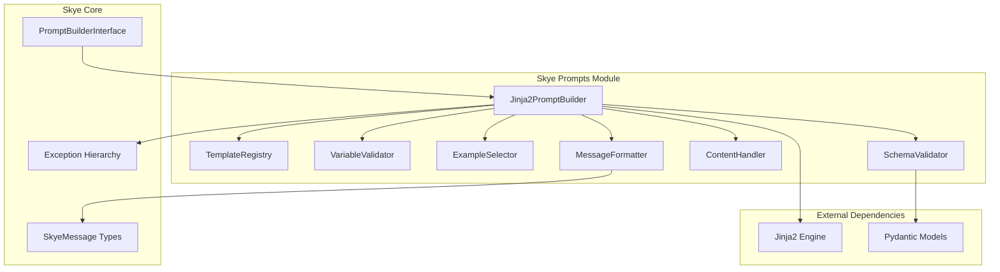

# Design Document: Skye Prompts Support

## Overview

This design document specifies the implementation of comprehensive prompts support for Skye using Jinja2 templating. The feature provides a production-ready implementation of the existing `PromptBuilderInterface`, enabling sophisticated template management, few-shot learning, multimodal content support, and structured output generation.

The implementation follows Skye's clean architecture principles, with the core functionality available as an optional extra (`skyeai[prompts]`). The design emphasizes performance, flexibility, and seamless integration with existing Skye components while maintaining provider agnosticism.

## Architecture

### High-Level Architecture



### Component Responsibilities

**Jinja2PromptBuilder**: Main implementation class that orchestrates all template operations and implements the `PromptBuilderInterface`.

**TemplateRegistry**: Manages template storage, versioning, and retrieval with efficient caching.

**VariableValidator**: Handles variable validation, default values, and allowed missing variables.

**ExampleSelector**: Implements different strategies for selecting few-shot examples (semantic, random, fixed).

**MessageFormatter**: Converts rendered template strings into appropriate `SkyeMessage` objects with role management.

**ContentHandler**: Processes multimodal content (images, audio, video) and formats them for different providers.

**SchemaValidator**: Manages output schemas and generates structured output instructions.

## Components and Interfaces

### Jinja2PromptBuilder

The main implementation class that provides all functionality defined in `PromptBuilderInterface`.

```python
class Jinja2PromptBuilder(PromptBuilderInterface):
    """Production implementation of PromptBuilderInterface using Jinja2.
    
    This class provides comprehensive template management with:
    - Jinja2 template engine with custom filters and macros
    - Template versioning and composition
    - Few-shot learning with dynamic example selection
    - Multimodal content support
    - Message role management
    - Output schema validation
    - Performance optimization through caching
    """
    
    def __init__(
        self,
        template_dir: str | None = None,
        auto_reload: bool = False,
        cache_size: int = 1000
    ):
        """Initialize the prompt builder.
        
        Args:
            template_dir: Optional directory to load templates from
            auto_reload: Whether to auto-reload templates from files
            cache_size: Maximum number of compiled templates to cache
        """
```

**Key Features:**
- Thread-safe template compilation and caching
- Configurable Jinja2 environment with custom extensions
- Support for template inheritance and includes
- Automatic template validation on registration
- Memory-efficient storage with LRU cache eviction

### TemplateRegistry

Manages template storage with versioning support and efficient retrieval.

```python
class TemplateRegistry:
    """Registry for managing prompt templates with versioning."""
    
    def __init__(self, cache_size: int = 1000):
        """Initialize template registry with LRU cache."""
    
    def register(
        self, 
        name: str, 
        template: str, 
        version: str = "1.0",
        metadata: dict[str, Any] | None = None
    ) -> None:
        """Register a template with optional metadata."""
    
    def get(self, name: str, version: str | None = None) -> TemplateEntry:
        """Retrieve template entry by name and version."""
    
    def list_templates(self) -> list[TemplateInfo]:
        """List all registered templates with metadata."""
```

**Storage Format:**
- Templates stored as `{name}:{version}` keys
- Compiled Jinja2 templates cached for performance
- Metadata includes variables, content types, roles, examples
- Support for template dependencies and composition

### VariableValidator

Handles variable validation, defaults, and missing variable policies.

```python
class VariableValidator:
    """Validates template variables and manages defaults."""
    
    def __init__(self):
        self.defaults: dict[str, Any] = {}
        self.allowed_missing: set[str] = set()
        self.callable_defaults: dict[str, Callable[[], Any]] = {}
    
    def validate_variables(
        self, 
        template_vars: set[str], 
        provided_vars: dict[str, Any]
    ) -> dict[str, Any]:
        """Validate and merge variables with defaults."""
    
    def extract_template_variables(self, template: Template) -> set[str]:
        """Extract all variable names from a Jinja2 template."""
```

**Validation Logic:**
- Merge provided variables with defaults (provided takes precedence)
- Execute callable defaults at render time for dynamic values
- Check for missing required variables (excluding allowed missing)
- Support for nested variable validation in complex templates

### ExampleSelector

Implements different strategies for selecting few-shot examples.

```python
class ExampleSelector:
    """Selects examples for few-shot learning."""
    
    def select_examples(
        self,
        examples: list[dict[str, Any]],
        input_data: dict[str, Any],
        max_examples: int,
        strategy: str = "fixed"
    ) -> list[dict[str, Any]]:
        """Select examples based on strategy."""

class SemanticExampleSelector(ExampleSelector):
    """Selects examples based on semantic similarity."""
    
class RandomExampleSelector(ExampleSelector):
    """Selects random examples."""
    
class FixedExampleSelector(ExampleSelector):
    """Always uses the same examples."""
```

**Selection Strategies:**
- **Fixed**: Always use the same examples in order
- **Random**: Randomly select examples each time
- **Semantic**: Use embedding similarity to select relevant examples
- **Length-based**: Select examples based on input length similarity

### MessageFormatter

Converts rendered templates into `SkyeMessage` objects with proper roles.

```python
class MessageFormatter:
    """Formats rendered templates into SkyeMessage objects."""
    
    def format_messages(
        self,
        rendered_content: str,
        role_mapping: dict[str, str] | None = None,
        multimodal_content: dict[str, Any] | None = None
    ) -> list[SkyeMessage]:
        """Convert rendered template to SkyeMessage objects."""
    
    def create_message_by_role(
        self, 
        content: str, 
        role: str,
        metadata: dict[str, Any] | None = None
    ) -> SkyeMessage:
        """Create appropriate message type based on role."""
```

**Message Creation Logic:**
- Parse role sections from rendered templates
- Create `SystemMessage`, `UserMessage`, `AssistantMessage`, `CapabilityMessage`
- Handle multimodal content in message creation
- Preserve metadata and content type information

### ContentHandler

Processes multimodal content for different formats and providers.

```python
class ContentHandler:
    """Handles multimodal content processing."""
    
    def process_image_content(
        self, 
        image_data: str, 
        format_type: str = "url"
    ) -> dict[str, Any]:
        """Process image content in various formats."""
    
    def process_multimodal_content(
        self,
        content_variables: dict[str, str],
        variable_values: dict[str, Any]
    ) -> dict[str, Any]:
        """Process multiple content types."""
    
    def validate_content_format(
        self, 
        content: Any, 
        expected_type: str
    ) -> bool:
        """Validate content matches expected format."""
```

**Content Processing:**
- Support for images (URL, base64, file path)
- Audio and video content handling
- File attachment processing
- Content validation and format conversion
- Provider-agnostic content representation

### SchemaValidator

Manages output schemas and generates structured output instructions.

```python
class SchemaValidator:
    """Validates and formats output schemas."""
    
    def set_schema(
        self, 
        schema: dict[str, Any] | type
    ) -> None:
        """Set output schema from dict or Pydantic model."""
    
    def generate_instructions(self) -> str:
        """Generate formatted instructions for LLM."""
    
    def validate_schema(self, schema: Any) -> bool:
        """Validate schema format and structure."""
```

**Schema Support:**
- Pydantic model conversion to JSON schema
- Direct JSON schema support
- Instruction generation for different output formats
- Schema validation and error reporting

## Data Models

### Core Data Structures

```python
@dataclass
class TemplateEntry:
    """Represents a registered template with metadata."""
    name: str
    version: str
    template: Template  # Compiled Jinja2 template
    raw_template: str
    variables: set[str]
    metadata: dict[str, Any]
    created_at: datetime
    
@dataclass
class TemplateInfo:
    """Template information for listing and introspection."""
    name: str
    version: str
    variables: list[str]
    optional_variables: list[str]
    has_examples: bool
    content_types: list[str]
    message_roles: list[str]
    
@dataclass
class ExampleConfig:
    """Configuration for few-shot examples."""
    examples: list[dict[str, Any]]
    example_template: str | None
    selector_type: str
    max_examples: int
    selector_kwargs: dict[str, Any]
    
@dataclass
class ContentConfig:
    """Configuration for multimodal content."""
    content_variables: dict[str, str]  # var_name -> content_type
    image_format: str
    validation_rules: dict[str, Any]
    
@dataclass
class RoleConfig:
    """Configuration for message roles."""
    role_mapping: dict[str, str]  # section_name -> role
    placeholders: dict[str, str]  # placeholder_name -> default_role
    default_role: str
```

### Configuration Models

```python
class PromptBuilderConfig(BaseModel):
    """Configuration for Jinja2PromptBuilder."""
    template_dir: str | None = None
    auto_reload: bool = False
    cache_size: int = 1000
    default_role: str = "user"
    allowed_missing_variables: list[str] = Field(default_factory=list)
    default_values: dict[str, Any] = Field(default_factory=dict)
    
class Jinja2Config(BaseModel):
    """Jinja2 environment configuration."""
    auto_escape: bool = False
    trim_blocks: bool = True
    lstrip_blocks: bool = True
    keep_trailing_newline: bool = True
    extensions: list[str] = Field(default_factory=list)
```

## Implementation Details

### Jinja2 Environment Setup

```python
def create_jinja_environment(config: Jinja2Config) -> Environment:
    """Create configured Jinja2 environment."""
    env = Environment(
        loader=DictLoader({}),  # Templates loaded dynamically
        autoescape=config.auto_escape,
        trim_blocks=config.trim_blocks,
        lstrip_blocks=config.lstrip_blocks,
        keep_trailing_newline=config.keep_trailing_newline,
        extensions=config.extensions
    )
    
    # Add custom filters
    env.filters.update({
        'upper': str.upper,
        'lower': str.lower,
        'title': str.title,
        'strip': str.strip,
        'truncate': lambda s, length=100: s[:length] + '...' if len(s) > length else s,
        'format_json': lambda obj: json.dumps(obj, indent=2),
        'format_list': lambda items, sep=', ': sep.join(str(item) for item in items)
    })
    
    return env
```

### Template Compilation and Caching

```python
class TemplateCache:
    """LRU cache for compiled templates."""
    
    def __init__(self, max_size: int = 1000):
        self.cache: OrderedDict[str, Template] = OrderedDict()
        self.max_size = max_size
    
    def get_or_compile(
        self, 
        template_key: str, 
        template_source: str,
        environment: Environment
    ) -> Template:
        """Get cached template or compile and cache."""
        if template_key in self.cache:
            # Move to end (most recently used)
            self.cache.move_to_end(template_key)
            return self.cache[template_key]
        
        # Compile template
        template = environment.from_string(template_source)
        
        # Add to cache
        self.cache[template_key] = template
        
        # Evict oldest if over limit
        if len(self.cache) > self.max_size:
            self.cache.popitem(last=False)
        
        return template
```

### Variable Extraction and Validation

```python
def extract_variables_from_template(template: Template) -> set[str]:
    """Extract all variable names from a Jinja2 template."""
    from jinja2 import meta
    
    # Get AST from template
    ast = template.environment.parse(template.source)
    
    # Extract undeclared variables (template variables)
    variables = meta.find_undeclared_variables(ast)
    
    return variables

def validate_and_merge_variables(
    template_vars: set[str],
    provided_vars: dict[str, Any],
    defaults: dict[str, Any],
    callable_defaults: dict[str, Callable[[], Any]],
    allowed_missing: set[str]
) -> dict[str, Any]:
    """Validate and merge all variable sources."""
    
    # Start with defaults
    merged = defaults.copy()
    
    # Execute callable defaults
    for key, callable_default in callable_defaults.items():
        if key not in provided_vars:
            merged[key] = callable_default()
    
    # Override with provided variables
    merged.update(provided_vars)
    
    # Check for missing required variables
    missing = template_vars - set(merged.keys()) - allowed_missing
    if missing:
        raise ValueError(f"Missing required variables: {sorted(missing)}")
    
    return merged
```

### Example Selection Implementation

```python
class SemanticExampleSelector(ExampleSelector):
    """Select examples based on semantic similarity."""
    
    def __init__(self, embedding_function: Callable[[str], list[float]] | None = None):
        self.embedding_function = embedding_function or self._default_embedding
        self.example_embeddings: dict[int, list[float]] = {}
    
    def select_examples(
        self,
        examples: list[dict[str, Any]],
        input_data: dict[str, Any],
        max_examples: int,
        strategy: str = "semantic"
    ) -> list[dict[str, Any]]:
        """Select most similar examples."""
        
        if not examples:
            return []
        
        # Get input embedding
        input_text = self._extract_text_for_similarity(input_data)
        input_embedding = self.embedding_function(input_text)
        
        # Calculate similarities
        similarities = []
        for i, example in enumerate(examples):
            if i not in self.example_embeddings:
                example_text = self._extract_text_for_similarity(example)
                self.example_embeddings[i] = self.embedding_function(example_text)
            
            similarity = self._cosine_similarity(
                input_embedding, 
                self.example_embeddings[i]
            )
            similarities.append((similarity, example))
        
        # Sort by similarity and take top examples
        similarities.sort(key=lambda x: x[0], reverse=True)
        return [example for _, example in similarities[:max_examples]]
    
    def _default_embedding(self, text: str) -> list[float]:
        """Simple TF-IDF based embedding for basic similarity."""
        # Implementation of basic text similarity
        pass
```

### Message Role Processing

```python
def process_role_sections(
    rendered_content: str,
    role_mapping: dict[str, str]
) -> list[tuple[str, str]]:
    """Process template sections with role markers."""
    
    sections = []
    current_role = "user"  # default
    current_content = []
    
    lines = rendered_content.split('\n')
    
    for line in lines:
        # Check for role markers like [SYSTEM], [USER], [ASSISTANT]
        role_match = re.match(r'^\[(\w+)\]$', line.strip())
        if role_match:
            # Save previous section
            if current_content:
                sections.append((current_role, '\n'.join(current_content).strip()))
                current_content = []
            
            # Update current role
            role_name = role_match.group(1).lower()
            current_role = role_mapping.get(role_name, role_name)
        else:
            current_content.append(line)
    
    # Save final section
    if current_content:
        sections.append((current_role, '\n'.join(current_content).strip()))
    
    return sections

def create_messages_from_sections(
    sections: list[tuple[str, str]],
    multimodal_content: dict[str, Any] | None = None
) -> list[SkyeMessage]:
    """Create SkyeMessage objects from role sections."""
    
    messages = []
    
    for role, content in sections:
        if not content.strip():
            continue
            
        # Create appropriate message type
        if role == "system":
            message = SystemMessage(content=content)
        elif role == "assistant":
            message = AssistantMessage(content=content)
        elif role == "capability":
            message = CapabilityMessage(content=content)
        else:  # default to user
            message = UserMessage(content=content)
        
        # Add multimodal content if present
        if multimodal_content:
            # Process and attach multimodal content
            pass
        
        messages.append(message)
    
    return messages
```

## Error Handling

### Exception Hierarchy

```python
class PromptBuilderError(SkyeError):
    """Base exception for prompt builder errors."""
    pass

class TemplateNotFoundError(PromptBuilderError):
    """Template not found in registry."""
    pass

class TemplateValidationError(PromptBuilderError):
    """Template validation failed."""
    pass

class VariableValidationError(PromptBuilderError):
    """Variable validation failed."""
    pass

class ContentValidationError(PromptBuilderError):
    """Content validation failed."""
    pass

class SchemaValidationError(PromptBuilderError):
    """Output schema validation failed."""
    pass
```

### Error Context and Recovery

```python
def safe_template_render(
    template: Template,
    variables: dict[str, Any],
    template_name: str
) -> str:
    """Safely render template with detailed error context."""
    try:
        return template.render(**variables)
    except TemplateRuntimeError as e:
        raise TemplateValidationError(
            f"Template '{template_name}' rendering failed: {e}",
            details={
                "template_name": template_name,
                "error_line": getattr(e, 'lineno', None),
                "provided_variables": list(variables.keys()),
                "original_error": str(e)
            }
        ) from e
    except Exception as e:
        raise PromptBuilderError(
            f"Unexpected error rendering template '{template_name}': {e}",
            details={
                "template_name": template_name,
                "error_type": type(e).__name__,
                "original_error": str(e)
            }
        ) from e
```

## Testing Strategy

### Unit Testing Approach

The testing strategy follows Skye standards with comprehensive unit tests for each component and property-based tests for universal correctness properties.

**Unit Test Coverage:**
- Template registration and retrieval
- Variable validation and merging
- Example selection algorithms
- Message formatting and role assignment
- Content handling for different formats
- Schema validation and instruction generation
- Error handling and edge cases

**Test Organization:**
```
tests/
├── unit/
│   ├── test_jinja2_prompt_builder.py
│   ├── test_template_registry.py
│   ├── test_variable_validator.py
│   ├── test_example_selector.py
│   ├── test_message_formatter.py
│   ├── test_content_handler.py
│   └── test_schema_validator.py
├── integration/
│   ├── test_end_to_end_rendering.py
│   ├── test_multimodal_integration.py
│   └── test_skye_integration.py
└── fixtures/
    ├── sample_templates/
    └── test_data/
```

### Property-Based Testing

Property-based tests will validate universal correctness properties using pytest and Hypothesis, running a minimum of 100 iterations per property test.

**Test Configuration:**
- Use Hypothesis for generating test data
- Configure 100+ iterations per property test
- Tag each test with feature and property reference
- Focus on invariants and round-trip properties
