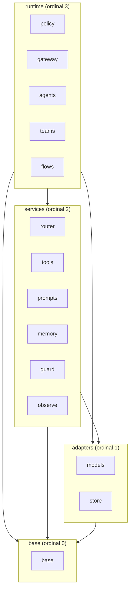

# Design Document

## Overview

This design describes the **target** module and folder structure of Nimbus. It is a structure-only design: it defines package boundaries, the layer dependency direction, naming and codename rules, optional-module packaging, and the resolution location for each known overlap. It describes a target state and does **not** move code, edit source, or create tasks; executing the moves belongs to a later phase (tasks.md) governed by the requirements in `.kiro/specs/structure/requirements.md`, which is the source of truth.

The design is shaped by binding product constraints: a serverless-first deployment packaged as a zip-based runtime, a strict size and load budget enforced by `budgets.toml` and the tests under `tests/budget`, strict modularity with lazy imports, and provider adapters that prefer the standard library over heavy SDKs (made binding in the Dependency policy: standard library first, REST over SDK section). Nimbus is at version 0.1.0 with almost no users, so a breaking rename is acceptable when documented.

The target is organized as:

- **Four Layers** with a single downward dependency direction (`base=0`, `adapters=1`, `services=2`, `runtime=3`).
- **14 Components**, each with one short shared name (`^[a-z]{3,7}$`) used identically for its package folder, spec folder, module package, and docs section.
- **A codename watermark** per Component (cloud/weather words) that appears in exactly four places and never in code, imports, file names, or spec folders.
- **One distribution with extras**: the core install carries always-present Components; optional Components are bounded by an Extra and loaded lazily through the stdlib lazy-import mechanism plus a thin `MissingExtraError` wrapper (see Lazy imports at boundaries).
- **No code moves in this phase**: every boundary, rename, merge, split, and overlap resolution below is a declaration of target state (Requirements 5, 11).

### Two independent axes (read this first)

The structure has **two orthogonal axes** that are easy to conflate. They are independent and must be read separately.

**Axis 1 — Layer (an import-direction rule only).** A Layer is a static rule about which Component may import which other Component, enforced by a deterministic AST test. **Nothing is installed, loaded, or bundled per Layer.** The rule "a Component in Layer `N` may import only Components in a Layer with ordinal ≤ `N`" is a **ceiling** — it states the maximum a Component is *allowed* to import, not a list of dependencies it *requires*. Assigning `agents` to the runtime Layer does **not** mean `agents` imports every services-Layer Component; it only means `agents` is *permitted* to import downward. Most Components import far fewer Components than the ceiling allows (see the per-component dependency matrix).

**Axis 2 — Installation (core vs extra).** Each Component is classified independently as either always-present in the core install or installed by its own Extra. This classification is **orthogonal to the Layer**: a services-Layer Component can be core (e.g. `router`) while another services-Layer Component is optional (e.g. `memory`). Importing a Component is **lazy**: code for a Component you do not use is never imported, even when its files ship inside the installed package, and a heavy library is pulled only at first use through the stdlib lazy-import mechanism (see Lazy imports at boundaries).

Consequently, **a user is not forced to install or load `memory`, `guard`, `observe`, `teams`, `flows`, or any other optional Component to use the rest of Nimbus.** Each Extra is independent: installing one Extra never pulls another (installing `tools` does not pull `observe` or `memory`). The Layer table below defines Axis 1; the Installation classification section defines Axis 2.

**Design assumption (A1, carried from requirements):** the `base` package must be importable without pydantic for structural purposes; the pydantic-to-dataclasses migration is a separate later spec. This is an open, unresolved tension with the `python-standards` steering and is recorded, not silently resolved (Requirement 3.6).

**Note (provider rename vertex → google):** The provider formerly named `vertex` is renamed `google` (Google renamed Vertex AI to the Gemini Enterprise Agent Platform in April 2026). Throughout this design, read every `vertex`/`Vertex` as `google`: `models/llm/google_provider.py`, `models/embeddings/google_*.py`, class `GoogleProvider`, registered name `"google"`, and the extra `google`. The SDK package remains `google-cloud-aiplatform`. This mirrors Assumption A6 in requirements.md.

## Architecture

### Layers and ordinals

The structure defines exactly four Layers, each with an ordinal from most foundational to most dependent (Requirement 2.1):

| Layer | Ordinal | Components (Requirement 2.2) |
|-------|---------|------------------------------|
| base | 0 | `base` |
| adapters | 1 | `models`, `store` |
| services | 2 | `router`, `tools`, `prompts`, `memory`, `guard`, `observe` |
| runtime | 3 | `policy`, `gateway`, `agents`, `teams`, `flows` |

This table is **Axis 1 only** — it assigns each Component to a Layer so the import-direction rule can be enforced. It says nothing about what is installed or loaded, and it does not imply that a Component depends on every Component in a lower Layer.

### Installation classification (core vs extra)

This section defines **Axis 2** and implements the complete partition required by Requirement 6.1: each of the 14 Components is classified as exactly one of core-always-present or optional-behind-an-Extra. This classification is **orthogonal to the Layer table above** — Layer membership does not determine installation, and installation does not determine import direction.

| Class | Components | What installs it | Heavy libraries |
|-------|------------|------------------|-----------------|
| **Core — always present, no heavy deps** | `base` | the core install (`pip install nimbus`) | none (standard library only) |
| **Optional — behind its own independent Extra** (heavy libs lazy-imported) | `models`, `store`, `tools`, `memory`, `observe` | `pip install nimbus[<extra>]` | see per-Component notes below |
| **Present without heavy dependencies** (pure-Python code, no Extra needed; installing them costs nothing) | `router`, `prompts`, `guard`, `policy`, `gateway`, `agents`, `teams`, `flows` | ship with the core install as pure modules | none beyond core deps |

**Per-Component Extra notes (optional class):**

- `models` — provider adapters. **Each provider is its own independent Extra**: `bedrock`, `openai`, `anthropic`, `azure`, `vertex`, `cohere`. Installing one provider Extra does not pull another.
- `store` — durable backends; drivers behind extras (`dynamodb` via boto3 preinstalled in the target serverless runtime; `redis` driver via the `memory` Extra where used).
- `tools` — capability runtime; `httpx` and MCP client, lazy-imported, provided by the `tools` Extra.
- `memory` — conversation/state memory; `redis.asyncio` and `asyncpg`, provided by the `memory` Extra.
- `observe` — events, logs, metrics, traces; observability libraries (e.g. OpenTelemetry / Prometheus client), provided by the `observe` Extra.

**Every Extra is independent.** Installing `tools` does not install `observe`, `memory`, or any provider; installing `openai` does not install `bedrock`. There is no implicit transitive Extra.

**Reconciliation with `budgets.toml`.** The pure-Python class aligns with `[extras_policy].known_empty = ["agents", "guard", "prompts"]`: those three ship as empty or pure modules today and are **not** Extras (they declare no optional dependency). `prompts` only repeats `jinja2`, which is already a core dependency, so it needs no Extra of its own. `router`, `policy`, `gateway`, `teams`, and `flows` are likewise pure-Python and carry no Extra (zero heavy dependencies), consistent with the empty-modules policy in `budgets.toml`. This classification is the Requirement 6.1 partition; it is orthogonal to the Layer assignment and does not change it.

### Dependency rule

A Component in the Layer with ordinal `N` imports only from Components in a Layer with ordinal **less than or equal to** `N` (Requirement 2.3). Equivalently, imports point downward (toward more foundational layers) or sideways (within the same layer); no import points upward. This is a **ceiling**, not a dependency list: it states the maximum a Component is *allowed* to import, and a Component typically imports far fewer Components than the Layer rule permits (the exact, tighter per-component allowances are given in the per-component dependency matrix). The `base` Layer imports only the Python standard library and performs no file-system, network, or process I/O (Requirement 2.4).



This diagram shows the **import-direction ceiling (the Layer rule)**, not actual dependencies. Arrows denote the *allowed* import direction; every arrow points downward toward a lower or equal ordinal, and there is no upward edge. A Layer-to-Layer arrow does **not** mean every Component in the upper Layer imports every Component in the lower one — it means such an import is permitted at most. The actual, tighter dependencies are declared per Component in the Per-component dependency matrix. This direction is enforced by a deterministic AST test (see Per-component dependency matrix and Testing Strategy).

### Known violations to be removed by the target

The target structure removes these current upward imports (Requirement 2.7): `completion.py` imports `capabilities`; `providers` imports `capabilities`; and `interfaces` imports `memory`. In the target, the capability **schema** that `completion` needs is a pure contract inside `base`, and the `memory` **port** lives in `base/interfaces` while the `memory` implementation stays in the `memory` Component, so no base-layer module imports a higher layer.

## Target package tree

The target tree places a real `base` package at the foundation and a curated top-level `__init__.py`. `base` is a real importable package, not only a conceptual layer (Requirement 3.1).

```
src/nimbus/
├── __init__.py                 # re-exports ONLY: messages, completion, exceptions, config (Req 6.5)
│
├── base/                       # Layer 0 — standard library only, no I/O (Req 2.4, 3)
│   ├── __init__.py
│   ├── messages.py             # core message models
│   ├── completion.py           # CompletionRequest / CompletionResponse
│   ├── capability_schema.py    # pure capability schema/contract (lets completion drop its tools import)
│   ├── exceptions.py           # NimbusError hierarchy, incl. MissingExtraError
│   ├── config.py               # configuration loading
│   └── interfaces/             # Ports (interfaces), no I/O, no import of layers >0 (Req 3.3)
│       ├── __init__.py
│       ├── model.py            # ModelInterface port
│       ├── decision.py         # DecisionModel port (Jev contract) (Req 4.4)
│       ├── runnable.py         # Runnable port: one input → one output (Req 12.1)
│       ├── vector_encoder.py
│       ├── storage.py          # store port (Overlap 10.2 target: port side)
│       ├── registry.py         # unified registry port (Overlap 10.1 target: port side)
│       ├── cost_calculator.py  # cost port (Overlap 10.3)
│       ├── error_handler.py    # error port (Overlap 10.3)
│       ├── token_counter.py    # token port (Overlap 10.3)
│       ├── memory.py           # memory port (impl stays in memory Component; removes base→memory leak, Req 2.7)
│       ├── router.py
│       ├── safety.py
│       ├── observer.py
│       ├── event_handler.py
│       ├── content_reader.py
│       ├── multimodal_handler.py
│       ├── prompt.py
│       ├── config_loader.py
│       ├── plugin.py
│       └── capability.py       # capability port
│
├── models/                     # Layer 1 — adapters to every model API kind (Req 4)
│   ├── __init__.py
│   ├── base.py                 # shared base adapter (from providers/base.py, split)
│   ├── registry.py             # provider/model registry impl (Overlap 10.1 target: impl side)
│   ├── transport/              # ONE shared stdlib transport, retry, error mapping, token counting (Req 4.2)
│   │   ├── __init__.py
│   │   ├── http.py             # shared JSON HTTP over stdlib urllib (no httpx/requests)
│   │   ├── streaming.py        # stdlib SSE (text/event-stream) parser
│   │   ├── sigv4.py            # stdlib AWS SigV4 signer (Bedrock without boto3)
│   │   ├── retry.py            # shared retry policy (max 3 attempts, Req 4.3)
│   │   ├── error_mapping.py    # provider error → Nimbus error
│   │   ├── token_counter.py    # token counting impl
│   │   └── multimodal.py       # multimodal content handling
│   ├── llm/                    # large language model adapters (stdlib REST dialects)
│   │   ├── __init__.py
│   │   ├── openai_compatible.py # OpenAI + Azure + OpenAI-compatible ecosystem (parametrized by base_url/api_key)
│   │   ├── anthropic.py        # Anthropic Messages API (/v1/messages)
│   │   └── bedrock.py          # AWS Bedrock via shared SigV4 over urllib
│   ├── embeddings/             # embedding model adapters
│   │   ├── __init__.py
│   │   ├── bedrock_embeddings.py
│   │   ├── cohere_embeddings.py
│   │   ├── openai_embeddings.py
│   │   ├── vertex_embeddings.py
│   │   └── vertex_multimodal_embeddings.py
│   └── decision/               # Decision_Model (Jev) — third model kind (Req 4.1, 4.6)
│       ├── __init__.py
│       └── jev.py              # DecisionModel implementation
│
├── store/                      # Layer 1 — ONE shared package for external state (Req 5)
│   ├── __init__.py
│   ├── memory.py               # in-memory backend
│   ├── file.py                 # file backend
│   ├── dynamodb.py             # DynamoDB backend (first-choice durable, Req 5.4)
│   └── redis.py                # Redis backend
│
├── router/                     # Layer 2 — ModelRouter and routing concerns
│   ├── __init__.py
│   ├── model_router.py
│   ├── routing_strategies.py
│   ├── health_tracker.py       # health tracking used by routing
│   ├── config_models.py
│   └── fallbacks.py
│
├── tools/                      # Layer 2 — capabilities (MCP "tool" terminology) (Req 1, naming)
│   ├── __init__.py
│   ├── registry.py
│   ├── local_function.py
│   ├── remote_api.py           # HTTP via stdlib urllib transport; httpx/requests eliminated (Req 7.4)
│   ├── mcp_capability.py
│   ├── mcp_server_client.py    # tri-faceted MCP client (tools/prompts/resources); built-in + fastmcp behind one Port (Req 19)
│   ├── mcp_resource.py         # Resource type internal to tools (URI, MIME, text/bytes); no base Port, no new Component (Req 19.2, 19.3)
│   ├── capability_call_handler.py
│   ├── decorator.py
│   └── exceptions.py
│
├── prompts/                    # Layer 2 — loaders, role-based messages, templates
│   ├── __init__.py
│   ├── loaders.py
│   ├── messages.py
│   └── templates/
│
├── memory/                     # Layer 2 — declared-but-minimal this step (Req 6.7, A3)
│   └── __init__.py
├── guard/                      # Layer 2 — declared-but-minimal this step (Req 6.7, A3)
│   └── __init__.py
├── observe/                    # Layer 2 — declared-but-minimal this step (Req 6.7, A3)
│   └── __init__.py
│
├── policy/                     # Layer 3 — NEW declared-but-minimal (content in policy spec)
│   └── __init__.py
├── gateway/                    # Layer 3 — NEW declared-but-minimal (content in gateway spec)
│   └── __init__.py
├── agents/                     # Layer 3 — declared-but-minimal (content in agents spec)
│   └── __init__.py
├── teams/                      # Layer 3 — declared-but-minimal; coordinates units toward a shared objective (content in teams spec)
│   └── __init__.py
└── flows/                      # Layer 3 — declared-but-minimal; sequences units into ordered steps (content in flows spec)
    └── __init__.py
```

Notes:

- `base` is a real package containing the core models, the error hierarchy, configuration loading, and the Ports — all four module groups (Requirement 3.2).
- The Decision_Model (Jev) lives in `models/decision/`, as a third model kind alongside LLMs and embeddings (Requirement 4.1, 4.6); its contract (the `DecisionModel` Port) lives in `base/interfaces/decision.py` (Requirement 4.4).
- The lazy-import mechanism is the standard library plus a thin `MissingExtraError` helper in `base` (see Lazy imports at boundaries); it imports only standard-library `importlib`, so it is compatible with the base-layer stdlib-only rule (Requirement 2.4).

### Import paths (component, not layer)

The public import path uses the **Component** name, never the Layer name. A Layer is Axis-1 metadata consumed only by the AST import test (see Two independent axes); it is not a package and never appears in an import path.

Valid import paths name a Component:

```python
import nimbus                       # curated base re-exports: messages, completion, exceptions, config (Req 6.5)
from nimbus.models.llm import ...   # Component "models"
from nimbus.store import ...        # Component "store"
from nimbus.router import ...       # Component "router"
from nimbus.gateway import ...      # Component "gateway"
```

There is **no** `nimbus.base`-as-layer, **no** `nimbus.adapters`, **no** `nimbus.services`, and **no** `nimbus.runtime` in any import path. The four Layer names (`base` as an ordinal, `adapters`, `services`, `runtime`) are not importable packages — only `base` exists as a real package, and it does so as a Component, not as "the base layer."

Rationale:

- The Layer is only AST-test metadata (Axis 1). A Component may be reassigned to a different Layer without breaking a single import path, because paths are keyed to the Component name that does not change.
- The Layer names `adapters`, `services`, and `runtime` are not members of the 12-Component name set fixed by Requirement 1.3, so they must not appear in a path. Letting a layer name into an import path would break the shared-name rule (Requirement 1.2), which binds the package folder, spec folder, module package, and docs section to one identical Component name.
- This mirrors the spirit of the codename rule: structural/taxonomic labels (layers, codenames) are kept out of import paths, which carry only the plain Component name.

`base` is still a real package at `nimbus/base/`, but its curated public surface (`messages`, `completion`, `exceptions`, `config`) is re-exported at the top level so users reach it through `import nimbus` (Requirement 6.5).

## Per-component dependency matrix

The `Allowed_Imports_Matrix` declares, at **Component** granularity, the exact set of Components each Component may import. This is tighter than the Layer ceiling: the Layer rule forbids upward imports, and this matrix additionally restricts each Component to a named allowed set, so a legal-by-Layer import can still be a violation when it falls outside the Component's declared set.

Each entry lists the **maximum** a Component may import. A Component importing fewer Components than its entry allows is fine — the matrix is an upper bound, not a requirement. `base` imports nothing internal (standard library only). Every Component also consumes Ports defined in `base`; the "Ports consumed" column in Components and Interfaces lists those.

| Importer Component | Layer | May import these Components (maximum) | Optional (only if a feature is enabled) |
|--------------------|-------|---------------------------------------|------------------------------------------|
| `base` | base (0) | none (standard library only) | — |
| `models` | adapters (1) | `base` | — |
| `store` | adapters (1) | `base` | — |
| `router` | services (2) | `base`, `models`, `store` | — |
| `tools` | services (2) | `base`, `prompts` | `prompts` is a peer (same services Layer) imported only so the MCP client's prompt facet can return Nimbus prompt objects (Req 19.2) |
| `prompts` | services (2) | `base` | — |
| `memory` | services (2) | `base`, `store` | — |
| `guard` | services (2) | `base` | `models` (Jev/decision for pre-flight) |
| `observe` | services (2) | `base` | — |
| `policy` | runtime (3) | `base` | `models` (Jev, only if it uses decision models) — **not** `tools`, `memory`, `observe`, `guard` |
| `gateway` | runtime (3) | `base`, `tools` | `models` (Jev for tool selection), `policy` (if it enforces policy on operations) — **not** `memory`, `guard`, `observe`, and **not** `prompts` (the earlier MCP-driven `prompts` allowance is withdrawn now that the MCP client lives in `tools`, not `gateway`; Req 19.1) |
| `agents` | runtime (3) | `base`, `models` | `tools`, `prompts`, `memory`, `guard`, `observe`, `policy` — each only when the agent enables the corresponding hook. **Never** `teams` or `flows` |
| `teams` | runtime (3) | `base` | `prompts`, `memory`, `guard`, `observe`, `policy` — each only when the feature is enabled. **Never** `models` (a composed model arrives as a `Runnable` reference, not an import), and **never** `agents`, `teams`, or `flows` (composed units are held as `Runnable` Port references, not imported) |
| `flows` | runtime (3) | `base` | `prompts`, `memory`, `guard`, `observe`, `policy` — each only when the feature is enabled. **Never** `models` (a composed model arrives as a `Runnable` reference, not an import), and **never** `agents`, `teams`, or `flows` (composed units are held as `Runnable` Port references, not imported) |

The matrix lists the **maximum** a Component **may** import; a Component that imports fewer is compliant. The optional column marks imports that are permitted only when a specific feature is enabled — they are not required dependencies. For `agents`, every optional consumer is genuinely optional: an agent with no memory hook never imports `memory`, an agent with no observability hook never imports `observe`, and so on.

**Critical: `teams` and `flows` import neither `models` nor any orchestrator implementation module.** These runtime orchestrators compose one another and model adapters (a flow may contain models, agents, teams, or other flows; a team may contain models, agents, flows, or other teams), but composition is expressed **only** through the `Runnable` Port defined in `base` (see Composition model (Runnable)): a composing unit holds its children as `Runnable` references. Two kinds of import are therefore violations, regardless of Layer ordinal:

1. a direct `import` statement among the `agents`, `teams`, or `flows` implementation modules (Requirement 12.3, 12.6); and
2. an import of the `models` Component by `teams` or `flows` — a composed model must be received as a `Runnable` reference, not imported (Requirement 12.8, 12.9).

`agents` is the one orchestrator that still imports `models` directly (its allowed set includes `models`), because an agent's own loop drives a model; `teams` and `flows` do not, since any model they run arrives as a `Runnable`.

**Enforcement.** A deterministic test, modeled on `tests/budget/test_policy.py`, parses every module under `src/nimbus` with the `ast` module, resolves each `import` / `import from` to its owning Component, and checks three conditions against this matrix (Requirement 2.6, 12.6):

1. **No upward import** — the Layer ceiling: no import targets a Component in a higher-ordinal Layer.
2. **No out-of-set import** — no import targets a Component outside the importing Component's declared allowed set (including its optional entries). Because `models` is not in the `teams` or `flows` allowed set, a `teams`/`flows` import of `models` is caught here: a composed model must arrive as a `Runnable` reference (Requirement 12.8, 12.9).
3. **No orchestrator cross-import** — no module in `agents`, `teams`, or `flows` imports another of those three implementation modules; such composition must go through the `Runnable` Port in `base` (Requirement 12.3, 12.6).

So, for example, `gateway` importing `memory` is a violation under condition (2) even though `memory` sits in a lower Layer and would pass the Layer ceiling alone; `flows` importing `models` is a violation under condition (2) even though `models` sits in a lower Layer (the model must be received as a `Runnable`); and `flows` importing `agents` is a violation under condition (3) even though both sit in the same runtime Layer. By contrast, `tools` importing `prompts` is **in-set and legal**: the two are peers in the same services Layer (ordinal 2), and the import is declared in the `tools` allowed set so the MCP client's prompt facet can return Nimbus prompt objects (Req 19.2). Conversely, `gateway` no longer imports `prompts` for MCP — the MCP client is in `tools`, not `gateway` (Req 19.1) — so a `gateway → prompts` import is now an out-of-set violation under condition (2). The test:

- produces the same result for the same input (pure static analysis, no network, no install);
- reports each violation by naming the importing Component and its Layer and the imported Component and its Layer (Requirement 2.5);
- exits with a non-zero status when any violation is present (Requirement 2.6).

The three current violations in Requirement 2.7 are the first failures this test is expected to catch before the target structure removes them.

## Components and Interfaces

This section lists each Component, its Layer, the public interface role it plays, and the Ports it defines or consumes. Ports (interfaces) are defined only in `base/interfaces`; every cross-Component dependency crosses a Port, never a concrete implementation (Requirements 3.3, 5.2).

| Component | Layer | Role | Ports defined (in base) | Ports consumed |
|-----------|-------|------|-------------------------|----------------|
| `base` | 0 | Foundation: core models, error hierarchy, config, Ports, thin `missing_extra` lazy-import helper | all Ports (`model`, `decision`, `runnable`, `storage`, `registry`, `cost_calculator`, `error_handler`, `token_counter`, `memory`, `vector_encoder`, `router`, `safety`, `observer`, `event_handler`, `content_reader`, `multimodal_handler`, `prompt`, `config_loader`, `plugin`, `capability`). The `runnable` Port is implemented by model adapters (`models`), `agents`, `teams`, and `flows` (and optionally `tools`) | none (stdlib only, Req 2.4) |
| `models` | 1 | Adapters for LLMs, embeddings, and decision models; one shared transport, retry, error mapping, token counting. Model adapters also implement the `runnable` Port, so a model is usable anywhere a `Runnable` is accepted (Req 12.7) | — | `model`, `decision`, `vector_encoder`, `registry`, `cost_calculator`, `error_handler`, `token_counter`, `runnable` (implemented by its adapters) |
| `store` | 1 | One shared set of state backends (in-memory, file, DynamoDB, Redis) | — | `storage` |
| `router` | 2 | ModelRouter, strategies, health tracking, fallbacks | — | `router`, `model`, `decision`, `registry`, `storage` |
| `tools` | 2 | Capability registry, local functions, remote API, tri-faceted MCP client (tools/prompts/resources; built-in + `fastmcp`) | — | `capability`, `registry`, `prompt` (for the MCP client's prompt facet, consumed from the peer `prompts` Component) |
| `prompts` | 2 | Loaders, role-based messages, templates | — | `prompt`, `content_reader` |
| `memory` | 2 | Conversation/state memory (declared-but-minimal this step) | — | `memory`, `storage` |
| `guard` | 2 | Safety filters, pre-flight checks (declared-but-minimal this step) | — | `safety`, `decision` |
| `observe` | 2 | Events, logs, metrics, traces (declared-but-minimal this step) | — | `observer`, `event_handler` |
| `policy` | 3 | Policy engine (NEW declared-but-minimal; content in policy spec) | — | `safety`; optionally `decision` (only if it uses decision models) |
| `gateway` | 3 | Nimbus-acts-as-MCP-server role, toolset per operation (NEW declared-but-minimal; content in gateway spec). The MCP **client** does **not** live here — it lives in `tools` (Req 19.1) | — | `capability`; optionally `decision` (tool selection), `safety` (if it enforces policy) |
| `agents` | 3 | Agent loop, BaseAgent, hooks (declared-but-minimal; content in agents spec) | — | `runnable`, `model`; optionally (per enabled hook) `capability`, `prompt`, `memory`, `safety`, `observer` |
| `teams` | 3 | Coordinate multiple units (e.g. multiple agents) toward a shared objective; owns the team-role concept (declared-but-minimal; content in teams spec) | — | `runnable` only (composed units, **including models**, held as `Runnable` references); optionally (per enabled feature) `prompt`, `memory`, `safety`, `observer`. **Not** `model` — a composed model arrives as a `Runnable` |
| `flows` | 3 | Sequence units into a defined order of steps (declared-but-minimal; content in flows spec) | — | `runnable` only (composed units, **including models**, held as `Runnable` references); optionally (per enabled feature) `prompt`, `memory`, `safety`, `observer`. **Not** `model` — a composed model arrives as a `Runnable` |

Key interface contracts:

- **ModelInterface** (`base/interfaces/model.py`): the provider-agnostic completion contract consumed by `router`, `gateway`, and `agents`.
- **DecisionModel** (`base/interfaces/decision.py`): the single decision contract for Jev (see DecisionModel / Jev), consumed by `gateway`, `router`, and `guard` (Requirement 4.7).
- **Runnable** (`base/interfaces/runnable.py`): Nimbus's single, universal composition contract — one invocation operation accepting one input and returning one output — implemented by **model adapters (`models`)**, `agents`, `teams`, and `flows` (and optionally `tools`). `teams`/`flows` use it to compose other units — **including models** — by `Runnable` reference, so they import neither the orchestrator implementation modules nor the `models` Component (see Composition model (Runnable), Requirement 12).
- **Storage Port** (`base/interfaces/storage.py`): the only way a service reaches a store backend (Requirement 5.2, 5.3).
- **Registry Port** (`base/interfaces/registry.py`): the unified registry contract replacing the two current registries (Overlap A, Requirement 10.1).

## Composition model (Runnable)

The three runtime orchestrators — `agents`, `teams`, and `flows` — compose one another freely at runtime: a flow can contain agents, teams, or other flows; a team can contain agents, flows, or other teams. The structural challenge is to allow this composition **without** creating an import cycle among the orchestrator implementation modules. The design solves it with a single abstraction defined in `base` (Requirement 12).

**One Port, one operation.** `base/interfaces/runnable.py` defines exactly one `Runnable` Port that declares a single invocation operation accepting exactly one input argument and returning exactly one output value (Requirement 12.1). It performs no I/O and imports only the standard library, so it lives cleanly at Layer 0. The `Runnable` Port carries a conceptual codename `vapor` (a documentation-only watermark, distinct from the 14 Component Codenames; see Codename watermark placement, Requirement 9.8, 9.9).

**Runnable is the universal composition contract.** `Runnable` is Nimbus's single, universal "one input → one output" composition contract (LCEL-like): anything that conforms to it is substitutable wherever a `Runnable` is accepted. The implementers are:

- **model adapters** (the `models` Component) — Requirement 12.7;
- **`agents`**, **`teams`**, **`flows`** — Requirement 12.2;
- optionally **`tools`** (a capability can be exposed as a `Runnable`).

Because every one of these satisfies the same contract, any of them can stand in anywhere a `Runnable` is expected. In particular, a model adapter **is** a `Runnable`, so a model can be used directly as a step in a `flows` unit or as a member of a `teams` unit (Requirement 12.7).

**Models arrive as Runnables, so orchestrators do not import `models`.** Because a model adapter implements the `Runnable` Port, a `teams` or `flows` unit receives a model as a `Runnable` reference from its caller/configuration — it does **not** import the `models` Component (Requirement 12.8, 12.9). The only import a model adapter adds for this is `models` → `base` to implement the `Runnable` Port, which is a downward (Layer 1 → Layer 0) import and is allowed.

**Composition is by Port reference, not by import.** When a `teams` or `flows` unit composes another unit — whether that unit is a model, an agent, a team, or a flow — it holds that unit as a `Runnable` Port reference obtained from its caller/configuration; it does **not** import the `models`, `agents`, `teams`, or `flows` implementation module (Requirement 12.3, 12.4, 12.8). This is the key move: "a flow can contain models/agents/teams/other flows" and "a team can contain models/agents/flows/other teams" are expressed through the base-layer `Runnable` type, so no import edge is ever created from an orchestrator to `models` or among the orchestrator implementation modules. The import-direction stays acyclic because the only shared dependency is the `Runnable` Port in `base`, which every orchestrator already depends on downward.

### Roles are owned by teams

The role of a unit within a team — including a possible `supervisor` role — is owned by the `teams` Component, **not** by the `Runnable` Port in `base` and **not** by `agents` (Requirement 12.10). The `Runnable` Port stays a pure input→output contract with no notion of team role; a `teams` unit associates a role with a composed unit through **membership metadata defined in `teams`**, not through `Runnable` (Requirement 12.11).

A unit's team role is distinct from its own identity, so the same `Runnable` can hold different roles in different teams — for example a `supervisor` in one team and a plain worker in another (Requirement 12.12). A supervisor that decides which member works next may use a decision model (Jev / `DecisionModel`), but it **receives that model as a `Runnable` reference**, so `teams` still does not import `models`.

**Out of scope for this structure spec** (deferred to the future `teams` spec): the concrete `TeamMember` shape, the role set and its semantics, and supervisor routing logic. This design records only the boundary — role is a `teams`-owned concept distinct from both the `Runnable` contract and a unit's identity (Requirement 12.10, 12.11, 12.12).

**Runtime cycle detection.** Composition by Port reference means a unit could, at runtime, be nested within itself directly or transitively. Each composing unit detects such a cycle using a visited-set of unit identities or a configurable depth bound with a default maximum nesting depth of 100 levels; on detection it stops traversal at that point and raises a Nimbus error indicating the cyclic composition, without recursing beyond the depth bound (Requirement 12.5). This is a runtime behavior of the orchestrators; it is specified here as a target and covered by the orchestrators' own specs, not executed in this structure phase.

**Enforcement.** The deterministic AST import test (see Per-component dependency matrix) flags as a violation (i) any direct import among the `agents`, `teams`, and `flows` implementation modules, and (ii) any import of the `models` Component by `teams` or `flows` (a composed model must arrive as a `Runnable` reference, not an import). It exits non-zero when at least one such violation is present (Requirement 12.6, 12.8, 12.9).

## Data Models

The structure spec defines **where** data models live and the boundary rules they obey; it does not redefine their fields. Per Assumption A1, the `base` package must import without pydantic for structural purposes, so the models below are described by role and location, independent of whether they are pydantic models or dataclasses (the pydantic-to-dataclasses migration is a separate later spec, Requirement 3.6).

| Model group | Location | Description | Boundary rule |
|-------------|----------|-------------|---------------|
| Messages | `base/messages.py` | `NimbusMessage` and role variants (user/assistant/system/capability) | stdlib-only; no import of layers >0 (Req 3.3, 3.4) |
| Completion | `base/completion.py` | `CompletionRequest` / `CompletionResponse` | references the capability **schema** in base, not the `tools` Component (removes `completion`→`capabilities`, Req 2.7) |
| Capability schema | `base/capability_schema.py` | pure capability contract (name, description, parameter schema) | pure contract in base; runtime handlers/registry stay in `tools` |
| Error hierarchy | `base/exceptions.py` | `NimbusError` and subclasses incl. `MissingExtraError` | stdlib-only (Req 3.2, 6.3) |
| Config | `base/config.py` | configuration loading and `${VAR}` substitution | stdlib-only (Req 3.2, 2.4) |
| Decision result | returned by the `DecisionModel` Port | a choice from a finite option set + per-option probability in `[0,1]` summing to `1.0` | contract in `base/interfaces/decision.py`; impl in `models/decision/` (Req 4.4) |
| Router config | `router/config_models.py` | route aliases, targets, strategy, rate limits | services layer; consumes base ports only |
| Store records | `store/*.py` | backend-specific record/state shapes | one location per backend in `store` (Req 5.1, 5.5) |
| Resource (MCP) | `tools` (MCP client) | MCP resource read by URI: a MIME type and either text or bytes | type internal to `tools`, returned by the MCP client; **no base Port** and no new Component (Req 19.2, 19.3) |

## Current-file mapping table

Every current file maps to a target location, or is marked split/merge/delete with a one-line reason. No file is moved in this phase; this table is the declared target (Requirements 5, 11).

| Current path | Target | Reason |
|--------------|--------|--------|
| `__init__.py` | `nimbus/__init__.py` (curated) | Re-export only messages, completion, exceptions, config (Req 6.5). |
| `messages.py` | `nimbus/base/messages.py` | Core models belong in base (Req 3.2). |
| `completion.py` | `nimbus/base/completion.py` | Core models in base; its `capabilities` import is replaced by the base capability schema (Req 2.7). |
| `exceptions.py` | `nimbus/base/exceptions.py` | Error hierarchy in base; hosts MissingExtraError (Req 3.2, 6.3). |
| `config.py` | `nimbus/base/config.py` | Configuration loading in base (Req 3.2). |
| `interfaces/__init__.py` | `nimbus/base/interfaces/__init__.py` | Ports belong in base (Req 3.2, 3.3). |
| `interfaces/model.py` | `nimbus/base/interfaces/model.py` | Port. |
| `interfaces/capability.py` | `nimbus/base/interfaces/capability.py` | Port. |
| `interfaces/config_loader.py` | `nimbus/base/interfaces/config_loader.py` | Port. |
| `interfaces/content_reader.py` | `nimbus/base/interfaces/content_reader.py` | Port. |
| `interfaces/cost_calculator.py` | `nimbus/base/interfaces/cost_calculator.py` | Cost Port (Overlap 10.3, port side). |
| `interfaces/error_handler.py` | `nimbus/base/interfaces/error_handler.py` | Error Port (Overlap 10.3, port side). |
| `interfaces/token_counter.py` | `nimbus/base/interfaces/token_counter.py` | Token Port (Overlap 10.3, port side). |
| `interfaces/event_handler.py` | `nimbus/base/interfaces/event_handler.py` | Port. |
| `interfaces/memory.py` | `nimbus/base/interfaces/memory.py` | Port stays in base; memory impl stays in `memory` Component, removing the base→memory import (Req 2.7). |
| `interfaces/multimodal_handler.py` | `nimbus/base/interfaces/multimodal_handler.py` | Port. |
| `interfaces/observer.py` | `nimbus/base/interfaces/observer.py` | Port. |
| `interfaces/plugin.py` | `nimbus/base/interfaces/plugin.py` | Port. |
| `interfaces/prompt.py` | `nimbus/base/interfaces/prompt.py` | Port. |
| `interfaces/router.py` | `nimbus/base/interfaces/router.py` | Port. |
| `interfaces/safety.py` | `nimbus/base/interfaces/safety.py` | Port. |
| `interfaces/storage.py` | `nimbus/base/interfaces/storage.py` | Store Port; backends go to `store` (Overlap 10.2). |
| `interfaces/vector_encoder.py` | `nimbus/base/interfaces/vector_encoder.py` | Port. |
| `interfaces/route_registry.py` | merge → `nimbus/base/interfaces/registry.py` | Unified registry port (Overlap 10.1). |
| `providers/__init__.py` | `nimbus/models/__init__.py` | Rename providers → models (naming, Req 1). |
| `providers/base.py` (1,043) | **split** → `nimbus/models/base.py` + `nimbus/models/transport/{http,streaming,sigv4,retry,error_mapping,token_counter}.py` | 1,043-line file mixes base adapter with shared transport concerns; split by responsibility into the stdlib `urllib` transport (`http.py`), stdlib SSE streaming (`streaming.py`), stdlib AWS SigV4 signing (`sigv4.py`), plus the existing retry/error/token modules (Req 4.2; see Dependency policy). |
| `providers/retry.py` | `nimbus/models/transport/retry.py` | One shared retry policy (Req 4.2, 4.3). |
| `providers/error_handler.py` | `nimbus/models/transport/error_mapping.py` | One shared error mapping (Req 4.2). |
| `providers/token_counter.py` | `nimbus/models/transport/token_counter.py` | One shared token counter (Req 4.2). |
| `providers/multimodal.py` | `nimbus/models/transport/multimodal.py` | Shared transport concern. |
| *(new)* | `nimbus/models/transport/http.py` | Shared JSON HTTP over stdlib `urllib.request`; replaces httpx/requests (Dependency policy). |
| *(new)* | `nimbus/models/transport/streaming.py` | Shared stdlib SSE (`text/event-stream`) parser for streaming (Dependency policy). |
| *(new)* | `nimbus/models/transport/sigv4.py` | Shared AWS SigV4 signer over stdlib `hashlib`/`hmac`/`datetime`; lets Bedrock run without boto3 (Dependency policy). |
| `providers/cost_calculator.py` | `nimbus/models/transport/` (cost impl) | Cost implementation in the responsible Component (Overlap 10.3, impl side). |
| `providers/health.py` | **merge** → `nimbus/router/health_tracker.py` | Health is consumed by routing; recommend merging into the router health tracker rather than keeping it in models. |
| `providers/registry.py` | merge → `nimbus/models/registry.py` (impl) behind `base/interfaces/registry.py` (port) | Unify the two registries (Overlap 10.1). |
| `providers/lazy_import.py` | `nimbus/base/` thin `missing_extra` helper over stdlib `importlib` | Reduced from a bespoke importer to a thin `MissingExtraError` wrapper over stdlib `importlib` (or removed in favor of stdlib + the helper); stdlib keeps base compliant (Req 2.4, 6.2; see Lazy imports). |
| `providers/llm/openai_provider.py` + `providers/llm/azure_provider.py` | **collapse** → `nimbus/models/llm/openai_compatible.py` | One parametrized stdlib-REST adapter; Azure is the same `/v1/chat/completions` dialect with a different `base_url` and auth header (Dependency policy). |
| `providers/llm/anthropic_provider.py` | `nimbus/models/llm/anthropic.py` | Anthropic Messages API (`/v1/messages`) over stdlib REST; no SDK (Dependency policy). |
| `providers/llm/bedrock_provider.py` | `nimbus/models/llm/bedrock.py` | AWS Bedrock via shared stdlib SigV4 signer over `urllib`; no boto3 required (Dependency policy). |
| `providers/llm/vertex_provider.py` | `nimbus/models/llm/*` (own dialect, flagged) | Vertex may need its own dialect rather than the OpenAI-compatible adapter (assumption, see note). |
| `providers/embeddings/*` | `nimbus/models/embeddings/*` | Embedding adapters over the same stdlib transport; Cohere via the OpenAI-compatible path where applicable; Vertex embeddings may need their own dialect (assumption) (Req 4.1; Dependency policy). |
| `capabilities/__init__.py` | `nimbus/tools/__init__.py` | Rename capabilities → tools (naming + MCP term, Req 1). |
| `capabilities/registry.py` | `nimbus/tools/registry.py` | Tools registry. |
| `capabilities/capability_call_handler.py` | `nimbus/tools/capability_call_handler.py` | Handler stays in tools. |
| `capabilities/capability_models.py` | **split** → `nimbus/base/capability_schema.py` (pure contract) + `nimbus/tools/` (runtime models) | Pure schema belongs in base so `completion` can drop its tools import (Req 2.7); runtime pieces stay in tools. |
| `capabilities/schema.py` | → `nimbus/base/capability_schema.py` | Capability schema is a pure contract (base). |
| `capabilities/decorator.py` | `nimbus/tools/decorator.py` | Tools decorator. |
| `capabilities/exceptions.py` | `nimbus/tools/exceptions.py` | Tools-local exceptions (base.exceptions holds the shared hierarchy). |
| `capabilities/interface.py` | → `nimbus/base/interfaces/capability.py` | Capability port in base. |
| `capabilities/local_function.py` | `nimbus/tools/local_function.py` | Local function capability. |
| `capabilities/mcp_capability.py` | `nimbus/tools/mcp_capability.py` | MCP capability. |
| `capabilities/mcp_server_client.py` | `nimbus/tools/mcp_server_client.py` | Tri-faceted MCP client in `tools` (tools/prompts/resources); built-in stdlib client and `fastmcp` behind one Port (Req 19.1, 19.2, 19.4). |
| *(new)* | `nimbus/tools/mcp_resource.py` | `Resource` type internal to `tools` for MCP resources (URI, MIME type, text or bytes); no base Port, no new Component (Req 19.2, 19.3). |
| `capabilities/remote_api.py` | `nimbus/tools/remote_api.py` | HTTP calls use the shared stdlib `urllib` transport; the `httpx`/`requests` imports are eliminated at the source, not merely deferred (Req 7.4; Dependency policy). |
| `routes/__init__.py` | `nimbus/router/__init__.py` | Rename routes → router (name was misleading, Req 1). |
| `routes/config_models.py` | `nimbus/router/config_models.py` | Router config. |
| `routes/health_tracker.py` | `nimbus/router/health_tracker.py` | Stays in router (merge target for providers/health.py). |
| `routes/model_router.py` (1,105) | `nimbus/router/model_router.py` | Router core; large file, split deferred to its own spec (not required by structure). |
| `routes/routing_strategies.py` | `nimbus/router/routing_strategies.py` | Router strategies. |
| `routes/storage_backends.py` (665) | **split/move** → `nimbus/store/*` | Storage backends belong in the one shared store (Overlap 10.2, Req 5.1). |
| `prompts/__init__.py` | `nimbus/prompts/__init__.py` | Prompts Component. |
| `prompts/base.py` | `nimbus/prompts/loaders.py` + `messages.py` | Reuse liteprompt design (loaders, role messages, registry, truncation); see Prompts note. |
| `prompts/templates/` | `nimbus/prompts/templates/` | Templates. |
| `utils/__init__.py` | **delete/fold** → `nimbus/base/` | Keep utilities in base rather than a loose `utils` package; justify under Store/utility note. |
| `utils/validation.py` | `nimbus/base/` (small validation util) | Pure validation helper used across layers belongs at the foundation. |
| `agents/__init__.py` | `nimbus/agents/__init__.py` | Declared-but-minimal; content in agents spec (Req 6.7, A3). |
| `guard/__init__.py` | `nimbus/guard/__init__.py` | Declared-but-minimal (Req 6.7, A3). |
| `memory/__init__.py` | `nimbus/memory/__init__.py` | Declared-but-minimal (Req 6.7, A3). |
| `observe/__init__.py` | `nimbus/observe/__init__.py` | Declared-but-minimal (Req 6.7, A3). |
| *(new)* | `nimbus/policy/__init__.py` | NEW declared-but-minimal; real content in policy spec (Req 6.7). |
| *(new)* | `nimbus/gateway/__init__.py` | NEW declared-but-minimal; real content in gateway spec (Req 6.7). |
| *(new)* | `nimbus/teams/__init__.py` | NEW declared-but-minimal; coordinates units toward a shared objective; content in teams spec (Req 6.7). |
| *(new)* | `nimbus/flows/__init__.py` | NEW declared-but-minimal; sequences units into ordered steps; content in flows spec (Req 6.7). |
| *(new)* | `nimbus/base/interfaces/runnable.py` | NEW `Runnable` composition Port in base (Req 12.1). |

**Prompts note (target, not a move):** the prompts Component reuses the liteprompt design — loaders, role-based messages, registry, truncation — but **not** its Jinja2 engine. Jinja2 pulls a compiled package and is not guaranteed in the target serverless runtime; although `jinja2` is a core dependency in `budgets.toml` today, the target avoids depending on a compiled template engine. This is recorded as a target direction, not an executed change in this phase (Requirement 5/11).

## Overlap resolutions

Each Overlap has exactly one resolution location (Requirement 10.4), recorded as a future action with no code change in this phase (Requirement 10.5).

### Overlap A — two registries (Requirement 10.1)

Sources: `interfaces/route_registry.py` and `providers/registry.py`. Resolution: one registry **Port** in `nimbus/base/interfaces/registry.py` and one **implementation** owned by the `models` Component at `nimbus/models/registry.py`. The `models` Component owns the implementation because the registry's primary job is to register and resolve model adapters; the router consumes it through the base port. This is a single unification location.

### Overlap B — two storage concepts (Requirement 10.2)

Sources: `interfaces/storage.py` and `routes/storage_backends.py`. Resolution: the storage **Port** stays in `nimbus/base/interfaces/storage.py`; the concrete **backends** move into the one shared `store` Component (`nimbus/store/{memory,file,dynamodb,redis}.py`). The `store` Component is the single unification target (Requirement 10.2, 5.1).

### Overlap C — scattered cost, error, token (Requirement 10.3)

For each of the three concepts, the interface placement is a Port in `base`, and the implementation placement is in the responsible Component:

| Concept | Port (base/interfaces) | Implementation |
|---------|------------------------|----------------|
| cost | `cost_calculator.py` | `nimbus/models/transport/` (cost impl, from `providers/cost_calculator.py`) |
| errors | `error_handler.py` | `nimbus/models/transport/error_mapping.py` (from `providers/error_handler.py`) |
| tokens | `token_counter.py` | `nimbus/models/transport/token_counter.py` (from `providers/token_counter.py`) |

Each concept has exactly one port location and one implementation location.

### Planned spec renames (Requirement 10.6, recorded as future actions)

`nimbus → base`, `model-providers → models`, `capability-support → tools`, `prompts-support → prompts`, `policy-engine → policy`, `agent-runtime → agents`, `gateway` unchanged, and `nimbus-consolidation` folded into `structure`. These are declarations only; no other spec is edited in this phase (Requirement 11.3).

## Extension points (one point per integration kind)

Every external integration kind enters Nimbus through **exactly one** extension point: a **Port defined in `base`** plus a **registry**, with the concrete implementation placed in the single owning Component (Requirement 13.1). Adding an integration is therefore a local, additive act inside one Component — it must not modify any file outside that owning Component and must not introduce an import that violates the `Allowed_Imports_Matrix` (Requirement 13.4, 13.5).

| Integration kind | Port (in `base`) | Registry | Owning Component | How a new one is added |
|------------------|------------------|----------|------------------|------------------------|
| model provider | `model.py` (`ModelInterface`) / `decision.py` (`DecisionModel`) | model registry (`models/registry.py` behind `base/interfaces/registry.py`) | `models` | configuration or a thin dialect within `models`; no file edited outside `models` (Requirement 13.2) |
| store backend | `storage.py` | store registry (in `store`, behind the storage Port) | `store` | exactly one new module in `store` implementing the storage Port; no file edited outside `store` (Requirement 13.3) |
| tool / capability | `capability.py` | tools registry (`tools/registry.py`) | `tools` | register the capability through the tools registry; no file edited outside `tools` (Requirement 13.6) |
| observability exporter | `observer.py` | observe registry (in `observe`) | `observe` | register the exporter through the observe registry; no file edited outside `observe` (Requirement 13.6) |

**Tie-in with the REST-over-SDK dependency policy.** The model-provider extension point is where the "standard library first, REST over SDK" rule pays off directly: adding an OpenAI-compatible provider is **pure configuration** (a name, a `base_url`, an `api_key`, minor quirks) handed to the one `openai_compatible.py` adapter — no new module, no file touched outside `models`. That is the extension point in action: one Port plus one registry in the owning Component, and a new integration never fans out edits across the core (see Dependency policy: standard library first, REST over SDK).

**Enforcement.** The rule that an addition stays inside its owning Component is a structural/review-enforced property (it quantifies over hypothetical future additions, not over a fixed input space), backed at the source-tree level by the AST import-matrix test: any import a new integration introduces that leaves the owning Component's allowed set, or that modifies `base`/another Component's boundary, surfaces as a matrix violation (Requirement 13.4, 13.5).

## Public API and compatibility policy

`nimbus/__init__.py` re-exports exactly four names: `messages`, `completion`, `exceptions`, `config` (Requirement 6.5). Everything else currently re-exported is dropped so that importing the top-level package never triggers an optional or provider library import (Requirement 6.6, 7.1). The re-export set is testable against the `forbidden_at_import` set in `budgets.toml` (Requirement 6.5).

**Why the rest is dropped:** any re-export that reaches into `models`, `tools`, `store`, `router`, or a runtime Component risks importing an optional or provider library at `import nimbus` time, which would violate the clean-import requirement and the load budget. The curated four are all in `base` and require only the standard library.

**Compatibility / breaking-rename policy:** at version 0.1.0 with almost no users, a breaking rename is acceptable when documented (Requirement 1, product constraint 8). The migration may use temporary re-exports from old module paths to the new ones, followed by their removal; that execution is defined in tasks.md, and this design only states the policy. After the migration, `import nimbus` in a core-only install must import no library in `forbidden_at_import` and no optional library (Requirement 7.1, 7.2).

## Lazy imports at boundaries

Nimbus does **not** reimplement lazy loading. Python ≥3.10 (the floor required by `budgets.toml`) already provides everything needed: `importlib.util.LazyLoader` for deferring a module's execution, and module-level `__getattr__` (PEP 562) for deferring attribute resolution. The design uses these stdlib mechanisms directly; there is no bespoke importer class.

The **only** Nimbus-specific code is a thin helper that attempts the import at first use and, when the optional dependency is absent, raises `MissingExtraError` — a `NimbusError` subclass that wraps the underlying `ImportError`/`ModuleNotFoundError` and names the missing Extra (Requirement 6.3). Every optional Component imports its heavy library inside the function that first needs it, never at module import time (Requirement 6.2).

The helper lives in `base` and uses only stdlib `importlib`, so it does not break the base-layer stdlib-only rule.

The glossary term **LazyImporter** is retained but, in this design, means "the stdlib lazy-import mechanism (`importlib.util.LazyLoader` + PEP 562 module `__getattr__`) plus a thin `MissingExtraError` wrapper" — not a bespoke importer.

Canonical pattern (pseudocode):

```python
# nimbus/tools/mcp_server_client.py  (optional Component bounded by extra "tools")
import importlib
from nimbus.base.exceptions import MissingExtraError

def _missing_extra(module: str, extra: str):
    """Import an optional module at first use; map absence to MissingExtraError."""
    try:
        return importlib.import_module(module)
    except (ImportError, ModuleNotFoundError) as e:
        raise MissingExtraError(extra=extra, missing=module) from e

def _client():
    mcp = _missing_extra("mcp", extra="tools")
    return mcp.Client()
```

The import happens inside the function, so `import nimbus.tools.mcp_server_client` does not import the heavy library at module load (Requirement 7.4). `MissingExtraError` carries the Extra name and the wrapped original error (Requirement 6.3). Where a module should be deferred as a whole rather than per-call, `importlib.util.LazyLoader` and a module `__getattr__` achieve the same deferral with the stdlib alone.

As a result, `providers/lazy_import.py` is reduced from a bespoke importer to this thin `missing_extra` helper over stdlib `importlib` (see the current-file mapping). Note that the HTTP leak is eliminated at the source by the urllib transport (see Dependency policy), not merely deferred behind a lazy import.

## Store layout

All external state backends live in one shared `store` Component; each backend is a distinct module and appears in exactly one location (Requirement 5.1, 5.5). Services consume a backend only through the Base_Package storage Port, never by importing the backend implementation directly (Requirement 5.2); if a service needs a backend with no Port yet, a Port is defined in `base` first (Requirement 5.3).

| Backend | Module | Presence | Driver preference |
|---------|--------|----------|-------------------|
| in-memory | `store/memory.py` | always present (core) | standard library |
| file | `store/file.py` | always present (core) | standard library |
| DynamoDB | `store/dynamodb.py` | first-choice durable backend (Req 5.4) | boto3 (optional; preinstalled in the target serverless runtime) |
| Redis | `store/redis.py` | optional (extra `memory`) | `redis.asyncio`, pure-Python |
| PostgreSQL | *(backend used by `memory`)* | optional (extra `memory`) | `asyncpg`, pure-Python preferred over compiled `psycopg2` (Req 5.6, 8.3) |

Any durable-state requirement defaults to DynamoDB unless an alternative backend is explicitly declared (Requirement 5.4). Where a backend offers both a pure-Python and a compiled driver, the pure-Python driver is the default (Requirement 5.6).

## DecisionModel / Jev

`base/interfaces/decision.py` defines exactly one `DecisionModel` Port. A call supplies a finite set of allowed options; the response returns a single choice selected from that set together with a probability for each allowed option, where every probability is in `[0.0, 1.0]` and the probabilities sum to `1.0` (Requirement 4.4). An empty set of allowed options is rejected with a Nimbus error indicating at least one option is required, and no choice is returned (Requirement 4.5).

The implementation (codenamed Jev) lives in `models/decision/jev.py` as a third model kind alongside LLMs and embeddings (Requirement 4.1, 4.6). The `DecisionModel` Port is consumed by `gateway` (tool selection), `router` (selecting the cheapest capable model), and `guard` (pre-flight checks) (Requirement 4.7).

## Dependency policy: standard library first, REST over SDK

This is a **binding design rule**, grounded in product constraint 4 (prefer a thin standard-library adapter over a provider SDK) and the dependency preference order recorded in `budgets.toml` (standard library first, then libraries already present in the target serverless runtime, then pure-Python packages, compiled packages last).

**Rule.** Where a provider exposes a REST API, the adapter calls it with the Python standard library — `urllib.request` for the HTTP call, `json` for encoding, `hashlib`/`hmac` for request signing, and stdlib Server-Sent-Events parsing for streaming — instead of the vendor SDK. No `httpx`, no `requests`, and no provider SDK sits in the core path.

**This is not one hand-written adapter per provider.** It is **one shared transport** plus a small number of format "dialects." The shared transport lives in `models/transport/`:

| Module | Responsibility |
|--------|----------------|
| `http.py` | JSON POST/GET over `urllib.request`; bearer / API-key auth; headers; timeouts |
| `streaming.py` | parse `text/event-stream` (SSE `data:` lines) with the stdlib — no streaming SDK |
| `sigv4.py` | AWS Signature Version 4 signing with stdlib `hashlib`/`hmac`/`datetime` (a public, documented algorithm) so AWS endpoints need no boto3 |
| `retry.py` | shared retry policy, max 3 attempts (already exists; Req 4.2, 4.3) |
| `error_mapping.py` | provider error → Nimbus error (already exists; Req 4.2) |
| `token_counter.py` | shared token counting (already exists; Req 4.2) |

**Three adapter families** under `models/llm/` (and analogous modules under `models/embeddings/`):

1. **`openai_compatible.py`** — ONE parametrized adapter, keyed by `base_url` + `api_key`, covering OpenAI, Azure OpenAI, and the broad OpenAI-compatible ecosystem (Groq, Mistral, Together, Fireworks, DeepSeek, Cohere where compatible, and local servers such as vLLM / Ollama). Adding such a provider is **configuration** (name, `base_url`, minor quirks) — not a new module. The `/v1/chat/completions` schema is the de-facto industry standard, so one adapter serves the whole family.
2. **`anthropic.py`** — the Anthropic Messages API (`/v1/messages`) dialect over stdlib REST; no SDK.
3. **`bedrock.py`** — AWS Bedrock via the shared `sigv4.py` signer over `urllib`; **no boto3 required**. (The owner chose the ambitious zero-extra Bedrock path.)

**Consequence for extras.** Because the adapters are stdlib REST, the provider-SDK extras (`openai`, `anthropic`, `cohere`, `azure`, `vertex`) are driven toward **zero**: `models` ideally carries **no** provider-SDK extra at all. The honest residual extras are:

- `memory` — `asyncpg` (pure-Python) plus `redis` / `redis.asyncio`;
- `tools` and `observe` — **only** if a stdlib path is genuinely infeasible (MCP transport, telemetry export).

The `budgets.toml` fixes already recorded still apply: remove `psycopg2-binary` (unused, LGPL), declare `asyncpg`, and drive the `known_leaks` `httpx`/`requests` list to empty. **Additionally**, the `httpx`/`requests` dependency is eliminated **at the source** by the `urllib` transport — not merely moved behind a lazy import — so those entries, and their `[imports.max_files]` counts, reach zero because nothing imports them any more.

SigV4-by-hand is a **design target**; boto3 remains an acceptable optional fallback for Bedrock signing if it is preinstalled in the target serverless runtime.

**Assumption (A6):** streaming SSE parsing and SigV4 signing are implemented **once** in the shared transport and reused by every dialect. This single-implementation mechanism is what keeps per-provider code to a thin dialect rather than a full client, and it is the load-bearing assumption behind the zero-SDK extras above.

## Extras and budgets

Each optional Component maps to an Extra, and each Extra declares exactly the libraries its code imports — no missing and no unused declaration (Requirement 8.1). `budgets.toml` is the enforcement source of truth: `[imports.max_files]` (module-level third-party import counts), `[load].forbidden_at_import`, `[load].known_leaks`, `[core].known_import_failures`, and the `[extras.*]` tables.

Reflecting the SDK-free provider policy (see Dependency policy), the `models` Component carries **no provider-SDK extra**: every LLM and embedding adapter is stdlib REST over the shared `urllib` transport. The honest residual extras are the few places where no stdlib path exists.

| Component | Extra | Libraries the code imports |
|-----------|-------|----------------------------|
| models (all providers) | — (none) | stdlib only (`urllib.request`, `json`, `hashlib`, `hmac`, `datetime`) — OpenAI/Azure/OpenAI-compatible, Anthropic, and Bedrock via stdlib REST + SigV4 |
| memory | `memory` | `asyncpg` (pure-Python), `redis` / `redis.asyncio` |
| tools | `tools` | MCP transport only if no stdlib path exists (otherwise none) |
| observe | `observe` | telemetry export libs only if no stdlib path exists (otherwise none) |

boto3 is not an extra of `models`; it is only an optional Bedrock-signing fallback where it is already preinstalled in the target serverless runtime (see Dependency policy). The former provider-SDK extras (`openai`, `anthropic`, `cohere`, `azure`, `vertex`) are driven to zero.

**Fixes recorded (Requirement 8.2, 8.3, 8.4):** remove `psycopg2-binary` from the `memory` Extra — it is unused and LGPL-licensed — and declare `asyncpg`, which the `memory` code actually uses via `asyncpg` plus `redis.asyncio`. After the fix, the `memory` Extra declarations match exactly the libraries the `memory` code imports.

Extra declarations respect the dependency preference order in `budgets.toml` (Requirement 8.5): standard library first, then libraries already present in the target serverless runtime, then pure-Python packages, then compiled packages last.

**Budget debts to drive to empty:** `budgets.toml` currently records `known_import_failures = ["nimbus.capabilities"]` and `known_leaks = ["httpx", "requests"]`. The target eliminates the `httpx`/`requests` dependency **at the source**: the shared `urllib` transport replaces the third-party HTTP client entirely, so `remote_api.py` no longer imports `httpx` or `requests` at all (not merely behind a lazy import). After that, these entries are deleted (Requirement 7.4, 7.5), and the `[imports.max_files]` counts for `httpx` and `requests` shrink to zero and are removed with their dependency.

**Note (append 2026-11-01) — teams, flows, and mcp extras:** in addition to the table above, the `teams` and `flows` Components are each their own empty Extra and are listed in `[extras_policy].known_empty` of `budgets.toml` (zero third-party libraries at creation; see Extras: teams and flows (append 2026-11-01)). The `mcp` Extra remains the `fastmcp` extra with its existing `budgets.toml` entry, with a recorded future target of a standard-library MCP client that returns it to zero third-party libraries (see MCP client (append 2026-11-01)). This note is additive and does not modify the table above. The `teams` and `flows` Components are declared as `nimbus[teams]` / `nimbus[flows]` optional-dependencies groups in `pyproject.toml` and are empty (listed in `known_empty`) until a spec introduces a library.

## Codename watermark placement

Each Component carries exactly one Codename from this fixed mapping (Requirement 9.1, taken as given input, Assumption A4):

| Component | Codename | Component | Codename |
|-----------|----------|-----------|----------|
| base | stratus | memory | dew |
| models | zephyr | guard | halo |
| store | lake | policy | isobar |
| router | jet | observe | radar |
| tools | updraft | gateway | horizon |
| prompts | cirrus | agents | cyclone |
| | | teams | front |
| | | flows | stream |

Every Codename is 3–7 lowercase ASCII letters matching `^[a-z]{3,7}$`; the mapping has exactly 14 entries, one per Component, and all Codenames are unique (Requirement 9.2, 9.3).

**Conceptual codename for the `Runnable` Port (`vapor`).** The `Runnable` Port carries a conceptual codename `vapor` (a cloud-theme word, matching `^[a-z]{3,7}$` and unique with respect to the 14 Component Codenames). It is a **documentation-only watermark**: it is **not** one of the 14 Component Codenames, it is **not** counted in the "exactly 14 entries" invariant, and it appears only in documentation — the glossary/wiki and the `Runnable` Port's module docstring. `vapor` never appears in any import path, folder name, file name, class name, function name, configuration key, or spec folder name (Requirement 9.8, 9.9).

A Codename appears in exactly these four places and nowhere else (Requirement 9.4):

1. the `codename` front-matter field of the Component's spec and docs section;
2. one italic line under each docs section index, e.g. `*codename: stratus*`;
3. the last line of the package `__init__.py` module docstring, e.g. `Codename: stratus.`;
4. one glossary page in the documentation wiki mapping codename to plain name and role.

A Codename never appears in any import path, folder name, file name, class name, function name, configuration key, log field, or spec folder name (Requirement 9.5).

**Deterministic test (Requirement 9.6, 9.7):** a test verifies every Codename matches `^[a-z]{3,7}$`, all Codenames are unique, the mapping has exactly 14 entries, and no Codename appears in a package name, a file name, or an import. On violation it reports the offending Codename and location and fails. The same test also asserts, **separately from the 14-entry count**, that `vapor` matches `^[a-z]{3,7}$` and is unique with respect to the 14 Component Codenames; `vapor` is checked on its own and is never folded into the "exactly 14 entries" invariant (Requirement 9.8, 9.9).

## Correctness Properties

*A property is a characteristic or behavior that should hold true across all valid executions of a system — essentially, a formal statement about what the system should do. Properties serve as the bridge between human-readable specifications and machine-verifiable correctness guarantees.*

### Property 1: Layer import direction is downward-only

*For any* module under `src/nimbus`, every resolved internal import targets a Component whose Layer ordinal is less than or equal to the importing Component's Layer ordinal.

**Validates: Requirements 2.3, 2.5, 2.7**

### Property 2: Imports stay within each Component's declared allowed set

*For any* module under `src/nimbus`, every resolved internal import targets a Component that is a member of the importing Component's declared allowed-import set in the Per-component dependency matrix (including its optional entries), so a Component never imports a Component outside that set even when the import would satisfy the Layer ceiling alone.

**Validates: Requirements 2.3, 2.5**

### Property 3: base imports only the standard library

*For any* module in the `base` Component, every import statement resolves either to another `base` module or to a Python standard-library module, and no import resolves to a package outside the standard library (pydantic included) or to any Component in the adapters, services, or runtime Layers.

**Validates: Requirements 2.4, 3.3, 3.4, 3.5**

### Property 4: clean top-level import pulls no forbidden library

*For any* core-only install, executing `import nimbus` in a fresh interpreter loads no module whose top-level package is listed in `forbidden_at_import` in `budgets.toml`, and the module count does not exceed `max_modules_loaded` and the import time does not exceed `max_import_ms`.

**Validates: Requirements 7.1, 7.2, 7.3, 7.6**

### Property 5: extras declare exactly the imported libraries

*For any* Extra, the set of third-party libraries declared by that Extra equals the set of third-party libraries imported by that Component's code — no declared-but-unimported library and no imported-but-undeclared library.

**Validates: Requirements 8.1, 8.4, 8.6**

### Property 6: codename invariants hold

*For any* Codename in the mapping, it matches `^[a-z]{3,7}$`; across the mapping all Codenames are unique and the mapping has exactly 14 entries; and no Codename string appears in any package name, file name, or import path.

**Validates: Requirements 9.2, 9.3, 9.6, 9.7**

### Property 7: a storage backend lives in exactly one location

*For any* of the in-memory, file, DynamoDB, and Redis backends, the backend implementation appears only inside the `store` Component and in no service Component.

**Validates: Requirements 5.1, 5.5**

### Property 8: absent Extra raises MissingExtraError

*For any* optional Component whose Extra is not installed, using that Component raises `MissingExtraError`, the error is an instance of `NimbusError`, it wraps the underlying `ImportError`/`ModuleNotFoundError`, and it names the missing Extra.

**Validates: Requirements 6.3**

### Property 9: DecisionModel probabilities are well-formed

*For any* non-empty finite set of allowed options passed to a `DecisionModel` call, the response assigns each allowed option a probability in `[0.0, 1.0]`, the probabilities sum to `1.0`, and the returned choice is a member of the supplied option set; and *for any* empty option set the call is rejected with a Nimbus error and returns no choice.

**Validates: Requirements 4.4, 4.5**

### Property 10: models transport and adapters import no provider SDK or third-party HTTP client

*For any* module in the `models` Component (its transport and every adapter), every resolved import is either a Python standard-library module, another Nimbus Component permitted by the dependency matrix, or an honest residual Extra library; and no import resolves to a provider SDK (`openai`, `anthropic`, `boto3`, `azure`, `cohere`, `google`) or to a third-party HTTP client (`httpx`, `requests`).

**Validates: Requirements 7.1, 7.2, 8.1**

### Property 11: no import edge among orchestrator implementation modules

*For any* module in the `agents`, `teams`, or `flows` Component, no resolved internal import targets another of those three implementation modules; composition among orchestrators is expressed only through the `Runnable` Port in `base`, so the import graph among `agents`, `teams`, and `flows` is empty.

**Validates: Requirements 12.3, 12.6**

### Property 12: teams and flows import neither models nor any orchestrator implementation module

*For any* module in the `teams` or `flows` Component, no resolved internal import targets the `models` Component and no resolved internal import targets an `agents`, `teams`, or `flows` implementation module; every composed unit — including a model — is referenced only through the `Runnable` Port defined in `base`.

**Validates: Requirements 12.8, 12.9**

### Property 13: an added integration stays within its owning Component

*For any* integration of a given kind (model provider, store backend, tool/capability, observability exporter) added through its single extension point, the addition modifies only files inside that kind's owning Component and introduces no import that violates the `Allowed_Imports_Matrix`.

**Validates: Requirements 13.1, 13.4**

This property quantifies over hypothetical future additions rather than over a generated input space, so it is enforced by the extension-point design (one Port in `base` plus one registry per owning Component) together with the deterministic AST import-matrix test, not by a generated-input property-based test.

## Error Handling

- **MissingExtraError.** A custom exception in the `NimbusError` hierarchy, defined in `nimbus/base/exceptions.py`. It is raised when code uses an optional Component whose Extra is not installed; it wraps the underlying `ImportError`/`ModuleNotFoundError` and records the missing Extra name (Requirement 6.3). Callers can catch `NimbusError` broadly or `MissingExtraError` specifically.
- **Model transport errors.** The shared transport retries a transient failure up to a configurable maximum of 3 attempts, then maps the failure to a Nimbus error through the single shared error-mapping module (Requirement 4.3, 4.2).
- **DecisionModel errors.** An empty allowed-option set is rejected with a Nimbus error indicating at least one option is required; no choice is returned (Requirement 4.5).
- **Import-boundary violations.** The AST import-matrix test reports each violation with the importing Component and Layer and the imported Component and Layer, and exits non-zero (Requirement 2.5, 2.6). It additionally reports any direct import among the `agents`, `teams`, and `flows` implementation modules (Requirement 12.6).
- **Cyclic composition.** When a `teams` or `flows` unit nests a unit within itself directly or transitively, the composing unit detects the cycle (visited-set of unit identities or a configurable depth bound, default max nesting depth 100) and raises a Nimbus error indicating the cyclic composition without recursing beyond the bound (Requirement 12.5). This is a runtime behavior covered by the orchestrators' own specs.
- **Codename violations.** The codename test reports the offending Codename and its location when a Codename appears in a package name, file name, or import (Requirement 9.7).
- **Budget violations.** The budget tests report the offending library for a forbidden import or an unexpected leak, and the specific mismatch for an Extra that declares or omits a library (Requirement 7.6, 8.6).

## Testing Strategy

The structure is verified by deterministic tests, all runnable with `uv run pytest`, consistent with the existing `tests/budget` suite.

**Static / deterministic tests:**

- **Import-matrix test** — AST-based, modeled on `tests/budget/test_policy.py`. Parses every `src/nimbus` module, resolves imports to Components and Layers, and asserts (i) the Layer ceiling (no upward import), (ii) membership in each Component's declared allowed set in the Per-component dependency matrix, and (iii) no direct import among the `agents`, `teams`, and `flows` implementation modules (Requirement 12.6). Reports importer/imported Component and Layer; exits non-zero on violation (Requirements 2.5, 2.6, 12.6, 12.8, 12.9). Covers the three known violations in Requirement 2.7, catches out-of-set imports such as `gateway` importing `memory` and `teams`/`flows` importing `models` (a composed model must arrive as a `Runnable` reference, Requirement 12.8, 12.9), and catches orchestrator cross-imports such as `flows` importing `agents`.
- **Base stdlib-only test** — asserts no `base` module imports a non-stdlib package (pydantic included) or a higher Layer (Requirements 3.3, 3.4, 3.5).
- **Codename test** — asserts the `^[a-z]{3,7}$` pattern, uniqueness, exactly 12 entries, and absence from package/file/import names (Requirements 9.6, 9.7).
- **Extras-declare-exactly test** — compares each Extra's declared libraries against the libraries imported by its Component's code (Requirements 8.1, 8.4, 8.6), reusing the `[imports.max_files]` machinery in `budgets.toml`.
- **No-provider-SDK test (Property 10)** — AST-based; asserts that no module in the `models` Component (transport and adapters) imports a provider SDK (`openai`, `anthropic`, `boto3`, `azure`, `cohere`, `google`) or a third-party HTTP client (`httpx`, `requests`); every import resolves to the standard library, a permitted Nimbus Component, or an honest residual Extra (Requirements 7.1, 7.2, 8.1). This overlaps the `forbidden_at_import` check but asserts it at the source-tree level for `models`.

**Footprint / load tests** (modeled on `tests/budget/test_footprint_budget.py`):

- `import nimbus` in a clean core-only environment loads no `forbidden_at_import` library and stays within `max_modules_loaded` and `max_import_ms` (Requirements 7.1, 7.2, 7.3).
- `known_leaks` and `known_import_failures` are driven to empty as the `httpx`/`requests` dependency is eliminated at the source by the stdlib `urllib` transport (not merely deferred); the tests fail if a listed entry starts working, keeping the lists from going stale (Requirements 7.4, 7.5).

**Property-based testing.** PBT applies to the small set of pure, input-varying behaviors in this structure spec:

- **DecisionModel probabilities (Property 9).** Use a property-based testing library for Python (`hypothesis`) to generate non-empty finite option sets and assert the probability range, the sum-to-one invariant, and choice membership, and to generate the empty set and assert rejection. Minimum 100 iterations per property test; tag format `Feature: structure, Property 9: DecisionModel probabilities are well-formed`.

The structural properties (1–8, 10, 11, 12, and 13) are not generated-input property tests; they are **deterministic invariants over the static source tree, the install, and the configuration**, best enforced by the AST/budget/codename/no-provider-SDK tests above (which already run exhaustively over all modules rather than sampled inputs). Property 11 (no import edge among `agents`/`teams`/`flows`) is checked by condition (iii) of the import-matrix test; Property 12 (`teams`/`flows` import neither `models` nor any orchestrator implementation module) is checked by conditions (ii) and (iii) of the import-matrix test, since a `teams`/`flows` import of `models` is an out-of-set import; Property 13 (an added integration stays within its owning Component) is enforced by the extension-point design plus the import-matrix test, since it quantifies over hypothetical additions rather than a generated input space. This is the right tool because there is no meaningful random input space — the "for all modules" quantifier is satisfied by enumerating every module, not by sampling. Only Property 9 (DecisionModel probabilities) has a meaningful random input space and is the single generated-input property test.

The runtime cycle-detection behavior behind the `Runnable` composition model (visited-set of unit identities or a configurable depth bound, default max nesting depth 100, raising a Nimbus error on a cyclic composition — Requirement 12.5) is a runtime invariant of the orchestrators, not a static source-tree check; it is covered by the `agents`, `teams`, and `flows` orchestrator tests in their own specs, not by this structure phase.

**Definition of done:** the import-matrix test, the base stdlib-only test, the codename test, the extras-declare-exactly test, the no-provider-SDK test, and the footprint/load tests all pass, and both `make budget-fast` and `make budget` are green.

## Extras: teams and flows (append 2026-11-01)

This section records the target packaging for the two newest optional runtime Components, `teams` and `flows`, under the same Extra rules that govern every other optional Component (Requirement 14). It is appended without altering any existing section.

- **Each gets its own independent Extra.** `teams` and `flows` each map to exactly one Extra named `teams` and `flows` respectively, governed by the same rules as every other Extra: the Extra declares exactly the set of third-party libraries that its code imports — no library omitted and none included that the code does not import — it lists standard-library imports before third-party imports, it declares no compiled package (nothing that requires a build step or ships platform-specific binaries), and it is recorded as an entry in `budgets.toml` (Requirement 14.1). This is the same "standard library first, REST over SDK" preference order already made binding in the Dependency policy: standard library first, REST over SDK section.
- **Both start empty and are listed in `known_empty`.** At creation, `teams` and `flows` each declare zero third-party libraries, so both are listed in the `[extras_policy].known_empty` set of `budgets.toml` (Requirement 14.2). The current `known_empty` set already lists `agents`, `guard`, and `prompts` (and the budget file also carries `observe` and `tools` today); `teams` and `flows` join that set until a library is actually introduced. This empty-extra claim is a **hypothesis to confirm** against the live `budgets.toml`, not an executed change in this phase — it is recorded here as a target and checked by the existing extras-declare-exactly test together with the `known_empty` budget test, which fails if a listed extra stops being empty or an empty extra is missing from the list.
- **The two Extras are independent.** Installing the `teams` Extra must resolve a dependency set that excludes every library unique to the `flows` Extra, and installing `flows` must exclude every library unique to `teams` (Requirement 14.4, 14.5). There is no implicit transitive Extra between them — installing one never pulls the other — consistent with the "Every Extra is independent" rule in the Installation classification (core vs extra) section.
- **Introducing a library is a local, exact declaration.** When `teams` or `flows` later requires one or more third-party libraries, the spec that introduces the library declares it as an exact match to the import present in that Component's code, and removes the affected Extra from the `known_empty` set of `budgets.toml` in the same change (Requirement 14.3). No library may be declared ahead of an actual import, and no import may exist without a matching declaration.
- **Declared as optional-dependencies groups in `pyproject.toml`.** Each of the `teams` and `flows` Extras is declared as an optional-dependencies group in `pyproject.toml` (for example `[project.optional-dependencies].teams` and `[project.optional-dependencies].flows`), exactly like every other Extra, so each is installable as `nimbus[teams]` / `nimbus[flows]` (Requirement 14.6).
- **Rows in the extras table, under the optional-module packaging rules.** `teams` and `flows` also appear as rows in the design's extras table (the Extras and budgets region) and fall under the optional-module packaging requirements (Requirement 6), consistent with how every other Extra is declared and packaged. Because both are empty at creation, their declared-library set is empty and they are listed in the `known_empty` set of `budgets.toml` (Requirement 14.6, 14.2).
- **Optional exactly like `agents`; Nimbus runs with neither installed.** `teams` and `flows` are optional in exactly the way `agents` is: Nimbus functions with neither Extra installed. A fresh `import nimbus` never imports the `teams` or `flows` implementation modules, and the clean-import and import-matrix tests pass with neither Extra present (Requirement 14.7).

## MCP client (append 2026-11-01)

This section records the target shape of MCP support as a **client only**, appended without altering any existing section (Requirement 15).

- **Client only; server side is out of scope.** The MCP implementation exposes client-side capabilities only, covering exactly three MCP concern types — MCP tools, MCP resources, and MCP prompts. Every MCP server-side concern is out of scope for this structure spec: Nimbus-acts-as-MCP-server behavior is delegated to the `gateway` Component, which is the only place Nimbus plays the MCP-server role (Requirement 15.1).
- **MCP tools reuse the `tools` capability interfaces.** MCP tools reuse the existing capability interfaces defined in the `tools` Component; MCP support defines no additional tool or capability interface, base class, or registry outside `tools` (Requirement 15.2). There is no second tool/capability abstraction.
- **MCP prompts reuse the `prompts` interfaces.** MCP prompts reuse the existing prompt interfaces defined in the `prompts` Component; MCP support defines no additional prompt interface, base class, or template abstraction outside `prompts` (Requirement 15.3). There is no second prompt abstraction.
- **MCP stays the `mcp` Extra, with a stdlib-client future target.** MCP remains the Extra named `mcp`, depending on `fastmcp` today and retaining its existing entry in `budgets.toml` (Requirement 15.4). The recorded **future target** (not a current requirement) is a standard-library MCP client — JSON-RPC over stateless HTTP built on top of the shared `base`/`models` HTTP transport at `models/transport/http.py` — that reduces the `mcp` Extra to zero third-party runtime dependencies. This ties directly to the Dependency policy: standard library first, REST over SDK section: the same `urllib`-based transport that serves the provider REST dialects also carries JSON-RPC-over-HTTP, so the MCP client needs no third-party HTTP client or SDK. The `mcp` Extra and its budget are covered by the same extras-declare-exactly and `[imports.max_files]` machinery as every other Extra.

**Decided import-matrix rules (prose only; the matrix is not extended for undecided items).** The Per-component dependency matrix is **not rewritten** here. The following are the only MCP placements that are decided, stated in prose:

- The MCP-tools code (the decided, tools-facing portion of the MCP client) sits in the `tools` Component and may import only `base`, reusing the `tools` capability interfaces already declared for that Component in the matrix. This adds no new allowed-import edge: `tools` already imports only `base`.
- MCP prompts reuse the `prompts` Component's existing prompt interfaces, adding no new allowed-import edge for `prompts`.

No import-matrix rule is added for the two placements recorded as OPEN QUESTIONS below — the final location of the MCP client code and where MCP resources live — until those are decided (Requirement 15.6). The matrix stays exactly as defined in the Per-component dependency matrix section.

## Open questions (append 2026-11-01)

Two MCP placement items are explicitly **undecided** and are to be resolved in a later design iteration (Requirement 15.5):

1. **Where MCP resources live.** The owning location for MCP resource handling is not yet decided.
2. **Whether the MCP client code lives inside the `tools` Component (as today) or in its own Component.** The MCP client currently sits within `tools`; whether it should be promoted to its own Component is open.

### MCP-resource hypothesis (explicitly not a decision)

Recorded as an explicitly-flagged **hypothesis**, not a decision (Requirement 15.7): a small **resource Port in `base`** that (a) lists resources and (b) reads a resource by URI, returning a MIME type and either text or bytes. Under this hypothesis the Port is implemented by the MCP client and consumed by `prompts` as a context source and by `memory` as a retrieval source, introducing **no new Component**.

Comparison of placements for the resource concern (Requirement 15.8):

- **Resource Port in `base`, implemented by the MCP client** (the hypothesis above) — keeps the contract at the foundation with no new Component, and lets both `prompts` and `memory` consume it through `base` downward imports.
- **In `tools` as a read-only capability** — treats a resource read as a capability; viable but conflates a read-only external resource with the invokable capability concept.
- **In `store`** — **REJECTED** on the stated ground that `store` covers only what the framework *writes* (durable state it owns), not read-only external resources it merely reads.

No import-matrix rule is added for this hypothesis. Because the client-location and resource-placement questions are undecided, the Per-component dependency matrix is left unchanged until a decision is made; only then would any new allowed-import edge (for example a `prompts` or `memory` consumer of a new resource Port) be added.

## Extras and budgets — mcp under the tools extra (append 2026-11-01, supersedes the gateway folding)

**This note records the FINAL MCP-extra decision (Requirement 19.7) and supersedes the interim "mcp folded into gateway" folding.** The MCP client dependency (`fastmcp` today) is associated with the **`tools` Extra**: installing `nimbus[tools]` is sufficient to use MCP, and `fastmcp` is the optional full-capability alternative to the built-in standard-library MCP client. There is **no standalone `mcp` Extra** and **no `gateway`-specific MCP extra** for this purpose; the earlier folding of MCP into the `gateway` Extra (Requirement 16.6) is **withdrawn**. Where an earlier appended section or the extras table still refers to a standalone `mcp` extra or to MCP under `gateway` (for example the "Note (append 2026-11-01) — teams, flows, and mcp extras" paragraph, the MCP client (append 2026-11-01) section, and the superseded "MCP decided: client in tools" interim gateway wording), those references are **superseded** by this decision; the earlier text is left for history and this note is the final clarification (Requirement 19.7). The `tools` Extra and its `fastmcp` dependency are covered by the same extras-declare-exactly and `[imports.max_files]` machinery as every other Extra, and `fastmcp` is imported only at first use (never at `import nimbus` time) per Lazy imports at boundaries.

## MCP decided: client in tools (append 2026-11-01, supersedes the interim gateway decision)

**This section records the FINAL MCP placement decision (Requirement 19) and supersedes the interim decision that placed the MCP client in `gateway`.** The interim "client in gateway" / "mcp folded into gateway" text below is **withdrawn**: the MCP client is in `tools`, not `gateway`, and MCP is **not** folded into the `gateway` Extra. The earlier sections are retained for history and rewritten in place to state the final decision; where any earlier line still reads "gateway," it is superseded by this section (Requirement 19.1).

- **MCP client lives in `tools`.** The MCP client **code lives inside the `tools` Component**, resolving the client-code-location question (Requirement 15.5(b)) and superseding the interim gateway placement of Requirement 16 (Requirement 19.1). There is **no separate MCP Component** and no new Component of any kind (Requirement 19.3).
- **Tri-faceted client returning Nimbus types.** The MCP client is tri-faceted — it exposes MCP tools, MCP prompts, and MCP resources — and it returns Nimbus types: Nimbus `Capability` objects for tools (the `tools` capability type), Nimbus prompt objects for prompts (the `prompts` prompt type), and `Resource` objects for resources (Requirement 19.2).
- **`Resource` type is internal to `tools`.** The `Resource` type is defined internal to the `tools` Component (e.g. `nimbus/tools/mcp_resource.py`), representing an MCP resource read by URI with a MIME type and either text or bytes. There is **no resource Port in `base`** and **no new Component** for resources (Requirement 19.3). This rejects the earlier base-resource-Port hypothesis.
- **Built-in and `fastmcp` behind one Port.** The built-in MCP client (a standard-library JSON-RPC-over-HTTP client) and the official `fastmcp` client both implement the **same Port** and both return the identical Nimbus types for tools, prompts, and resources, so selecting one or the other requires no change to user application code (Requirement 19.4).
- **One boundary conversion; no leak.** Any official MCP/`fastmcp` protocol type (for example `mcp.types.Tool`, `mcp.types.Prompt`, `mcp.types.Resource`) is converted to the corresponding Nimbus type at exactly **one boundary point** within the `tools` MCP client, so no official protocol type is returned from or leaks outside the `tools` Component (Requirement 19.5). The conversion covers 100% of the fields and behaviors Nimbus consumes (consistent with Requirement 18.2), not the full official SDK surface (Requirement 19.6). If a received protocol type is missing or malformed in a field the conversion requires, the boundary **rejects** the input with an error naming the failing type and field and returns no partially populated Nimbus type (Requirement 19.9).
- **Import-matrix consequence (additive, prose-only).** Because the prompt facet returns Nimbus prompt objects, the `tools` Component may import its peer `prompts` Component (same services Layer, ordinal 2), as reflected in the updated `tools` row of the Per-component dependency matrix. This is a sideways (peer) import, introduces no cycle, and is in-set and legal. Correspondingly, the interim `gateway → {tools, prompts}` MCP allowance is **withdrawn**: `gateway` no longer imports `prompts` for MCP, so a `gateway → prompts` import is now an out-of-set violation (Requirement 19.1).
- **Extra: MCP under the `tools` Extra; `fastmcp` optional.** The MCP client dependency (`fastmcp` today) is associated with the **`tools` Extra**, so installing `nimbus[tools]` provides MCP and `fastmcp` is the optional full-capability alternative to the built-in client (Requirement 19.7). This **supersedes** Requirement 16.6's folding of MCP into the `gateway` Extra: there is no `gateway`-specific MCP extra and no standalone `mcp` Extra for this purpose.
- **Selection follows Requirement 17.** Selection between the built-in MCP client and `fastmcp` follows the backend-selection model (import-time selection via configuration or environment, one implementation per instance, no runtime mixing), so `import nimbus` imports neither the built-in client's optional dependency nor `fastmcp` unless selected (Requirement 19.8). If the implementation selected at import time is unavailable because its optional dependency is not installed, `import nimbus` surfaces an error naming the missing dependency and the selected implementation and does **not** silently fall back to the other implementation (Requirement 19.10).
- **Future target: stdlib MCP client.** The future-target built-in MCP client is a standard-library client using **JSON-RPC over stateless HTTP on top of the shared `models/transport/http.py`** transport, so the built-in path depends on **no third-party library**; `fastmcp` stays the optional full-capability alternative. This ties directly to the Dependency policy: standard library first, REST over SDK section — the same `urllib`-based transport that carries the provider REST dialects also carries JSON-RPC-over-HTTP for MCP.

## Backend selection: built-in vs official SDK (append 2026-11-01)

This section records the interchangeable-backend policy of Requirement 17. It generalizes the `gateway`/`fastmcp` pattern above (built-in stdlib client by default, optional SDK when selected) to **every** backend — model providers, embeddings, the MCP client, and any future backend — appended without altering any existing section.

- **Two interchangeable implementations behind one Port.** Each backend is selectable between the **Nimbus built-in standard-library implementation** and an **official vendor SDK implementation**. Both sit behind the **same Port** and expose identical Port method signatures and return types, so they are interchangeable; the choice is made via configuration or the registry (Requirement 17.1).
- **Built-in is the default; SDK is opt-in (auto-detect with explicit preference).** While no SDK backend is explicitly requested, Nimbus uses the built-in standard-library implementation (Requirement 17.2). The vendor SDK implementation is used only when the SDK is installed **and** explicitly requested via configuration or the registry (Requirement 17.3).
- **No SDK import unless selected.** While no SDK backend is explicitly requested, Nimbus imports no vendor SDK, consistent with the `forbidden_at_import` rule in `budgets.toml` and the clean-import requirement (Requirement 17.4).
- **No locked or gating version range.** Nimbus imposes **no** locked or gating supported version range on a selectable vendor SDK, and the library never refuses or blocks an SDK solely because of its version number (Requirement 17.5).
- **Decided once, at import or construction; one implementation per instance for its whole life.** When an SDK backend is explicitly requested, the choice is made **once**, at import or construction of the backend: if the vendor SDK imports successfully the backend instance uses the SDK implementation for the **entire life** of that instance; otherwise the instance uses the built-in standard-library implementation for its entire life, without raising a fatal error. A single backend instance uses exactly one implementation for its whole life — it never mixes the two across calls and never switches implementation at runtime after the initial selection (Requirement 17.6, 17.7).
- **Warnings (import-time only).**
  - **Fallback warning.** When the vendor SDK fails to import and the backend falls back to the built-in implementation at import or construction, Nimbus emits one warning or log message identifying the failed SDK import and the fallback to the built-in implementation (Requirement 17.6).
  - **Version-mismatch warning (informational, non-gating).** Nimbus records, for each vendor SDK, the version it was validated against in development as an informational reference (not a gate). When a backend selects the SDK implementation at import **and** the installed SDK version differs from that recorded validated version, Nimbus emits exactly **one** import-time warning naming the SDK, the installed version, and the validated version, while still using the installed SDK (Requirement 17.9).
- **Runtime SDK errors propagate; no silent fallback.** If a method of a selected SDK backend raises an error at runtime (for example due to a changed or incompatible SDK API), Nimbus maps that error to a Nimbus error and propagates it to the caller. It does **not** silently fall back to the built-in implementation for that call and does **not** reset the instance to the built-in implementation. Resolving the incompatibility — installing a compatible SDK version or no longer requesting the SDK — is the user's action and takes effect at the **next construction** of the backend (Requirement 17.8).
- **No boundary violation; SDK stays optional; version check never runs unless selected.** Selecting an SDK backend introduces no import that violates the `Allowed_Imports_Matrix`, and the SDK remains an optional dependency declared by the owning Component's Extra. While no SDK backend is explicitly requested, no vendor SDK is imported and no version check runs, consistent with the `forbidden_at_import` rule in `budgets.toml` (Requirement 17.9).
- **Configuration only; no user code change.** The choice between the built-in and the vendor SDK implementation is expressed entirely through configuration or environment and requires no change to user application code, since both share the same Port. It is settable per backend via an environment variable (for example `NIMBUS_<BACKEND>_IMPL` with value `builtin` or `sdk`) and via a key in the configuration file (for example `nimbus.yaml`), with an optional global default. When both an environment variable and a configuration-file value are present for the same backend, the environment variable takes precedence; and while no selection is specified for a backend, Nimbus defaults that backend to the built-in standard-library implementation (Requirement 17.10).

**Tie-in with the Dependency policy (standard library first, REST over SDK).** This policy is the general form of the stdlib-first rule in the Dependency policy: standard library first, REST over SDK section. The **stdlib adapter is the always-present default**, and an official vendor SDK is an **opt-in, interchangeable backend behind the same Port** — never pulled in by default and never imported unless explicitly selected. For example, the `google` provider's official SDK (`google-cloud-aiplatform`) could serve as the opt-in SDK backend, while the stdlib REST adapter for that provider stays the default used whenever the SDK is absent or unselected; the installed SDK version is never used as a gate (Requirement 17.5), only as the source of the informational import-time version-mismatch warning against the dev-validated version.

## Official SDKs as dev/test differential-test oracles (append 2026-11-01)

This section records Requirement 18: the official vendor SDKs are validation oracles installed only in development and CI, never shipped to production. It is appended without altering any existing section and is **independent of** the runtime opt-in model of Requirement 17 (see the independence note at the end).

- **Dev/test dependency group only; never a production dependency.** Every official vendor SDK used for validation is declared in a development/test dependency group (for example `[dependency-groups].dev`) and is **not** declared in `[project.optional-dependencies]` for that validation purpose, so no production or end-user install (`nimbus` or `nimbus[...]`) installs an SDK for validation (Requirement 18.1). Nimbus ships, declares as a runtime dependency, or requires **no** official vendor SDK in a production install; the production default remains the built-in standard-library implementation (Requirement 18.5).
- **Differential tests compare built-in vs SDK on the consumed subset.** For each backend that has both a built-in standard-library implementation and an official SDK implementation, a differential test runs the **same input** through both and asserts **100% compatibility on the subset of fields and behaviors Nimbus actually consumes** — not one-to-one equivalence with the full SDK surface. For that subset: structured fields match exactly by field-subset comparison, each numeric or timing value matches within a declared numeric epsilon, and error mapping matches at the **error-category** level (an equivalent category, not an exact error type or code). The SDK is treated as the oracle only for what Nimbus uses (Requirement 18.2). This is the same "100% of the consumed fields, not the full surface" coverage the `tools` MCP client's boundary conversion obeys (Requirement 19.6).
- **Two environments.** Differential tests run **only** in an environment where the official SDKs are installed (development or CI). The core-only footprint and clean-import tests run in a **separate core-only environment** where no SDK is installed (Requirement 18.3). When the SDKs are installed in dev/CI, their presence does **not** cause the `forbidden_at_import` or clean-import checks to fail, because those checks run in the separate core-only environment; `import nimbus` still imports no SDK (Requirement 18.4).
- **Skippable when prerequisites are absent.** Where a differential test for a backend requires live credentials or network access that are unavailable, that test may be **skipped** without failing the suite, while every differential test whose prerequisites are present still runs (Requirement 18.7).
- **Independence from Requirement 17.** Requirement 18 (SDKs as dev/test validation oracles, pinned in the dev/test dependency group to the validated version) is independent of Requirement 17 (a user's explicit opt-in to an SDK backend at runtime, selected once at import with one implementation per instance and no runtime switching). The dev/test-validated SDK version is the informational reference that Requirement 17's import-time version-mismatch warning compares the production-installed version against, and a user opt-in under Requirement 17 remains the user's own choice (Requirement 18.6).

## General boundary adapter: built-in vs external library (append 2026-11-01)

This section records Requirement 20: one general rule for **any** Component that offers both a built-in standard-library implementation and an implementation backed by an external library. It generalizes the two concrete cases already in this design — `models` (stdlib REST adapters vs official provider SDKs, Requirement 17) and the `tools` MCP client (built-in stdlib client vs `fastmcp`, Requirement 19) — and is appended without altering any existing section.

- **Same Port, identical Nimbus types.** Where a Component offers both a built-in standard-library implementation and an implementation backed by an external library, both implementations sit behind the **same Port** and return values of **identical Nimbus types** (same declared return type and Port method signatures), so user application code requires **zero source changes** regardless of which implementation is selected (Requirement 20.1).
- **One boundary conversion; external types never leak.** The external-library implementation is an adapter that converts **every** external-library input and output type into a Nimbus type at exactly **one boundary point** within the owning Component. No symbol, class, or instance originating from the external library is exposed in any Port return value, Port parameter, or public API of that Component (Requirement 20.2). If any external-library type is exposed outside the owning Component through a Port return value, Port parameter, or public API, the Component is marked non-conformant and the leak must be adapted to a Nimbus type before the Component is accepted (Requirement 20.3).
- **Selection per Requirement 17; validation per Requirement 18.** Selection between the built-in and external-library implementation follows Requirement 17 — import-time selection via configuration or environment, exactly one implementation per Component instance, no runtime mixing — and the external library is validated per Requirement 18 as a dev/test differential-test oracle, not shipped to production (Requirement 20.4).
- **Already governs `models` and `tools`; applies to future backends with no new Component/Port.** This general rule already governs the `models` Component (standard-library REST adapters versus official provider SDKs) and the `tools` MCP client (built-in versus `fastmcp`). Any future external-library backend for `observe`, `store`, `prompts`, or `agents` applies this same rule **without** introducing a new Component or a new Port beyond the owning Component's existing Port (Requirement 20.5).
- **`agents` exposes multiple agent types via its registry behind the Runnable/agent Port.** The `agents` Component exposes its multiple agent types (for example a ReAct agent) through the `agents` registry behind the `Runnable`/agent Port, extensible per Requirement 13 (one Port in `base` plus a registry in the owning Component). The concrete agent-type implementations are defined in the future `agents` spec and are **out of scope** for this structure spec (Requirement 20.6).

**Correctness note (stated in prose to avoid renumbering the Correctness Properties section): no external-library type leaks outside its owning Component.** *For any* Component that offers both a built-in and an external-library implementation (today `models` with provider SDKs and `tools` with `fastmcp`/`mcp` protocol types), no external-library type — no provider SDK type, no `fastmcp`/`mcp` protocol type such as `mcp.types.Tool`, `mcp.types.Prompt`, or `mcp.types.Resource` — is exposed outside that Component through a Port return value, Port parameter, or public API; every such external type is converted to a Nimbus type at a single boundary point within the Component. This is a structural/static invariant (not a generated-input property): it is enforced by an AST check that the owning Component's public surface (Port return types, Port parameters, and exported symbols) names only Nimbus or standard-library types, complementing the no-provider-SDK test already described in the Testing Strategy. **Validates: Requirements 19.5, 20.2, 20.3.**
