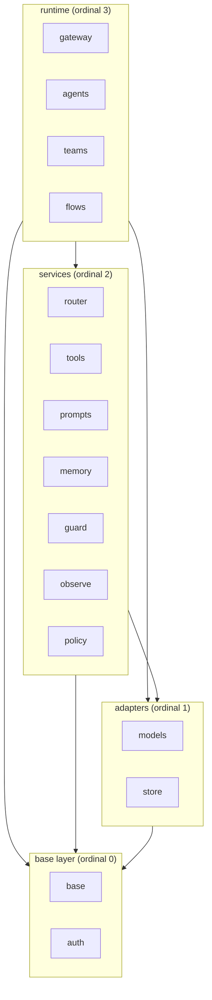

# Design Document

## Overview

This design describes the **target** module and folder structure of Nimbus. It is a structure-only design: it defines package boundaries, the layer dependency direction, naming and codename rules, optional-module packaging, and the resolution location for each known overlap. It states the target; the moves that reach it are executed by the task groups in `tasks.md`. `.kiro/specs/structure/requirements.md` is the source of truth, and requirements are cited here by number (Requirement N).

The design is shaped by binding product constraints: a serverless-first deployment packaged as a zip-based runtime, a strict size and load budget enforced by `budgets.toml` and the tests under `tests/budget`, strict modularity with lazy imports, and provider adapters that prefer the standard library over heavy SDKs (made binding in the Dependency policy: standard library first, REST over SDK section). Nimbus is at version 0.1.0 with almost no users, so a breaking rename is acceptable when documented.

The target is organized as:

- **Four Layers** with a single downward dependency direction (`base=0`, `adapters=1`, `services=2`, `runtime=3`).
- **15 Components**, each with one short shared name (`^[a-z]{3,7}$`) used identically for its package folder, spec folder, module package, and docs section.
- **A codename watermark** per Component (cloud/weather words) that appears in exactly four places and never in code, imports, file names, or spec folders.
- **One distribution with extras**: the core install carries always-present Components; optional Components are bounded by an Extra and loaded lazily through the stdlib lazy-import mechanism plus a thin `MissingExtraError` wrapper (see Lazy imports at boundaries).
- **Declarations, not execution**: every boundary, rename, merge, split, and overlap resolution below is a declaration of target state (Assumption A5); `tasks.md` executes them.

### Two independent axes (read this first)

The structure has **two orthogonal axes** that are easy to conflate. They are independent and must be read separately.

**Axis 1 — Layer (an import-direction rule only).** A Layer is a static rule about which Component may import which other Component, enforced by a deterministic AST test. **Nothing is installed, loaded, or bundled per Layer.** The rule "a Component in Layer `N` may import only Components in a Layer with ordinal ≤ `N`" is a **ceiling** — it states the maximum a Component is *allowed* to import, not a list of dependencies it *requires*. Assigning `agents` to the runtime Layer does **not** mean `agents` imports every services-Layer Component; it only means `agents` is *permitted* to import downward. Most Components import far fewer Components than the ceiling allows (see the per-component dependency matrix).

**Axis 2 — Installation (core vs extra).** Each Component is classified independently as either always-present in the core install or installed by its own Extra. This classification is **orthogonal to the Layer**: a services-Layer Component can be core (e.g. `router`) while another services-Layer Component is optional (e.g. `memory`). Importing a Component is **lazy**: code for a Component you do not use is never imported, even when its files ship inside the installed package, and a heavy library is pulled only at first use through the stdlib lazy-import mechanism (see Lazy imports at boundaries).

Consequently, **a user is not forced to install or load `memory`, `guard`, `observe`, `teams`, `flows`, or any other optional Component to use the rest of Nimbus.** Each Extra is independent: installing one Extra never pulls another (installing `tools` does not pull `observe` or `memory`). The Layer table below defines Axis 1; the Installation classification section defines Axis 2.

**Design assumption (A1, carried from requirements):** the `base` package must be importable without pydantic for structural purposes; the pydantic-to-dataclasses migration is a separate later spec. This is an open, unresolved tension with the `python-standards` steering and is recorded, not silently resolved (Requirement 3).

**Note (provider rename vertex → google):** The provider formerly named `vertex` is renamed `google` (Google renamed Vertex AI to the Gemini Enterprise Agent Platform in April 2026). Throughout this design, read every `vertex`/`Vertex` as `google`: `models/llm/google_provider.py`, `models/embeddings/google_*.py`, class `GoogleProvider`, registered name `"google"`, and the extra `google`. The SDK package remains `google-cloud-aiplatform`. This mirrors Assumption A6 in requirements.md.

## Architecture

### Layers and ordinals

The structure defines exactly four Layers, each with an ordinal from most foundational to most dependent (Requirement 2):

| Layer | Ordinal | Components |
|-------|---------|------------|
| base | 0 | `base`, `auth` |
| adapters | 1 | `models`, `store` |
| services | 2 | `router`, `tools`, `prompts`, `memory`, `guard`, `observe`, `policy` |
| runtime | 3 | `gateway`, `agents`, `teams`, `flows` |

This table is **Axis 1 only** — it assigns each Component to a Layer so the import-direction rule can be enforced. It says nothing about what is installed or loaded, and it does not imply that a Component depends on every Component in a lower Layer.

### Installation classification (core vs extra)

This section defines **Axis 2** and implements the complete partition required by Requirement 6: each of the 15 Components is classified as exactly one of core-always-present or optional-behind-an-Extra. This classification is **orthogonal to the Layer table above**: Layer membership does not determine installation, and installation does not determine import direction.

| Class | Components | What installs it | Heavy libraries |
|-------|------------|------------------|-----------------|
| **Core: always present, no heavy deps** | `base` | the core install (`pip install nimbus`) | none (standard library only) |
| **Optional: behind its own independent Extra** (heavy libs lazy-imported) | `auth`, `models`, `store`, `memory`, `observe`, `mcp` (the MCP client's `fastmcp`), `teams`, `flows` | `pip install nimbus[<extra>]` | see per-Component notes below |
| **Present without heavy dependencies** (pure-Python code, no Extra needed) | `router`, `tools`, `prompts`, `guard`, `policy`, `gateway`, `agents` | ship with the core install as pure modules | none beyond core deps |

**Per-Component Extra notes (optional class):**

- `auth`: declares only `rsa` (pure-Python, RS256 signing); strategies and credential sources are the `auth` and `models` specs (Requirement 18).
- `models`: provider adapters are stdlib REST and need no provider-SDK Extra; an Extra exists only where no stdlib path exists (for example `google`, which declares only the provider SDK and not `rsa`). No vendor SDK is on the runtime path (Requirement 20).
- `store`: durable backends; drivers behind extras (`dynamodb` via boto3 preinstalled in the target serverless runtime; the `redis` driver via the `memory` Extra where used).
- `memory`: conversation/state memory; `redis.asyncio` and `asyncpg`, provided by the `memory` Extra.
- `observe`: events, logs, metrics, traces; observability libraries only where no stdlib path exists.
- `mcp`: separate Extra providing `fastmcp`, the optional substitute for the built-in MCP client; `tools` itself carries no third-party library (Requirement 21).
- `teams`, `flows`: each its own Extra, empty at creation (Requirement 13).

**Every Extra is independent.** Installing one Extra never installs another. There is no implicit transitive Extra.

**Reconciliation with `budgets.toml`.** The pure-Python class aligns with `[extras_policy].known_empty`: those packages ship as empty or pure modules and declare no optional dependency. `prompts` only repeats `jinja2`, which is already a core dependency. This classification is the Requirement 6 partition; it is orthogonal to the Layer assignment and does not change it.

### Dependency rule

A Component in the Layer with ordinal `N` imports only from Components in a Layer with ordinal **strictly less than** `N`, with one exception: every Component may import `base` (Requirement 2). There is **no horizontal import** between two non-`base` Components of the same Layer. When a Component needs to consume a same-Layer peer, the contract is a **Port defined in `base`** and the consumer depends on that Port. The only same-Layer import is importing `base` itself (`auth -> base`), because `base` introduces no upward dependency and never imports another Component.

This is a **ceiling**, not a dependency list: it states the maximum a Component is *allowed* to import, and most Components import far fewer (the exact, tighter allowances are in the per-component dependency matrix). The `base` Component imports only the Python standard library and performs no file-system, network, or process I/O, with one sanctioned exception: `base/http.py`, the single stdlib-only HTTP transport (Requirement 2).



This diagram shows the **import-direction ceiling (the Layer rule)**, not actual dependencies. Arrows denote the *allowed* import direction; every arrow points downward toward a lower or equal ordinal, and there is no upward edge. A Layer-to-Layer arrow does **not** mean every Component in the upper Layer imports every Component in the lower one — it means such an import is permitted at most. The actual, tighter dependencies are declared per Component in the Per-component dependency matrix. This direction is enforced by a deterministic AST test (see Per-component dependency matrix and Testing Strategy).

### Known violations to be removed by the target

The target structure removes these current upward imports (Requirement 2): `completion.py` imports `capabilities`; `providers` imports `capabilities`; and `interfaces` imports `memory`. In the target, the capability **schema** that `completion` needs is a pure contract inside `base`, and the `memory` **port** lives in `base/interfaces` while the `memory` implementation stays in the `memory` Component, so no base-layer module imports a higher layer.

## Target package tree

The target tree places a real `base` package at the foundation and a curated top-level `__init__.py`. `base` is a real importable package, not only a conceptual layer (Requirement 3).

```
src/nimbus/
├── __init__.py                 # re-exports ONLY: messages, completion, exceptions, config (Req 6)
│
├── base/                       # Layer 0 — standard library only, no I/O (Req 2, 3)
│   ├── __init__.py
│   ├── messages.py             # core message models
│   ├── completion.py           # CompletionRequest / CompletionResponse
│   ├── capability_schema.py    # pure capability schema/contract (lets completion drop its tools import)
│   ├── exceptions.py           # NimbusError hierarchy, incl. MissingExtraError
│   ├── config.py               # configuration loading
│   ├── http.py                 # the single stdlib-only HTTP transport (sanctioned exception to no-I/O; shared by auth, models, tools)
│   └── interfaces/             # Ports (interfaces), no I/O, no import of layers >0 (Req 3)
│       ├── __init__.py
│       ├── model.py            # ModelInterface port
│       ├── decision.py         # DecisionModel port (Jev contract) (Req 4)
│       ├── runnable.py         # Runnable port: one input → one output (Req 11)
│       ├── vector_encoder.py
│       ├── storage.py          # store port (Overlap 10.2 target: port side)
│       ├── registry.py         # unified registry port (Overlap 10.1 target: port side)
│       ├── cost_calculator.py  # cost port (Overlap 10.3)
│       ├── error_handler.py    # error port (Overlap 10.3)
│       ├── token_counter.py    # token port (Overlap 10.3)
│       ├── memory.py           # memory port (impl stays in memory Component; removes base→memory leak, Req 2)
│       ├── router.py
│       ├── safety.py
│       ├── observer.py
│       ├── event_handler.py
│       ├── content_reader.py
│       ├── multimodal_handler.py
│       ├── prompt.py
│       ├── config_loader.py
│       ├── plugin.py
│       ├── capability.py       # capability port
│       ├── authorizer.py       # authorizer Port: principal, action, resource -> permit/forbid; implemented by policy (Req 17)
│       └── authentication.py   # authentication Port; implemented by auth (Req 18)
│
├── auth/                       # Layer 0 — authentication and credentials; imports only base (Req 18)
│   ├── __init__.py
│   └── sigv4.py                # SigV4 signer (moved from models/transport); strategies and credential sources land in the auth and models specs
│
├── models/                     # Layer 1 — adapters to every model API kind (Req 4)
│   ├── __init__.py
│   ├── base.py                 # shared base adapter (from providers/base.py, split)
│   ├── registry.py             # provider/model registry impl (Overlap 10.1 target: impl side)
│   ├── transport/              # ONE shared stdlib transport, retry, error mapping, token counting (Req 4)
│   │   ├── __init__.py
│   │   ├── http.py             # re-exports base/http.py (the single stdlib urllib transport; no httpx/requests)
│   │   ├── streaming.py        # stdlib SSE (text/event-stream) parser
│   │   ├── retry.py            # shared retry policy (max 3 attempts, Req 4)
│   │   ├── error_mapping.py    # provider error → Nimbus error
│   │   ├── token_counter.py    # token counting impl
│   │   └── multimodal.py       # multimodal content handling
│   ├── llm/                    # large language model adapters (stdlib REST dialects)
│   │   ├── __init__.py
│   │   ├── openai_compatible.py # OpenAI + Azure + OpenAI-compatible ecosystem (parametrized by base_url/api_key)
│   │   ├── anthropic.py        # Anthropic Messages API (/v1/messages)
│   │   └── bedrock.py          # AWS Bedrock via shared SigV4 over urllib
│   ├── embeddings/             # embedding model adapters
│   │   ├── __init__.py
│   │   ├── bedrock_embeddings.py
│   │   ├── cohere_embeddings.py
│   │   ├── openai_embeddings.py
│   │   ├── google_embeddings.py
│   │   └── google_multimodal_embeddings.py
│   └── decision/               # Decision_Model (Jev) — third model kind (Req 4)
│       ├── __init__.py
│       └── jev.py              # DecisionModel implementation
│
├── store/                      # Layer 1 — ONE shared package for external state (Req 5)
│   ├── __init__.py
│   ├── memory.py               # in-memory backend
│   ├── file.py                 # file backend
│   ├── dynamodb.py             # DynamoDB backend (first-choice durable, Req 5)
│   └── redis.py                # Redis backend
│
├── router/                     # Layer 2 — ModelRouter and routing concerns
│   ├── __init__.py
│   ├── model_router.py
│   ├── routing_strategies.py
│   ├── health_tracker.py       # health tracking used by routing
│   ├── config_models.py
│   └── fallbacks.py
│
├── tools/                      # Layer 2 — capabilities (MCP "tool" terminology) (Req 1, naming)
│   ├── __init__.py
│   ├── registry.py
│   ├── local_function.py
│   ├── remote_api.py           # HTTP via stdlib urllib transport; httpx/requests eliminated (Req 7)
│   ├── mcp_capability.py
│   ├── mcp_client.py           # create_mcp_client(target, impl="builtin"): the one factory (Req 21)
│   ├── mcp_server_client.py    # built-in tri-faceted MCP client (tools/prompts/resources), consume-only over HTTP
│   ├── mcp_fastmcp.py          # fastmcp-backed client (mcp extra) behind the same Port
│   ├── mcp_boundary.py         # the single conversion point from official MCP types to Nimbus types (Req 15)
│   ├── mcp_resource.py         # Resource type internal to tools (URI, MIME, text/bytes); no base Port, no new Component (Req 15)
│   ├── capability_call_handler.py
│   ├── decorator.py
│   └── exceptions.py
│
├── prompts/                    # Layer 2 — loaders, role-based messages, templates
│   ├── __init__.py
│   ├── loaders.py
│   ├── messages.py
│   └── templates/
│
├── memory/                     # Layer 2 — declared-but-minimal this step (Req 6, A3)
│   └── __init__.py
├── guard/                      # Layer 2 — declared-but-minimal this step (Req 6, A3)
│   └── __init__.py
├── observe/                    # Layer 2 — declared-but-minimal this step (Req 6, A3)
│   └── __init__.py
├── policy/                     # Layer 2 — declared-but-minimal; implements the authorizer Port (content in policy spec)
│   └── __init__.py
│
├── gateway/                    # Layer 3 — NEW declared-but-minimal (content in gateway spec)
│   └── __init__.py
├── agents/                     # Layer 3 — declared-but-minimal (content in agents spec)
│   └── __init__.py
├── teams/                      # Layer 3 — declared-but-minimal; coordinates units toward a shared objective (content in teams spec)
│   └── __init__.py
└── flows/                      # Layer 3 — declared-but-minimal; sequences units into ordered steps (content in flows spec)
    └── __init__.py
```

Notes:

- `base` is a real package containing the core models, the error hierarchy, configuration loading, and the Ports — all four module groups (Requirement 3).
- The Decision_Model (Jev) lives in `models/decision/`, as a third model kind alongside LLMs and embeddings (Requirement 4); its contract (the `DecisionModel` Port) lives in `base/interfaces/decision.py` (Requirement 4).
- The lazy-import mechanism is the standard library plus a thin `MissingExtraError` helper in `base` (see Lazy imports at boundaries); it imports only standard-library `importlib`, so it is compatible with the base-layer stdlib-only rule (Requirement 2).

### Import paths (component, not layer)

The public import path uses the **Component** name, never the Layer name. A Layer is Axis-1 metadata consumed only by the AST import test (see Two independent axes); it is not a package and never appears in an import path.

Valid import paths name a Component:

```python
import nimbus                       # curated base re-exports: messages, completion, exceptions, config (Req 6)
from nimbus.models.llm import ...   # Component "models"
from nimbus.store import ...        # Component "store"
from nimbus.router import ...       # Component "router"
from nimbus.gateway import ...      # Component "gateway"
```

There is **no** `nimbus.base`-as-layer, **no** `nimbus.adapters`, **no** `nimbus.services`, and **no** `nimbus.runtime` in any import path. The four Layer names (`base` as an ordinal, `adapters`, `services`, `runtime`) are not importable packages — only `base` exists as a real package, and it does so as a Component, not as "the base layer."

Rationale:

- The Layer is only AST-test metadata (Axis 1). A Component may be reassigned to a different Layer without breaking a single import path, because paths are keyed to the Component name that does not change.
- The Layer names `adapters`, `services`, and `runtime` are not members of the 15-Component name set fixed by Requirement 1, so they must not appear in a path. Letting a layer name into an import path would break the shared-name rule (Requirement 1), which binds the package folder, spec folder, module package, and docs section to one identical Component name.
- This mirrors the spirit of the codename rule: structural/taxonomic labels (layers, codenames) are kept out of import paths, which carry only the plain Component name.

`base` is still a real package at `nimbus/base/`, but its curated public surface (`messages`, `completion`, `exceptions`, `config`) is re-exported at the top level so users reach it through `import nimbus` (Requirement 6).

## Per-component dependency matrix

The `Allowed_Imports_Matrix` declares, at **Component** granularity, the exact set of Components each Component may import. This is tighter than the Layer ceiling: the Layer rule forbids upward imports, and this matrix additionally restricts each Component to a named allowed set, so a legal-by-Layer import can still be a violation when it falls outside the Component's declared set. It is enforced by `tests/budget/test_import_matrix.py` (`LAYER` and `ALLOWED`).

Each entry lists the **maximum** a Component may import. Importing fewer is fine. Every Component also consumes Ports defined in `base`; the "Ports consumed" column in Components and Interfaces lists those.

| Importer Component | Layer | May import these Components (maximum) | Notes |
|--------------------|-------|---------------------------------------|-------|
| `base` | base (0) | none (standard library only) | `base/http.py` is the one sanctioned network-I/O module |
| `auth` | base (0) | `base` | the only same-Layer import is `auth -> base` |
| `models` | adapters (1) | `base`, `auth` | |
| `store` | adapters (1) | `base`, `auth` | |
| `router` | services (2) | `base`, `models`, `store` | |
| `tools` | services (2) | `base`, `auth` | **never `prompts`**: the MCP prompt facet uses the message types in `base` via the `MCPPrompt` descriptor in `tools` (Requirement 15) |
| `prompts` | services (2) | `base` | |
| `memory` | services (2) | `base`, `store`, `auth` | |
| `guard` | services (2) | `base` | `models` only for Jev pre-flight decisions |
| `observe` | services (2) | `base` | |
| `policy` | services (2) | `base`, `models` | `models` only if it uses decision models; implements the authorizer Port |
| `gateway` | runtime (3) | `base`, `tools`, `models`, `auth` | `models` for Jev tool selection; **never** `policy`, `guard`, `observe`, `memory`, `prompts` |
| `agents` | runtime (3) | `base`, `models` | `tools` and `prompts` only when the agent enables the corresponding hook; **never** `policy`, `guard`, `observe`, `memory` (received via `base` Ports/hooks); **never** `teams` or `flows` |
| `teams` | runtime (3) | `base` | `prompts` only when enabled; **never** `models` (a composed model arrives as a `Runnable`), `agents`, `teams`, `flows`, nor `policy`, `guard`, `observe`, `memory` |
| `flows` | runtime (3) | `base` | same as `teams` |

The matrix lists the **maximum** a Component **may** import; a Component that imports fewer is compliant. The optional column marks imports that are permitted only when a specific feature is enabled — they are not required dependencies. For `agents`, every optional consumer is genuinely optional: an agent with no memory hook never imports `memory`, an agent with no observability hook never imports `observe`, and so on.

**Critical: `teams` and `flows` import neither `models` nor any orchestrator implementation module.** These runtime orchestrators compose one another and model adapters (a flow may contain models, agents, teams, or other flows; a team may contain models, agents, flows, or other teams), but composition is expressed **only** through the `Runnable` Port defined in `base` (see Composition model (Runnable)): a composing unit holds its children as `Runnable` references. Two kinds of import are therefore violations, regardless of Layer ordinal:

1. a direct `import` statement among the `agents`, `teams`, or `flows` implementation modules (Requirement 11); and
2. an import of the `models` Component by `teams` or `flows` — a composed model must be received as a `Runnable` reference, not imported (Requirement 11).

`agents` is the one orchestrator that still imports `models` directly (its allowed set includes `models`), because an agent's own loop drives a model; `teams` and `flows` do not, since any model they run arrives as a `Runnable`.

**Enforcement.** A deterministic test, modeled on `tests/budget/test_policy.py`, parses every module under `src/nimbus` with the `ast` module, resolves each `import` / `import from` to its owning Component, and checks three conditions against this matrix (Requirements 2, 11):

1. **No upward import** — the Layer ceiling: no import targets a Component in a higher-ordinal Layer.
2. **No out-of-set import** — no import targets a Component outside the importing Component's declared allowed set (including its optional entries). Because `models` is not in the `teams` or `flows` allowed set, a `teams`/`flows` import of `models` is caught here: a composed model must arrive as a `Runnable` reference (Requirement 11).
3. **No orchestrator cross-import** — no module in `agents`, `teams`, or `flows` imports another of those three implementation modules; such composition must go through the `Runnable` Port in `base` (Requirement 11).

So, for example, `gateway` importing `memory` is a violation under condition (2) even though `memory` sits in a lower Layer and would pass the Layer ceiling alone; `flows` importing `models` is a violation under condition (2) (the model must be received as a `Runnable`); `flows` importing `agents` is a violation under condition (3) even though both sit in the same runtime Layer; and `tools` importing `prompts` is a violation under condition (2) (Requirement 15), as is any runtime Component importing `policy`, `guard`, `observe`, or `memory` (Requirement 17). The test:

- produces the same result for the same input (pure static analysis, no network, no install);
- reports each violation by naming the importing Component and its Layer and the imported Component and its Layer (Requirement 2);
- exits with a non-zero status when any violation is present (Requirement 2).

The three current violations in Requirement 2 are the first failures this test is expected to catch before the target structure removes them.

## Components and Interfaces

This section lists each Component, its Layer, the public interface role it plays, and the Ports it defines or consumes. Ports (interfaces) are defined only in `base/interfaces`; every cross-Component dependency crosses a Port, never a concrete implementation (Requirements 3, 5).

| Component | Layer | Role | Ports consumed |
|-----------|-------|------|----------------|
| `base` | 0 | Foundation: core models, error hierarchy, config, all Ports, thin `missing_extra` helper, the stdlib `http.py` transport. Ports: `model`, `decision`, `runnable`, `storage`, `registry`, `cost_calculator`, `error_handler`, `token_counter`, `memory`, `vector_encoder`, `router`, `safety`, `observer`, `event_handler`, `content_reader`, `multimodal_handler`, `prompt`, `config_loader`, `plugin`, `capability`, `authorizer`, `authentication` | none (stdlib only) |
| `auth` | 0 | Authentication strategies, credential sources, token cache, SigV4 signer (declared-but-minimal this step) | `authentication` (implements it) |
| `models` | 1 | Adapters for LLMs, embeddings, and decision models; one shared transport, retry, error mapping, token counting. Model adapters implement `runnable`, so a model is usable anywhere a `Runnable` is accepted | `model`, `decision`, `vector_encoder`, `registry`, `cost_calculator`, `error_handler`, `token_counter`, `runnable`; outbound auth via `auth` |
| `store` | 1 | One shared set of state backends (in-memory, file, DynamoDB, Redis) | `storage`; credentials via `auth` |
| `router` | 2 | ModelRouter, strategies, health tracking, fallbacks | `router`, `model`, `decision`, `registry`, `storage` |
| `tools` | 2 | Capability registry, local functions, remote API, tri-faceted MCP client (tools/prompts/resources; built-in + `fastmcp`) | `capability`, `registry`, `prompt` (the `PromptBuilderInterface` Port) and the `base` message types for the MCP prompt facet; outbound auth via `auth` |
| `prompts` | 2 | Loaders, role-based messages, templates | `prompt`, `content_reader` |
| `memory` | 2 | Conversation/state memory (declared-but-minimal this step) | `memory`, `storage`; credentials via `auth` |
| `guard` | 2 | Safety filters, pre-flight checks (declared-but-minimal) | `safety`, `decision` |
| `observe` | 2 | Events, logs, metrics, traces (declared-but-minimal) | `observer`, `event_handler` |
| `policy` | 2 | Policy decisions; implements the authorizer Port (declared-but-minimal; content in policy spec) | `authorizer` (implements it); optionally `decision` |
| `gateway` | 3 | Nimbus-acts-as-MCP-server role, toolset per operation (declared-but-minimal; content in gateway spec). The MCP **client** lives in `tools` | `capability`; optionally `decision` (tool selection); the optional services (`authorizer`, `safety`, `observer`, `memory`) arrive by injection |
| `agents` | 3 | Agent loop, BaseAgent, hooks (declared-but-minimal; content in agents spec) | `runnable`, `model`; per enabled hook `capability`, `prompt`; the optional services arrive by injection |
| `teams` | 3 | Coordinate multiple units toward a shared objective; owns the team-role concept (declared-but-minimal) | `runnable` only (composed units, **including models**, held as `Runnable` references); optionally `prompt` |
| `flows` | 3 | Sequence units into a defined order of steps (declared-but-minimal) | `runnable` only (composed units, **including models**, held as `Runnable` references); optionally `prompt` |

Key interface contracts:

- **ModelInterface** (`base/interfaces/model.py`): the provider-agnostic completion contract consumed by `router`, `gateway`, and `agents`.
- **DecisionModel** (`base/interfaces/decision.py`): the single decision contract for Jev (see DecisionModel / Jev), consumed by `gateway`, `router`, and `guard` (Requirement 4).
- **Runnable** (`base/interfaces/runnable.py`): Nimbus's single, universal composition contract — one invocation operation accepting one input and returning one output — implemented by **model adapters (`models`)**, `agents`, `teams`, and `flows` (and optionally `tools`). `teams`/`flows` use it to compose other units — **including models** — by `Runnable` reference, so they import neither the orchestrator implementation modules nor the `models` Component (see Composition model (Runnable), Requirement 11).
- **Storage Port** (`base/interfaces/storage.py`): the only way a service reaches a store backend (Requirement 5).
- **Registry Port** (`base/interfaces/registry.py`): the unified registry contract replacing the two current registries (Overlap A, Requirement 10).
- **Authorizer Port** (`base/interfaces/authorizer.py`): accepts a principal, an action, and a resource and returns exactly one of `permit` or `forbid`; implemented by `policy`, injected into runtime Components (Requirement 17).
- **Authentication Port** (`base/interfaces/authentication.py`): applies authentication to a request by adding headers or signing it; implemented by `auth` (Requirement 18).

## Composition model (Runnable)

The three runtime orchestrators — `agents`, `teams`, and `flows` — compose one another freely at runtime: a flow can contain agents, teams, or other flows; a team can contain agents, flows, or other teams. The structural challenge is to allow this composition **without** creating an import cycle among the orchestrator implementation modules. The design solves it with a single abstraction defined in `base` (Requirement 11).

**One Port, one operation.** `base/interfaces/runnable.py` defines exactly one `Runnable` Port that declares a single invocation operation accepting exactly one input argument and returning exactly one output value (Requirement 11). It performs no I/O and imports only the standard library, so it lives cleanly at Layer 0. The `Runnable` Port carries a conceptual codename `vapor` (a documentation-only watermark, distinct from the Component Codenames — now 15 including `auth=ozone`; see Codename watermark placement, Requirement 9).

**Runnable is the universal composition contract.** `Runnable` is Nimbus's single, universal "one input → one output" composition contract (LCEL-like): anything that conforms to it is substitutable wherever a `Runnable` is accepted. The implementers are:

- **model adapters** (the `models` Component) — Requirement 11;
- **`agents`**, **`teams`**, **`flows`** — Requirement 11;
- optionally **`tools`** (a capability can be exposed as a `Runnable`).

Because every one of these satisfies the same contract, any of them can stand in anywhere a `Runnable` is expected. In particular, a model adapter **is** a `Runnable`, so a model can be used directly as a step in a `flows` unit or as a member of a `teams` unit (Requirement 11).

**Models arrive as Runnables, so orchestrators do not import `models`.** Because a model adapter implements the `Runnable` Port, a `teams` or `flows` unit receives a model as a `Runnable` reference from its caller/configuration — it does **not** import the `models` Component (Requirement 11). The only import a model adapter adds for this is `models` → `base` to implement the `Runnable` Port, which is a downward (Layer 1 → Layer 0) import and is allowed.

**Composition is by Port reference, not by import.** When a `teams` or `flows` unit composes another unit — whether that unit is a model, an agent, a team, or a flow — it holds that unit as a `Runnable` Port reference obtained from its caller/configuration; it does **not** import the `models`, `agents`, `teams`, or `flows` implementation module (Requirement 11). This is the key move: "a flow can contain models/agents/teams/other flows" and "a team can contain models/agents/flows/other teams" are expressed through the base-layer `Runnable` type, so no import edge is ever created from an orchestrator to `models` or among the orchestrator implementation modules. The import-direction stays acyclic because the only shared dependency is the `Runnable` Port in `base`, which every orchestrator already depends on downward.

### Roles are owned by teams

The role of a unit within a team — including a possible `supervisor` role — is owned by the `teams` Component, **not** by the `Runnable` Port in `base` and **not** by `agents` (Requirement 11). The `Runnable` Port stays a pure input→output contract with no notion of team role; a `teams` unit associates a role with a composed unit through **membership metadata defined in `teams`**, not through `Runnable` (Requirement 11).

A unit's team role is distinct from its own identity, so the same `Runnable` can hold different roles in different teams — for example a `supervisor` in one team and a plain worker in another (Requirement 11). A supervisor that decides which member works next may use a decision model (Jev / `DecisionModel`), but it **receives that model as a `Runnable` reference**, so `teams` still does not import `models`.

**Out of scope for this structure spec** (deferred to the future `teams` spec): the concrete `TeamMember` shape, the role set and its semantics, and supervisor routing logic. This design records only the boundary — role is a `teams`-owned concept distinct from both the `Runnable` contract and a unit's identity (Requirement 11).

**Runtime cycle detection.** Composition by Port reference means a unit could, at runtime, be nested within itself directly or transitively. Each composing unit detects such a cycle using a visited-set of unit identities or a configurable depth bound with a default maximum nesting depth of 100 levels; on detection it stops traversal at that point and raises a Nimbus error indicating the cyclic composition, without recursing beyond the depth bound (Requirement 11). This is a runtime behavior of the orchestrators; it is specified here as a target and covered by the orchestrators' own specs, not executed in this structure phase.

**Enforcement.** The deterministic AST import test (see Per-component dependency matrix) flags as a violation (i) any direct import among the `agents`, `teams`, and `flows` implementation modules, and (ii) any import of the `models` Component by `teams` or `flows` (a composed model must arrive as a `Runnable` reference, not an import). It exits non-zero when at least one such violation is present (Requirement 11).

## Data Models

The structure spec defines **where** data models live and the boundary rules they obey; it does not redefine their fields. Per Assumption A1, the `base` package must import without pydantic for structural purposes, so the models below are described by role and location, independent of whether they are pydantic models or dataclasses (the pydantic-to-dataclasses migration is a separate later spec, Requirement 3).

| Model group | Location | Description | Boundary rule |
|-------------|----------|-------------|---------------|
| Messages | `base/messages.py` | `NimbusMessage` and role variants (user/assistant/system/capability) | stdlib-only; no import of layers >0 (Req 3) |
| Completion | `base/completion.py` | `CompletionRequest` / `CompletionResponse` | references the capability **schema** in base, not the `tools` Component (removes `completion`→`capabilities`, Req 2) |
| Capability schema | `base/capability_schema.py` | pure capability contract (name, description, parameter schema) | pure contract in base; runtime handlers/registry stay in `tools` |
| Error hierarchy | `base/exceptions.py` | `NimbusError` and subclasses incl. `MissingExtraError` | stdlib-only (Req 3, 6) |
| Config | `base/config.py` | configuration loading and `${VAR}` substitution | stdlib-only (Req 3, 2) |
| Decision result | returned by the `DecisionModel` Port | a choice from a finite option set + per-option probability in `[0,1]` summing to `1.0` | contract in `base/interfaces/decision.py`; impl in `models/decision/` (Req 4) |
| Router config | `router/config_models.py` | route aliases, targets, strategy, rate limits | services layer; consumes base ports only |
| Store records | `store/*.py` | backend-specific record/state shapes | one location per backend in `store` (Req 5) |
| Resource (MCP) | `tools` (MCP client) | MCP resource read by URI: a MIME type and either text or bytes | type internal to `tools`, returned by the MCP client; **no base Port** and no new Component today (Requirement 15). When `prompts`/`memory` consume resources, a resource Port is added to `base` per the no-horizontal-import rule (see the MCP section) |

## Current-file mapping table

Every current file maps to a target location, or is marked split/merge/delete with a one-line reason. This table is the declared target; `tasks.md` executes the moves.

| Current path | Target | Reason |
|--------------|--------|--------|
| `__init__.py` | `nimbus/__init__.py` (curated) | Re-export only messages, completion, exceptions, config (Req 6). |
| `messages.py` | `nimbus/base/messages.py` | Core models belong in base (Req 3). |
| `completion.py` | `nimbus/base/completion.py` | Core models in base; its `capabilities` import is replaced by the base capability schema (Req 2). |
| `exceptions.py` | `nimbus/base/exceptions.py` | Error hierarchy in base; hosts MissingExtraError (Req 3, 6). |
| `config.py` | `nimbus/base/config.py` | Configuration loading in base (Req 3). |
| `interfaces/__init__.py` | `nimbus/base/interfaces/__init__.py` | Ports belong in base (Req 3). |
| `interfaces/model.py` | `nimbus/base/interfaces/model.py` | Port. |
| `interfaces/capability.py` | `nimbus/base/interfaces/capability.py` | Port. |
| `interfaces/config_loader.py` | `nimbus/base/interfaces/config_loader.py` | Port. |
| `interfaces/content_reader.py` | `nimbus/base/interfaces/content_reader.py` | Port. |
| `interfaces/cost_calculator.py` | `nimbus/base/interfaces/cost_calculator.py` | Cost Port (Overlap 10.3, port side). |
| `interfaces/error_handler.py` | `nimbus/base/interfaces/error_handler.py` | Error Port (Overlap 10.3, port side). |
| `interfaces/token_counter.py` | `nimbus/base/interfaces/token_counter.py` | Token Port (Overlap 10.3, port side). |
| `interfaces/event_handler.py` | `nimbus/base/interfaces/event_handler.py` | Port. |
| `interfaces/memory.py` | `nimbus/base/interfaces/memory.py` | Port stays in base; memory impl stays in `memory` Component, removing the base→memory import (Req 2). |
| `interfaces/multimodal_handler.py` | `nimbus/base/interfaces/multimodal_handler.py` | Port. |
| `interfaces/observer.py` | `nimbus/base/interfaces/observer.py` | Port. |
| `interfaces/plugin.py` | `nimbus/base/interfaces/plugin.py` | Port. |
| `interfaces/prompt.py` | `nimbus/base/interfaces/prompt.py` | Port. |
| `interfaces/router.py` | `nimbus/base/interfaces/router.py` | Port. |
| `interfaces/safety.py` | `nimbus/base/interfaces/safety.py` | Port. |
| `interfaces/storage.py` | `nimbus/base/interfaces/storage.py` | Store Port; backends go to `store` (Overlap 10.2). |
| `interfaces/vector_encoder.py` | `nimbus/base/interfaces/vector_encoder.py` | Port. |
| `interfaces/route_registry.py` | merge → `nimbus/base/interfaces/registry.py` | Unified registry port (Overlap 10.1). |
| `providers/__init__.py` | `nimbus/models/__init__.py` | Rename providers → models (naming, Req 1). |
| `providers/base.py` (1,043) | **split** → `nimbus/models/base.py` + `nimbus/models/transport/{http,streaming,retry,error_mapping,token_counter}.py` | 1,043-line file mixes base adapter with shared transport concerns; split by responsibility into the stdlib `urllib` transport (`http.py`, implemented in `base/http.py`), stdlib SSE streaming (`streaming.py`), plus the retry/error/token modules (Requirement 4). SigV4 signing goes to `auth` (Requirement 18). |
| `providers/retry.py` | `nimbus/models/transport/retry.py` | One shared retry policy (Req 4). |
| `providers/error_handler.py` | `nimbus/models/transport/error_mapping.py` | One shared error mapping (Req 4). |
| `providers/token_counter.py` | `nimbus/models/transport/token_counter.py` | One shared token counter (Req 4). |
| `providers/multimodal.py` | `nimbus/models/transport/multimodal.py` | Shared transport concern. |
| *(new)* | `nimbus/base/http.py` (re-exported by `nimbus/models/transport/http.py`) | The single shared JSON HTTP transport over stdlib `urllib.request`; replaces httpx/requests; shared by `models`, `tools`, and `auth` (Dependency policy). |
| *(new)* | `nimbus/models/transport/streaming.py` | Shared stdlib SSE (`text/event-stream`) parser for streaming (Dependency policy). |
| *(new)* | `nimbus/auth/sigv4.py` | AWS SigV4 signer over stdlib `hashlib`/`hmac`/`datetime`; lets Bedrock run without boto3; lives in `auth` (Requirement 18). |
| `providers/cost_calculator.py` | `nimbus/models/transport/` (cost impl) | Cost implementation in the responsible Component (Overlap 10.3, impl side). |
| `providers/health.py` | **merge** → `nimbus/router/health_tracker.py` | Health is consumed by routing; recommend merging into the router health tracker rather than keeping it in models. |
| `providers/registry.py` | merge → `nimbus/models/registry.py` (impl) behind `base/interfaces/registry.py` (port) | Unify the two registries (Overlap 10.1). |
| `providers/lazy_import.py` | `nimbus/base/` thin `missing_extra` helper over stdlib `importlib` | Reduced from a bespoke importer to a thin `MissingExtraError` wrapper over stdlib `importlib` (or removed in favor of stdlib + the helper); stdlib keeps base compliant (Req 2, 6; see Lazy imports). |
| `providers/llm/openai_provider.py` + `providers/llm/azure_provider.py` | **collapse** → `nimbus/models/llm/openai_compatible.py` | One parametrized stdlib-REST adapter; Azure is the same `/v1/chat/completions` dialect with a different `base_url` and auth header (Dependency policy). |
| `providers/llm/anthropic_provider.py` | `nimbus/models/llm/anthropic.py` | Anthropic Messages API (`/v1/messages`) over stdlib REST; no SDK (Dependency policy). |
| `providers/llm/bedrock_provider.py` | `nimbus/models/llm/bedrock.py` | AWS Bedrock via shared stdlib SigV4 signer over `urllib`; no boto3 required (Dependency policy). |
| `providers/llm/vertex_provider.py` | `nimbus/models/llm/google_provider.py` (own dialect, flagged) | The provider is renamed `google` (Assumption A6); it may need its own dialect rather than the OpenAI-compatible adapter. |
| `providers/embeddings/*` | `nimbus/models/embeddings/*` | Embedding adapters over the same stdlib transport; Cohere via the OpenAI-compatible path where applicable; Google embeddings may need their own dialect (Requirement 4; Dependency policy). |
| `capabilities/__init__.py` | `nimbus/tools/__init__.py` | Rename capabilities → tools (naming + MCP term, Req 1). |
| `capabilities/registry.py` | `nimbus/tools/registry.py` | Tools registry. |
| `capabilities/capability_call_handler.py` | `nimbus/tools/capability_call_handler.py` | Handler stays in tools. |
| `capabilities/capability_models.py` | **split** → `nimbus/base/capability_schema.py` (pure contract) + `nimbus/tools/` (runtime models) | Pure schema belongs in base so `completion` can drop its tools import (Req 2); runtime pieces stay in tools. |
| `capabilities/schema.py` | → `nimbus/base/capability_schema.py` | Capability schema is a pure contract (base). |
| `capabilities/decorator.py` | `nimbus/tools/decorator.py` | Tools decorator. |
| `capabilities/exceptions.py` | `nimbus/tools/exceptions.py` | Tools-local exceptions (base.exceptions holds the shared hierarchy). |
| `capabilities/interface.py` | → `nimbus/base/interfaces/capability.py` | Capability port in base. |
| `capabilities/local_function.py` | `nimbus/tools/local_function.py` | Local function capability. |
| `capabilities/mcp_capability.py` | `nimbus/tools/mcp_capability.py` | MCP capability. |
| `capabilities/mcp_server_client.py` | `nimbus/tools/mcp_server_client.py` | Tri-faceted MCP client in `tools` (tools/prompts/resources); built-in stdlib client and `fastmcp` behind one Port (Req 15). |
| *(new)* | `nimbus/tools/mcp_resource.py` | `Resource` type internal to `tools` for MCP resources (URI, MIME type, text or bytes); no base Port, no new Component (Req 15). |
| `capabilities/remote_api.py` | `nimbus/tools/remote_api.py` | HTTP calls use the shared stdlib `urllib` transport; the `httpx`/`requests` imports are eliminated at the source, not merely deferred (Req 7; Dependency policy). |
| `routes/__init__.py` | `nimbus/router/__init__.py` | Rename routes → router (name was misleading, Req 1). |
| `routes/config_models.py` | `nimbus/router/config_models.py` | Router config. |
| `routes/health_tracker.py` | `nimbus/router/health_tracker.py` | Stays in router (merge target for providers/health.py). |
| `routes/model_router.py` (1,105) | `nimbus/router/model_router.py` | Router core; large file, split deferred to its own spec (not required by structure). |
| `routes/routing_strategies.py` | `nimbus/router/routing_strategies.py` | Router strategies. |
| `routes/storage_backends.py` (665) | **split/move** → `nimbus/store/*` | Storage backends belong in the one shared store (Overlap 10.2, Req 5). |
| `prompts/__init__.py` | `nimbus/prompts/__init__.py` | Prompts Component. |
| `prompts/base.py` | `nimbus/prompts/loaders.py` + `messages.py` | Reuse liteprompt design (loaders, role messages, registry, truncation); see Prompts note. |
| `prompts/templates/` | `nimbus/prompts/templates/` | Templates. |
| `utils/__init__.py` | **delete/fold** → `nimbus/base/` | Keep utilities in base rather than a loose `utils` package; justify under Store/utility note. |
| `utils/validation.py` | `nimbus/base/` (small validation util) | Pure validation helper used across layers belongs at the foundation. |
| `agents/__init__.py` | `nimbus/agents/__init__.py` | Declared-but-minimal; content in agents spec (Req 6, A3). |
| `guard/__init__.py` | `nimbus/guard/__init__.py` | Declared-but-minimal (Req 6, A3). |
| `memory/__init__.py` | `nimbus/memory/__init__.py` | Declared-but-minimal (Req 6, A3). |
| `observe/__init__.py` | `nimbus/observe/__init__.py` | Declared-but-minimal (Req 6, A3). |
| *(new)* | `nimbus/policy/__init__.py` | NEW declared-but-minimal; real content in policy spec (Req 6). |
| *(new)* | `nimbus/gateway/__init__.py` | NEW declared-but-minimal; real content in gateway spec (Req 6). |
| *(new)* | `nimbus/teams/__init__.py` | NEW declared-but-minimal; coordinates units toward a shared objective; content in teams spec (Req 6). |
| *(new)* | `nimbus/flows/__init__.py` | NEW declared-but-minimal; sequences units into ordered steps; content in flows spec (Req 6). |
| *(new)* | `nimbus/base/interfaces/runnable.py` | NEW `Runnable` composition Port in base (Requirement 11). |
| *(new)* | `nimbus/base/interfaces/authorizer.py`, `nimbus/base/interfaces/authentication.py` | NEW authorizer and authentication Ports in base (Requirements 17, 18). |
| *(new)* | `nimbus/auth/__init__.py` | NEW declared-but-minimal Layer-0 Component (Requirement 18). |

**Prompts note (target, not a move):** the prompts Component reuses the liteprompt design (loaders, role-based messages, registry, truncation) but **not** its Jinja2 engine. Jinja2 pulls a compiled package and is not guaranteed in the target serverless runtime; although `jinja2` is a core dependency in `budgets.toml` today, the target avoids depending on a compiled template engine. This is a target direction, not an executed change.

## Overlap resolutions

Each Overlap has exactly one resolution location (Requirement 10), recorded as a target.

### Overlap A — two registries (Requirement 10)

Sources: `interfaces/route_registry.py` and `providers/registry.py`. Resolution: one registry **Port** in `nimbus/base/interfaces/registry.py` and one **implementation** owned by the `models` Component at `nimbus/models/registry.py`. The `models` Component owns the implementation because the registry's primary job is to register and resolve model adapters; the router consumes it through the base port. This is a single unification location.

### Overlap B — two storage concepts (Requirement 10)

Sources: `interfaces/storage.py` and `routes/storage_backends.py`. Resolution: the storage **Port** stays in `nimbus/base/interfaces/storage.py`; the concrete **backends** move into the one shared `store` Component (`nimbus/store/{memory,file,dynamodb,redis}.py`). The `store` Component is the single unification target (Requirements 10, 5).

### Overlap C — scattered cost, error, token (Requirement 10)

For each of the three concepts, the interface placement is a Port in `base`, and the implementation placement is in the responsible Component:

| Concept | Port (base/interfaces) | Implementation |
|---------|------------------------|----------------|
| cost | `cost_calculator.py` | `nimbus/models/transport/` (cost impl, from `providers/cost_calculator.py`) |
| errors | `error_handler.py` | `nimbus/models/transport/error_mapping.py` (from `providers/error_handler.py`) |
| tokens | `token_counter.py` | `nimbus/models/transport/token_counter.py` (from `providers/token_counter.py`) |

Each concept has exactly one port location and one implementation location.

### Planned spec renames (Requirement 10, recorded as future actions)

`nimbus → base`, `model-providers → models`, `capability-support → tools`, `prompts-support → prompts`, `policy-engine → policy`, `agent-runtime → agents`, `gateway` unchanged, and `nimbus-consolidation` folded into `structure`. These are declarations only; each spec is renamed by its own task, never as a side effect of this one.

## Extension points (one point per integration kind)

Every external integration kind enters Nimbus through **exactly one** extension point: a **Port defined in `base`** plus a **registry**, with the concrete implementation placed in the single owning Component (Requirement 12). Adding an integration is therefore a local, additive act inside one Component — it must not modify any file outside that owning Component and must not introduce an import that violates the `Allowed_Imports_Matrix` (Requirement 12).

| Integration kind | Port (in `base`) | Registry | Owning Component | How a new one is added |
|------------------|------------------|----------|------------------|------------------------|
| model provider | `model.py` (`ModelInterface`) / `decision.py` (`DecisionModel`) | model registry (`models/registry.py` behind `base/interfaces/registry.py`) | `models` | configuration or a thin dialect within `models`; no file edited outside `models` (Requirement 12) |
| store backend | `storage.py` | store registry (in `store`, behind the storage Port) | `store` | exactly one new module in `store` implementing the storage Port; no file edited outside `store` (Requirement 12) |
| tool / capability | `capability.py` | tools registry (`tools/registry.py`) | `tools` | register the capability through the tools registry; no file edited outside `tools` (Requirement 12) |
| observability exporter | `observer.py` | observe registry (in `observe`) | `observe` | register the exporter through the observe registry; no file edited outside `observe` (Requirement 12) |
| credential provider | authentication / credential-source Port (in `base`) | auth credential-source registry (in `auth`) | `auth` | register a custom credential source (for example a secret manager beyond the natively supported AWS Secrets Manager / SSM / Azure Key Vault / Google Secret Manager) through the `auth` registry; no file edited outside `auth` (Requirement 18) |

**Tie-in with the REST-over-SDK dependency policy.** The model-provider extension point is where the "standard library first, REST over SDK" rule pays off directly: adding an OpenAI-compatible provider is **pure configuration** (a name, a `base_url`, an `api_key`, minor quirks) handed to the one `openai_compatible.py` adapter — no new module, no file touched outside `models`. That is the extension point in action: one Port plus one registry in the owning Component, and a new integration never fans out edits across the core (see Dependency policy: standard library first, REST over SDK).

**Enforcement.** The rule that an addition stays inside its owning Component is a structural/review-enforced property (it quantifies over hypothetical future additions, not over a fixed input space), backed at the source-tree level by the AST import-matrix test: any import a new integration introduces that leaves the owning Component's allowed set, or that modifies `base`/another Component's boundary, surfaces as a matrix violation (Requirement 12).

## Public API and compatibility policy

`nimbus/__init__.py` re-exports exactly four names: `messages`, `completion`, `exceptions`, `config` (Requirement 6). Everything else currently re-exported is dropped so that importing the top-level package never triggers an optional or provider library import (Requirements 6, 7). The re-export set is testable against the `forbidden_at_import` set in `budgets.toml` (Requirement 6).

**Why the rest is dropped:** any re-export that reaches into `models`, `tools`, `store`, `router`, or a runtime Component risks importing an optional or provider library at `import nimbus` time, which would violate the clean-import requirement and the load budget. The curated four are all in `base` and require only the standard library.

**Compatibility / breaking-rename policy:** at version 0.1.0 with almost no users, a breaking rename is acceptable when documented (Requirement 1, product constraint 8). The migration may use temporary re-exports from old module paths to the new ones, followed by their removal; that execution is defined in tasks.md, and this design only states the policy. After the migration, `import nimbus` in a core-only install must import no library in `forbidden_at_import` and no optional library (Requirement 7).

## Lazy imports at boundaries

Nimbus does **not** reimplement lazy loading. Python ≥3.10 (the floor required by `budgets.toml`) already provides everything needed: `importlib.util.LazyLoader` for deferring a module's execution, and module-level `__getattr__` (PEP 562) for deferring attribute resolution. The design uses these stdlib mechanisms directly; there is no bespoke importer class.

The **only** Nimbus-specific code is a thin helper that attempts the import at first use and, when the optional dependency is absent, raises `MissingExtraError` — a `NimbusError` subclass that wraps the underlying `ImportError`/`ModuleNotFoundError` and names the missing Extra (Requirement 6). Every optional Component imports its heavy library inside the function that first needs it, never at module import time (Requirement 6).

The helper lives in `base` and uses only stdlib `importlib`, so it does not break the base-layer stdlib-only rule.

The glossary term **LazyImporter** is retained but, in this design, means "the stdlib lazy-import mechanism (`importlib.util.LazyLoader` + PEP 562 module `__getattr__`) plus a thin `MissingExtraError` wrapper" — not a bespoke importer.

Canonical pattern (pseudocode):

```python
# nimbus/tools/mcp_fastmcp.py  (fastmcp lives in the optional "mcp" extra)
import importlib
from nimbus.base.exceptions import MissingExtraError

def _missing_extra(module: str, extra: str):
    """Import an optional module at first use; map absence to MissingExtraError."""
    try:
        return importlib.import_module(module)
    except (ImportError, ModuleNotFoundError) as e:
        raise MissingExtraError(extra=extra, missing=module) from e

def _client():
    fastmcp = _missing_extra("fastmcp", extra="mcp")
    return fastmcp.Client(...)
```

The import happens inside the function, so `import nimbus.tools.mcp_fastmcp` does not import the heavy library at module load (Requirement 7). `MissingExtraError` carries the Extra name and the wrapped original error (Requirement 6). Where a module should be deferred as a whole rather than per-call, `importlib.util.LazyLoader` and a module `__getattr__` achieve the same deferral with the stdlib alone.

As a result, `providers/lazy_import.py` is reduced from a bespoke importer to this thin `missing_extra` helper over stdlib `importlib` (see the current-file mapping). Note that the HTTP leak is eliminated at the source by the urllib transport (see Dependency policy), not merely deferred behind a lazy import.

## Store layout

All external state backends live in one shared `store` Component; each backend is a distinct module and appears in exactly one location (Requirement 5). Services consume a backend only through the Base_Package storage Port, never by importing the backend implementation directly (Requirement 5); if a service needs a backend with no Port yet, a Port is defined in `base` first (Requirement 5).

| Backend | Module | Presence | Driver preference |
|---------|--------|----------|-------------------|
| in-memory | `store/memory.py` | always present (core) | standard library |
| file | `store/file.py` | always present (core) | standard library |
| DynamoDB | `store/dynamodb.py` | first-choice durable backend (Req 5) | boto3 (optional; preinstalled in the target serverless runtime) |
| Redis | `store/redis.py` | optional (extra `memory`) | `redis.asyncio`, pure-Python |
| PostgreSQL | *(backend used by `memory`)* | optional (extra `memory`) | `asyncpg`, pure-Python preferred over compiled `psycopg2` (Req 5, 8) |

Any durable-state requirement defaults to DynamoDB unless an alternative backend is explicitly declared (Requirement 5). Where a backend offers both a pure-Python and a compiled driver, the pure-Python driver is the default (Requirement 5).

## DecisionModel / Jev

`base/interfaces/decision.py` defines exactly one `DecisionModel` Port. A call supplies a finite set of allowed options; the response returns a single choice selected from that set together with a probability for each allowed option, where every probability is in `[0.0, 1.0]` and the probabilities sum to `1.0` (Requirement 4). An empty set of allowed options is rejected with a Nimbus error indicating at least one option is required, and no choice is returned (Requirement 4).

The implementation (codenamed Jev) lives in `models/decision/jev.py` as a third model kind alongside LLMs and embeddings (Requirement 4). The `DecisionModel` Port is consumed by `gateway` (tool selection), `router` (selecting the cheapest capable model), and `guard` (pre-flight checks) (Requirement 4).

## Dependency policy: standard library first, REST over SDK

This is a **binding design rule**, grounded in product constraint 4 (prefer a thin standard-library adapter over a provider SDK) and the dependency preference order recorded in `budgets.toml` (standard library first, then libraries already present in the target serverless runtime, then pure-Python packages, compiled packages last).

**Rule.** Where a provider exposes a REST API, the adapter calls it with the Python standard library — `urllib.request` for the HTTP call, `json` for encoding, `hashlib`/`hmac` for request signing, and stdlib Server-Sent-Events parsing for streaming — instead of the vendor SDK. No `httpx`, no `requests`, and no provider SDK sits in the core path.

**This is not one hand-written adapter per provider.** It is **one shared transport** plus a small number of format "dialects." The shared transport lives in `models/transport/`:

| Module | Responsibility |
|--------|----------------|
| `http.py` | JSON POST/GET over `urllib.request`; bearer / API-key auth; headers; timeouts |
| `streaming.py` | parse `text/event-stream` (SSE `data:` lines) with the stdlib — no streaming SDK |
| `auth/sigv4.py` *(in `auth`)* | AWS Signature Version 4 signing with stdlib `hashlib`/`hmac`/`datetime` (a public, documented algorithm) so AWS endpoints need no boto3; reused by the Bedrock adapter |
| `retry.py` | shared retry policy, max 3 attempts (already exists; Req 4) |
| `error_mapping.py` | provider error → Nimbus error (already exists; Req 4) |
| `token_counter.py` | shared token counting (already exists; Req 4) |

**Three adapter families** under `models/llm/` (and analogous modules under `models/embeddings/`):

1. **`openai_compatible.py`** — ONE parametrized adapter, keyed by `base_url` + `api_key`, covering OpenAI, Azure OpenAI, and the broad OpenAI-compatible ecosystem (Groq, Mistral, Together, Fireworks, DeepSeek, Cohere where compatible, and local servers such as vLLM / Ollama). Adding such a provider is **configuration** (name, `base_url`, minor quirks) — not a new module. The `/v1/chat/completions` schema is the de-facto industry standard, so one adapter serves the whole family.
2. **`anthropic.py`** — the Anthropic Messages API (`/v1/messages`) dialect over stdlib REST; no SDK.
3. **`bedrock.py`** — AWS Bedrock via the `auth` SigV4 signer over `urllib`; **no boto3 required**. (The owner chose the ambitious zero-extra Bedrock path.)

**Consequence for extras.** Because the adapters are stdlib REST, the provider-SDK extras (`openai`, `anthropic`, `cohere`, `azure`, `google`) are driven toward **zero**: `models` ideally carries **no** provider-SDK extra at all. The honest residual extras are:

- `memory` — `asyncpg` (pure-Python) plus `redis` / `redis.asyncio`;
- `tools` and `observe` — **only** if a stdlib path is genuinely infeasible (MCP transport, telemetry export).

The `budgets.toml` fixes already recorded still apply: remove `psycopg2-binary` (unused, LGPL), declare `asyncpg`, and drive the `known_leaks` `httpx`/`requests` list to empty. **Additionally**, the `httpx`/`requests` dependency is eliminated **at the source** by the `urllib` transport — not merely moved behind a lazy import — so those entries, and their `[imports.max_files]` counts, reach zero because nothing imports them any more.

SigV4-by-hand is a **design target**; boto3 remains an acceptable optional fallback for Bedrock signing if it is preinstalled in the target serverless runtime.

**Assumption (A6):** streaming SSE parsing and SigV4 signing are implemented **once** (streaming in the shared transport, SigV4 in `auth`) and reused by every dialect. This single-implementation mechanism is what keeps per-provider code to a thin dialect rather than a full client, and it is the load-bearing assumption behind the zero-SDK extras above.

## Extras and budgets

Each optional Component maps to an Extra, and each Extra declares exactly the libraries its code imports — no missing and no unused declaration (Requirement 8). `budgets.toml` is the enforcement source of truth: `[imports.max_files]` (module-level third-party import counts), `[load].forbidden_at_import`, `[load].known_leaks`, `[core].known_import_failures`, and the `[extras.*]` tables.

Reflecting the SDK-free provider policy (see Dependency policy), the `models` Component carries **no provider-SDK extra**: every LLM and embedding adapter is stdlib REST over the shared `urllib` transport. The honest residual extras are the few places where no stdlib path exists.

| Component | Extra | Libraries the code imports |
|-----------|-------|----------------------------|
| models (all providers) | — (none) | stdlib only (`urllib.request`, `json`, `hashlib`, `hmac`, `datetime`) — OpenAI/Azure/OpenAI-compatible, Anthropic, and Bedrock via stdlib REST + SigV4 |
| memory | `memory` | `asyncpg` (pure-Python), `redis` / `redis.asyncio` |
| tools | — (none) | none: `tools` carries no third-party library (Requirement 21) |
| observe | `observe` | telemetry export libs only if no stdlib path exists (otherwise none) |
| tools (MCP client) | `mcp` | `fastmcp` — the optional substitute for the built-in MCP client; separate Extra with its own `budgets.toml` entry (Req 21); imported only when `create_mcp_client(..., impl="fastmcp")` is called |
| auth | `auth` | `rsa` (pure-Python, RS256 signing) — the only third-party library `auth` imports (Req 18); the `google` Extra declares only the provider SDK, not `rsa` |
| teams | `teams` | none at creation — empty Extra, listed in `known_empty` (Req 13) |
| flows | `flows` | none at creation — empty Extra, listed in `known_empty` (Req 13) |

boto3 is not an extra of `models`; it is only an optional Bedrock-signing fallback where it is already preinstalled in the target serverless runtime (see Dependency policy). The former provider-SDK extras (`openai`, `anthropic`, `cohere`, `azure`, `google`) are driven to zero.

**Fixes recorded (Requirement 8):** remove `psycopg2-binary` from the `memory` Extra — it is unused and LGPL-licensed — and declare `asyncpg`, which the `memory` code actually uses via `asyncpg` plus `redis.asyncio`. After the fix, the `memory` Extra declarations match exactly the libraries the `memory` code imports.

Extra declarations respect the dependency preference order in `budgets.toml` (Requirement 8): standard library first, then libraries already present in the target serverless runtime, then pure-Python packages, then compiled packages last.

**Budget debts to drive to empty:** `budgets.toml` currently records `known_import_failures = ["nimbus.capabilities"]` and `known_leaks = ["httpx", "requests"]`. The target eliminates the `httpx`/`requests` dependency **at the source**: the shared `urllib` transport replaces the third-party HTTP client entirely, so `remote_api.py` no longer imports `httpx` or `requests` at all (not merely behind a lazy import). After that, these entries are deleted (Requirement 7), and the `[imports.max_files]` counts for `httpx` and `requests` shrink to zero and are removed with their dependency.

**`teams`, `flows`, and `mcp` Extras.** `teams` and `flows` are each their own empty Extra, declared as `nimbus[teams]` / `nimbus[flows]` optional-dependencies groups in `pyproject.toml` and listed in `[extras_policy].known_empty` of `budgets.toml` until a spec introduces a library (Requirement 13). The `mcp` Extra holds `fastmcp`, the optional substitute for the built-in MCP client, with its own `budgets.toml` entry (Requirement 21); the built-in MCP client is already standard-library JSON-RPC over HTTP, so the default path needs no third-party library.

## Codename watermark placement

Each Component carries exactly one Codename from this fixed mapping (Requirement 9, taken as given input, Assumption A4):

| Component | Codename | Component | Codename |
|-----------|----------|-----------|----------|
| base | stratus | memory | dew |
| models | zephyr | guard | halo |
| store | lake | policy | isobar |
| router | jet | observe | radar |
| tools | updraft | gateway | horizon |
| prompts | cirrus | agents | cyclone |
| | | teams | front |
| | | flows | stream |
| | | **auth** | **ozone** |

Every Codename is 3–7 lowercase ASCII letters matching `^[a-z]{3,7}$`; the mapping has exactly 15 entries, one per Component, and all Codenames are unique (Requirement 9). After the planned rename (Requirement 19) the freed word `nimbus` becomes the project-wide umbrella watermark, documentation-only, outside the 15 Component Codenames and analogous to `vapor` for `Runnable`.

**Conceptual codename for the `Runnable` Port (`vapor`).** The `Runnable` Port carries a conceptual codename `vapor` (a cloud-theme word, matching `^[a-z]{3,7}$` and unique with respect to the Component Codenames, now 15 including `auth=ozone`). It is a **documentation-only watermark**: it is **not** one of the Component Codenames, it is **not** counted in the "exactly 15 entries" invariant, and it appears only in documentation — the glossary/wiki and the `Runnable` Port's module docstring. `vapor` never appears in any import path, folder name, file name, class name, function name, configuration key, or spec folder name (Requirement 9).

A Codename appears in exactly these four places and nowhere else (Requirement 9):

1. the `codename` front-matter field of the Component's spec and docs section;
2. one italic line under each docs section index, e.g. `*codename: stratus*`;
3. the last line of the package `__init__.py` module docstring, e.g. `Codename: stratus.`;
4. one glossary page in the documentation wiki mapping codename to plain name and role.

A Codename never appears in any import path, folder name, file name, class name, function name, configuration key, log field, or spec folder name (Requirement 9).

**Deterministic test (Requirement 9):** a test verifies every Codename matches `^[a-z]{3,7}$`, all Codenames are unique, the mapping has exactly 15 entries, and no Codename appears in a package name, a file name, or an import. On violation it reports the offending Codename and location and fails. The same test also asserts, **separately from the entry count**, that `vapor` matches `^[a-z]{3,7}$` and is unique with respect to the Component Codenames, and that the umbrella watermark `nimbus` (adopted after the rename) is likewise unique and documentation-only; `vapor` and `nimbus` are never folded into the "exactly 15 entries" invariant.

## Correctness Properties

*A property is a characteristic or behavior that should hold true across all valid executions of a system — essentially, a formal statement about what the system should do. Properties serve as the bridge between human-readable specifications and machine-verifiable correctness guarantees.*

### Property 1: Layer import direction is downward-only

*For any* module under `src/nimbus`, every resolved internal import targets a Component whose Layer ordinal is less than or equal to the importing Component's Layer ordinal.

**Validates: Requirement 2**

### Property 2: Imports stay within each Component's declared allowed set

*For any* module under `src/nimbus`, every resolved internal import targets a Component that is a member of the importing Component's declared allowed-import set in the Per-component dependency matrix (including its optional entries), so a Component never imports a Component outside that set even when the import would satisfy the Layer ceiling alone.

**Validates: Requirement 2**

### Property 3: base imports only the standard library

*For any* module in the `base` Component, every import statement resolves either to another `base` module or to a Python standard-library module, and no import resolves to a package outside the standard library (pydantic included) or to any Component in the adapters, services, or runtime Layers.

**Validates: Requirements 2, 3**

### Property 4: clean top-level import pulls no forbidden library

*For any* core-only install, executing `import nimbus` in a fresh interpreter loads no module whose top-level package is listed in `forbidden_at_import` in `budgets.toml`, and the module count does not exceed `max_modules_loaded` and the import time does not exceed `max_import_ms`.

**Validates: Requirement 7**

### Property 5: extras declare exactly the imported libraries

*For any* Extra, the set of third-party libraries declared by that Extra equals the set of third-party libraries imported by that Component's code — no declared-but-unimported library and no imported-but-undeclared library.

**Validates: Requirement 8**

### Property 6: codename invariants hold

*For any* Codename in the mapping, it matches `^[a-z]{3,7}$`; across the mapping all Codenames are unique and the mapping has exactly 15 entries (including `auth=ozone`); and no Codename string appears in any package name, file name, or import path.

**Validates: Requirement 9**

### Property 7: a storage backend lives in exactly one location

*For any* of the in-memory, file, DynamoDB, and Redis backends, the backend implementation appears only inside the `store` Component and in no service Component.

**Validates: Requirement 5**

### Property 8: absent Extra raises MissingExtraError

*For any* optional Component whose Extra is not installed, using that Component raises `MissingExtraError`, the error is an instance of `NimbusError`, it wraps the underlying `ImportError`/`ModuleNotFoundError`, and it names the missing Extra.

**Validates: Requirement 6**

### Property 9: DecisionModel probabilities are well-formed

*For any* non-empty finite set of allowed options passed to a `DecisionModel` call, the response assigns each allowed option a probability in `[0.0, 1.0]`, the probabilities sum to `1.0`, and the returned choice is a member of the supplied option set; and *for any* empty option set the call is rejected with a Nimbus error and returns no choice.

**Validates: Requirement 4**

### Property 10: models transport and adapters import no provider SDK or third-party HTTP client

*For any* module in the `models` Component (its transport and every adapter), every resolved import is either a Python standard-library module, another Nimbus Component permitted by the dependency matrix, or an honest residual Extra library; and no import resolves to a provider SDK (`openai`, `anthropic`, `boto3`, `azure`, `cohere`, `google`) or to a third-party HTTP client (`httpx`, `requests`).

**Validates: Requirements 7, 8**

### Property 11: no import edge among orchestrator implementation modules

*For any* module in the `agents`, `teams`, or `flows` Component, no resolved internal import targets another of those three implementation modules; composition among orchestrators is expressed only through the `Runnable` Port in `base`, so the import graph among `agents`, `teams`, and `flows` is empty.

**Validates: Requirement 11**

### Property 12: teams and flows import neither models nor any orchestrator implementation module

*For any* module in the `teams` or `flows` Component, no resolved internal import targets the `models` Component and no resolved internal import targets an `agents`, `teams`, or `flows` implementation module; every composed unit — including a model — is referenced only through the `Runnable` Port defined in `base`.

**Validates: Requirement 11**

### Property 13: an added integration stays within its owning Component

*For any* integration of a given kind (model provider, store backend, tool/capability, observability exporter) added through its single extension point, the addition modifies only files inside that kind's owning Component and introduces no import that violates the `Allowed_Imports_Matrix`.

**Validates: Requirement 12**

This property quantifies over hypothetical future additions rather than over a generated input space, so it is enforced by the extension-point design (one Port in `base` plus one registry per owning Component) together with the deterministic AST import-matrix test, not by a generated-input property-based test.

## Error Handling

- **MissingExtraError.** A custom exception in the `NimbusError` hierarchy, defined in `nimbus/base/exceptions.py`. It is raised when code uses an optional Component whose Extra is not installed; it wraps the underlying `ImportError`/`ModuleNotFoundError` and records the missing Extra name (Requirement 6). Callers can catch `NimbusError` broadly or `MissingExtraError` specifically.
- **Model transport errors.** The shared transport retries a transient failure up to a configurable maximum of 3 attempts, then maps the failure to a Nimbus error through the single shared error-mapping module (Requirement 4).
- **DecisionModel errors.** An empty allowed-option set is rejected with a Nimbus error indicating at least one option is required; no choice is returned (Requirement 4).
- **Import-boundary violations.** The AST import-matrix test reports each violation with the importing Component and Layer and the imported Component and Layer, and exits non-zero (Requirement 2). It additionally reports any direct import among the `agents`, `teams`, and `flows` implementation modules (Requirement 11).
- **Cyclic composition.** When a `teams` or `flows` unit nests a unit within itself directly or transitively, the composing unit detects the cycle (visited-set of unit identities or a configurable depth bound, default max nesting depth 100) and raises a Nimbus error indicating the cyclic composition without recursing beyond the bound (Requirement 11). This is a runtime behavior covered by the orchestrators' own specs.
- **Codename violations.** The codename test reports the offending Codename and its location when a Codename appears in a package name, file name, or import (Requirement 9).
- **Budget violations.** The budget tests report the offending library for a forbidden import or an unexpected leak, and the specific mismatch for an Extra that declares or omits a library (Requirements 7, 8).

## Testing Strategy

The structure is verified by deterministic tests, all runnable with `uv run pytest`, consistent with the existing `tests/budget` suite.

**Static / deterministic tests:**

- **Import-matrix test** — AST-based, modeled on `tests/budget/test_policy.py`. Parses every `src/nimbus` module, resolves imports to Components and Layers, and asserts (i) the Layer ceiling (no upward import), (ii) membership in each Component's declared allowed set in the Per-component dependency matrix, and (iii) no direct import among the `agents`, `teams`, and `flows` implementation modules (Requirement 11). Reports importer/imported Component and Layer; exits non-zero on violation (Requirements 2, 11). Covers the three known violations in Requirement 2, catches out-of-set imports such as `gateway` importing `memory` and `teams`/`flows` importing `models` (a composed model must arrive as a `Runnable` reference, Requirement 11), and catches orchestrator cross-imports such as `flows` importing `agents`.
- **Base stdlib-only test** — asserts no `base` module imports a non-stdlib package (pydantic included) or a higher Layer (Requirement 3).
- **Codename test**: asserts the `^[a-z]{3,7}$` pattern, uniqueness, exactly **15** entries, and absence from package/file/import names (Requirement 9).
- **Extras-declare-exactly test** — compares each Extra's declared libraries against the libraries imported by its Component's code (Requirement 8), reusing the `[imports.max_files]` machinery in `budgets.toml`.
- **No-provider-SDK test (Property 10)** — AST-based; asserts that no module in the `models` Component (transport and adapters) imports a provider SDK (`openai`, `anthropic`, `boto3`, `azure`, `cohere`, `google`) or a third-party HTTP client (`httpx`, `requests`); every import resolves to the standard library, a permitted Nimbus Component, or an honest residual Extra (Requirements 7, 8). This overlaps the `forbidden_at_import` check but asserts it at the source-tree level for `models`.

**Footprint / load tests** (modeled on `tests/budget/test_footprint_budget.py`):

- `import nimbus` in a clean core-only environment loads no `forbidden_at_import` library and stays within `max_modules_loaded` and `max_import_ms` (Requirement 7).
- `known_leaks` and `known_import_failures` are driven to empty as the `httpx`/`requests` dependency is eliminated at the source by the stdlib `urllib` transport (not merely deferred); the tests fail if a listed entry starts working, keeping the lists from going stale (Requirement 7).

**Property-based testing.** PBT applies to the small set of pure, input-varying behaviors in this structure spec:

- **DecisionModel probabilities (Property 9).** Use a property-based testing library for Python (`hypothesis`) to generate non-empty finite option sets and assert the probability range, the sum-to-one invariant, and choice membership, and to generate the empty set and assert rejection. Minimum 100 iterations per property test; tag format `Feature: structure, Property 9: DecisionModel probabilities are well-formed`.

The structural properties (1–8, 10, 11, 12, and 13) are not generated-input property tests; they are **deterministic invariants over the static source tree, the install, and the configuration**, best enforced by the AST/budget/codename/no-provider-SDK tests above (which already run exhaustively over all modules rather than sampled inputs). Property 11 (no import edge among `agents`/`teams`/`flows`) is checked by condition (iii) of the import-matrix test; Property 12 (`teams`/`flows` import neither `models` nor any orchestrator implementation module) is checked by conditions (ii) and (iii) of the import-matrix test, since a `teams`/`flows` import of `models` is an out-of-set import; Property 13 (an added integration stays within its owning Component) is enforced by the extension-point design plus the import-matrix test, since it quantifies over hypothetical additions rather than a generated input space. This is the right tool because there is no meaningful random input space — the "for all modules" quantifier is satisfied by enumerating every module, not by sampling. Only Property 9 (DecisionModel probabilities) has a meaningful random input space and is the single generated-input property test.

The runtime cycle-detection behavior behind the `Runnable` composition model (visited-set of unit identities or a configurable depth bound, default max nesting depth 100, raising a Nimbus error on a cyclic composition — Requirement 11) is a runtime invariant of the orchestrators, not a static source-tree check; it is covered by the `agents`, `teams`, and `flows` orchestrator tests in their own specs, not by this structure phase.

**Definition of done:** the import-matrix test, the base stdlib-only test, the codename test, the extras-declare-exactly test, the no-provider-SDK test, and the footprint/load tests all pass, and both `make budget-fast` and `make budget` are green.

## Extras: teams and flows

`teams` and `flows` each map to exactly one Extra of the same name, governed by the same rules as every other Extra (Requirement 13): it declares exactly the third-party libraries its code imports (none omitted, none unused), lists standard-library imports before third-party ones, declares no compiled package, and is recorded in `budgets.toml`.

- **Both start empty** and are listed in `[extras_policy].known_empty`; the existing extras-declare-exactly test and the `known_empty` budget test fail if a listed Extra stops being empty or an empty Extra is missing from the list.
- **Independent.** Installing `teams` excludes every library unique to `flows` and vice versa; neither pulls the other.
- **Introducing a library is a local, exact declaration.** The spec that introduces it declares it as an exact match to the import in that Component's code and removes the Extra from `known_empty` in the same change.
- **Declared as optional-dependencies groups in `pyproject.toml`** (`nimbus[teams]`, `nimbus[flows]`) and listed in the extras table.
- **Core works without them.** `import nimbus` never imports `teams` or `flows`; the clean-import and import-matrix tests pass with neither Extra installed.

## MCP client

The MCP client lives in `tools` and is **consume-only** (Requirement 15). Nimbus acting as an MCP server is the `gateway`'s concern and out of scope here.

- **Tri-faceted, Nimbus types out.** The client exposes tools (Nimbus `Capability` objects, reusing the `tools` capability interfaces; no second tool abstraction), prompts (messages), and resources (`Resource` objects).
- **`tools` does not import `prompts`.** The prompt facet uses only the message types in `base` (`NimbusMessage`, `UserMessage`, `AssistantMessage`, which `prompts/messages.py` merely re-exports) and the `MCPPrompt` descriptor in `tools`. "Reusing the prompt abstraction" means reusing the `PromptBuilderInterface` Port and the `base` message types. The allowed set of `tools` is `{base, auth}`, and the import-matrix test reports any `tools -> prompts` import. *(Design open question, no task: whether the prompt facet should implement `PromptBuilderInterface` (`render(template_name, variables) -> list[NimbusMessage]`) so the agent has one prompt shape; today `get_prompt` returns the messages directly.)*
- **Built-in and `fastmcp` behind one Port.** Both implement the same Port and return identical Nimbus types, so choosing one needs no change in user code.
- **One boundary conversion; no leak.** Official MCP types (`mcp.types.Tool`, `mcp.types.Prompt`, `mcp.types.Resource`) are converted to Nimbus types at exactly one point (`tools/mcp_boundary.py`); none is returned from or leaks outside `tools`. The conversion covers 100 percent of the fields and behaviors Nimbus consumes, not the full SDK surface. A received type missing a required field is rejected with an error naming the type and field, never returned partially populated.
- **`Resource` stays internal to `tools`.** No resource Port in `base`, no new Component. Per the no-horizontal-import rule, WHEN `prompts` (as a context source) or `memory` (as a retrieval source) needs MCP resources, a resource Port is defined in `base` (list and read by URI, returning a MIME type and text or bytes), implemented by the `tools` MCP client and consumed through that Port; that addition replaces the "no resource Port" statement. `store` was rejected as a home for resources because it covers only what the framework writes.
- **Built-in client scope.** Standard-library JSON-RPC over stateless HTTP on top of `base/http.py`; no stdio transport, no subprocess, never starts a server (Requirement 21). A stdio transport offered by `fastmcp` is a `fastmcp`-only capability outside the differential tests.

## MCP implementation chosen by an explicit argument

`create_mcp_client(target, impl="builtin")` (Requirement 21): `impl` defaults to `"builtin"`; `"fastmcp"` is the only other accepted value; any other value raises an error and returns no client. `impl="fastmcp"` without `fastmcp` installed raises `MissingExtraError` naming the extra `mcp`. There is no environment variable, no configuration entry, and no fallback; the reading of `NIMBUS_MCP_IMPL` in `tools/mcp_client.py` is removed. `import nimbus` imports neither `fastmcp` nor any optional MCP dependency unless explicitly selected. The `mcp` Extra is separate with its own budget, and the differential tests between the two clients stay as the interchangeability contract.

## One implementation per model provider

Each model provider has exactly one active implementation: Nimbus's built-in standard-library adapter (Requirement 20). There is no selection environment variable (`NIMBUS_IMPL`, `NIMBUS_<BACKEND>_IMPL`), no `impl` block in the config file, no global default, no SDK version table, no version warning, no fallback to an SDK, and no SDK auto-discovery. Where a provider's built-in adapter does not yet exist, it lands as the built-in implementation, never as a vendor SDK. A vendor-SDK adapter is deleted or kept only as a bring-your-own documentation example. The selection machinery (`base/backend_select.py`, `base/sdk_versions.py`, `load_impl_config` and the `impl` handling in `base/config.py`, the `impl_backend` handling in `models/base.py` and the adapters, `tests/unit/test_backend_select.py`) is removed by a task; `tests/differential` stays.

## Official SDKs as dev/test oracles

Official vendor SDKs are validation oracles installed only in development and CI (Requirement 14).

- **Dev/test dependency group only** (for example `[dependency-groups].dev`), never in `[project.optional-dependencies]` for validation and never a runtime dependency; the production default is the built-in implementation.
- **Differential tests** run the same input through the built-in and the SDK implementation and assert 100% compatibility on the fields and behaviors Nimbus consumes: structured fields match by field-subset comparison, numeric and timing values within a declared epsilon, error mapping at the error-category level.
- **Two environments.** Differential tests run only where SDKs are installed; the core-only footprint and clean-import tests run in a separate environment with no SDK, so SDKs in dev/CI never break `forbidden_at_import` checks.
- **Skippable** when live credentials or network access are unavailable, while every test whose prerequisites are present still runs.
- **Independent of the runtime path**: the SDK version validated in dev/test is only the oracle, never a runtime fallback.

## General boundary adapter: built-in vs external library

One rule for any Component offering both a built-in and an external-library implementation (Requirement 16): both sit behind the **same Port** and return **identical Nimbus types**, so user code needs zero changes; the external implementation converts every external type into a Nimbus type at **exactly one boundary point** inside the owning Component; an external type exposed through a Port return value, Port parameter, or public API makes the Component non-conformant. It governs `models` and the `tools` MCP client today, and applies to any future external-library backend for `observe`, `store`, `prompts`, or `agents` without a new Component or Port. The `agents` Component exposes its agent types (for example ReAct) through the `agents` registry behind the `Runnable`/agent Port, extensible per the extension-point rule; concrete agent types belong to the `agents` spec.

**Correctness note (stated in prose to avoid renumbering the Correctness Properties):** *for any* Component with a built-in and an external-library implementation, no external-library type (no provider SDK type, no `mcp.types.*`) is exposed outside that Component. This is a static invariant enforced by an AST check that the Component's public surface names only Nimbus or standard-library types. **Validates: Requirement 16.**

## SDK compatibility at the data level; environment-variable scope

- **Data level, not classes** (Requirement 22). Nimbus accepts messages and tool definitions in the OpenAI data shape and returns Nimbus types; its shapes never mirror, subclass, or re-export a vendor SDK class; a non-conforming input is rejected with an error naming the invalid field or shape, original input unchanged.
- **Bring-your-own adapter is the only vendor-SDK path.** A user writes a small adapter satisfying `Runnable` and passes it where a model is expected: zero config, zero environment variables, zero registration. Any other vendor-SDK path is not exposed.
- **Credentials come from provider-standard variables via `auth`** (`OPENAI_API_KEY`, `ANTHROPIC_API_KEY`, `AWS_*`, `GOOGLE_*`, `AZURE_*`), never from a Nimbus-prefixed variable (Requirement 23).
- **Exactly three Nimbus-prefixed variables:** `NIMBUS_LOG_LEVEL`, `NIMBUS_CONFIG`, `NIMBUS_ENABLE_TELEMETRY`. This bounds the rename: exactly these become `SKYE_*`.

## Policy is a service; runtime never imports optional services

`policy` decides (permit or forbid) and does not orchestrate, exactly like `guard`; it is in the services Layer with allowed imports `{base, models}` (Requirement 17). `base` defines the **authorizer Port** and `policy` implements it. The runtime Components (`gateway`, `agents`, `teams`, `flows`) exclude `policy`, `guard`, `observe`, and `memory` from their allowed sets; these services reach the runtime only through `base` Ports (guard `interfaces/safety.py`, observe `interfaces/observer.py`, memory `interfaces/memory.py`, authorizer), by injection or hooks, so none has to be installed to use the runtime. When an authorizer is provided to the `gateway`, every capability listing and call is checked by it; when none is provided, the behavior is deferred to the `gateway` spec. The import-matrix test fails and names the offending runtime package and service on any such import.

## Auth component

`auth` is the fifteenth Component, in Layer 0 next to `base` but separate from it (Requirement 18): `base` is standard-library only with no I/O (apart from `base/http.py`), whereas `auth` calls metadata and token endpoints, reads credential files, may run a subprocess, and needs `rsa` for RS256 signing.

- **Authentication Port in `base`; implementations in `auth`.** `auth` imports only `base`. `models`, `store`, `tools`, `memory`, and `gateway` may import `auth` (see the matrix).
- **Contents:** authentication strategies (API key and bearer, SigV4, OAuth2); credential sources (environment, files, container credentials, instance metadata IMDSv2, token exchange services, metadata server) and native secret-manager sources (AWS Secrets Manager, AWS SSM Parameter Store, Azure Key Vault, Google Secret Manager) that call over `base/http.py`; an **extensible credential-source Port** for user-registered sources; a token cache; the SigV4 signer moved from `models/transport`.
- **Extra:** declares exactly `rsa`; the `google` Extra declares only the provider SDK.
- **Non-interactive only.** `auth` supports only documented, non-deprecated, non-interactive modes at a stated date and never runs an interactive login. Where a mode depends on an earlier CLI login (AWS IAM Identity Center SSO, `az login`, `gcloud auth login`, ADC login) it only reads the cache the CLI wrote, and raises a clear "log in again with the CLI" error if it is missing or expired.
- **Modes to verify against current provider docs:** serverless execution role (env vars, container-credentials endpoint, IMDSv2); AWS assume-role including cross-account via signed STS; web identity (OIDC token file); Bedrock API keys; Google service-account files (RS256 with `rsa`), impersonation, metadata server, authorized-user refresh token, Workload Identity Federation, API key or access token from the environment; Microsoft Entra ID for Azure OpenAI (managed identity, client secret, certificate with `rsa`, federated token file, API key); API key or bearer for OpenAI-compatible providers, Anthropic, and Cohere.
- **Out of scope:** on-premises Active Directory (Kerberos, NTLM, ADFS), SAML, HSMs (PKCS#11), non-RSA signing.
- **Glossary contrast:** `auth` is authentication and credentials, `policy` is authorization. Codename `ozone`. Implementing strategies and sources belongs to the `auth` and `models` specs, not this structure spec.

### `base/http.py` stays in `base`

The shared HTTP transport stays inside `base` as the single, explicit exception to the base no-network-I/O rule. It uses only the standard library (`urllib`, `json`), imports no third-party package, and is shared by `auth` (token, metadata, and secret-manager calls), `models` (`models/transport/http.py` re-exports it), and `tools` (`remote_api`, the built-in MCP client). Moving it to a new Layer-0 component was rejected: the transport is stdlib-only and belongs at the foundation.

## Planned rename Nimbus to Skye (executed last)

Documented now, executed as the final task group (Requirement 19); nothing is renamed before it.

- **Names.** Project **Skye**; import package `skye`; PyPI distribution `skyeai` (`skye` belongs to an unrelated package, `skyai` is taken).
- **Mechanical substitution.** `src/nimbus -> src/skye` and every import; `NimbusMessage`/`NimbusError`/`NimbusConfig` and any other `Nimbus*` name to `Skye*`; the three `NIMBUS_*` environment variables to `SKYE_*`; `nimbus.yaml -> skye.yaml`; the project name in `pyproject.toml` to `skyeai`; and the occurrences in `budgets.toml`, CI, CODEOWNERS, the Makefile, the specs, the steering, the wiki, the examples, and the README. The GitHub repository rename is done by the owner (the platform redirects the old address).
- **Precondition (non-coding first task).** All previous task groups closed; the owner has checked the trademark of "Skye" in software; the owner has reserved `skyeai` (and `skye-ai`) on PyPI.
- **Definition of done.** `make budget-fast`, `make budget`, `make differential`, and the guardrail tests give the same results as before the rename, with the codename test adapted to the new names.
- **Umbrella watermark.** After the rename `nimbus` becomes the project-wide umbrella watermark, documentation-only, outside the 15 Component Codenames and analogous to `vapor`; it never appears in an import path, folder, file, class, function, configuration key, or spec folder name.
