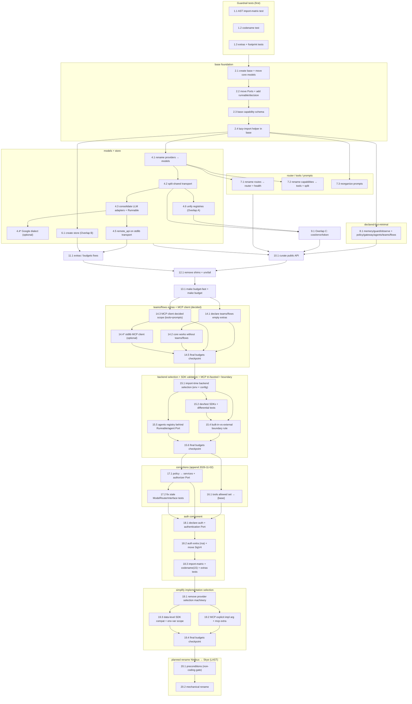

# Implementation Plan: structure

## Overview

This plan executes the target module and folder structure defined in `design.md`, governed by the testable requirements in `requirements.md` (the source of truth). It is a **structure-only migration**: it moves and renames packages and declares boundaries. It introduces **no behavior change** — every code-moving step is a pure structural move.

### Overall ordering principle (read this first)

- **Every task leaves the test suite green and the budgets green.** Run `make budget-fast` locally after each task; `make budget` green is part of the definition of done.
- **Guardrail tests come first.** The AST import-matrix test, the codename test, and the extras/footprint tests are written before any move, so the target structure is enforced from the first step. The three known import violations (`completion` → `capabilities`, `providers` → `capabilities`, `interfaces` → `memory`) are marked known-failing (xfail) until the moves remove them.
- **Moves use `git mv` plus TEMPORARY re-exports.** Each code-moving task is: `git mv` the files to the new location → add a temporary re-export shim at the old import path → update references → run tests and budgets. A later task (Group 10) removes every shim once all call sites use the new paths. Nothing breaks mid-migration.
- **No behavior change.** A move never edits logic; it only changes where code lives and how it is imported. Where a split is required (e.g. `providers/base.py`), the split preserves behavior and only separates responsibilities into new modules.
- **No source change in a non-coding sense.** Every task below is a concrete coding step (write a test, `git mv`, add a shim, update imports, adjust `budgets.toml`). There are no research, deployment, or manual-testing tasks.

## Tasks

- [x] 1. Guardrail tests first (enforce the structure before any move)
  - [x] 1.1 Write the AST import-matrix test
    - Create a deterministic test modeled on `tests/budget/test_policy.py` that parses every module under `src/nimbus` with the `ast` module and resolves each import to its owning Component and Layer.
    - Encode the 4 Layers (`base=0`, `adapters=1`, `services=2`, `runtime=3`) and the per-Component `Allowed_Imports_Matrix` from the design.
    - Enforce the three conditions: (i) no upward import (Layer ceiling), (ii) no out-of-set import — including that `teams`/`flows` must NOT import `models`, (iii) no orchestrator cross-import among `agents`/`teams`/`flows`.
    - On violation, report the importing Component+Layer and the imported Component+Layer, and exit non-zero.
    - Mark the three known violations (`completion` → `capabilities`, `providers` → `capabilities`, `interfaces` → `memory`) as known-failing/xfail; they are expected to fail until the moves remove them.
    - _Requirements: 2.3, 2.5, 2.6, 2.7, 12.3, 12.6, 12.8, 12.9_

  - [x] 1.2 Write the codename test
    - Create a deterministic test asserting the 14 Component Codenames each match `^[a-z]{3,7}$`, are unique, number exactly 14, and never appear in any package name, file name, or import.
    - Check the `Runnable` conceptual codename `vapor` separately: it matches `^[a-z]{3,7}$` and is unique with respect to the 14, and is NOT counted in the "exactly 14 entries" invariant.
    - On violation, report the offending Codename and location and fail.
    - _Requirements: 9.2, 9.3, 9.6, 9.7, 9.8, 9.9_

  - [x] 1.3 Write the extras-declare-exactly test and the clean-import/footprint test
    - Write the extras-declare-exactly test: compare each Extra's declared libraries against the third-party libraries its Component's code imports, reusing the `[imports.max_files]` machinery in `budgets.toml`; report any missing or unused declaration.
    - Write the clean-import/footprint test modeled on `tests/budget/test_footprint_budget.py`: a fresh `import nimbus` imports nothing in `forbidden_at_import`, stays within `max_modules_loaded` and `max_import_ms`, and tracks `known_leaks`/`known_import_failures`.
    - _Requirements: 7.1, 7.2, 7.3, 7.6, 8.1, 8.6_

- [x] 2. Create the base package foundation
  - [x] 2.1 Create the `base` package and move core models
    - Create `nimbus/base/__init__.py`.
    - `git mv` `messages.py`, `completion.py`, `exceptions.py`, `config.py` into `nimbus/base/`.
    - Add temporary re-export shims at the old top-level paths so existing imports keep working.
    - _Requirements: 3.1, 3.2_

  - [x] 2.2 Move the Ports into `base/interfaces` and add the new Ports
    - `git mv` `interfaces/*` into `nimbus/base/interfaces/` with temporary re-export shims at the old paths.
    - Add `base/interfaces/runnable.py` (the single `Runnable` Port: one input → one output) and `base/interfaces/decision.py` (the `DecisionModel` Port).
    - Keep the memory **Port** in `base/interfaces/memory.py`; the memory implementation stays in the `memory` Component, removing the `interfaces` → `memory` import.
    - _Requirements: 3.2, 3.3, 4.4, 12.1_

  - [x] 2.3 Add the pure capability schema to base
    - Create `nimbus/base/capability_schema.py` as a pure contract (name, description, parameter schema), standard library only.
    - Update `base/completion.py` to reference the base capability schema instead of the `capabilities`/`tools` Component, removing the `completion` → `capabilities` violation.
    - _Requirements: 2.7_

  - [x] 2.4 Move the lazy-import helper into base as a thin wrapper
    - Reduce `providers/lazy_import.py` to a thin `missing_extra` helper in `base` over stdlib `importlib`, raising `MissingExtraError` (a `NimbusError` subclass) that wraps the underlying `ImportError`/`ModuleNotFoundError` and names the missing Extra.
    - Keep a temporary re-export at the old path for call sites not yet updated.
    - _Requirements: 6.2, 6.3_

- [x] 3. Checkpoint - Ensure all tests pass
  - Ensure all tests pass and `make budget-fast` is green; ask the user if questions arise.

- [x] 4. models component (adapters) with the shared stdlib transport
  - [x] 4.1 Rename `providers` → `models`
    - `git mv` `providers/` to `nimbus/models/` with temporary re-export shims at the old `providers` import paths.
    - _Requirements: 1, 4.1_

  - [x] 4.2 Split the shared transport out of the base adapter
    - Split `providers/base.py` into `models/base.py` plus `models/transport/{http,streaming,sigv4,retry,error_mapping,token_counter,multimodal}.py`.
    - `http.py` uses stdlib `urllib.request` + `json`; `streaming.py` is a stdlib SSE (`text/event-stream`) parser; `sigv4.py` signs with stdlib `hashlib`/`hmac`/`datetime`; `retry.py` keeps the max-3-attempts policy; `error_mapping.py` and `token_counter.py` carry over the existing shared logic.
    - Preserve behavior — this is a responsibility split, not a rewrite.
    - _Requirements: 4.2, 4.3_

  - [x] 4.3 Consolidate the LLM adapters and implement the Runnable port
    - Collapse `openai_provider` + `azure_provider` into `models/llm/openai_compatible.py` (one parametrized adapter keyed by `base_url` + `api_key`).
    - Move `anthropic_provider` → `models/llm/anthropic.py` (Messages API over stdlib REST); move `bedrock_provider` → `models/llm/bedrock.py` (shared SigV4 signer, no boto3 required).
    - Make the model adapters implement the `Runnable` Port so a model is usable anywhere a `Runnable` is accepted.
    - _Requirements: 4.1, 4.8, 12.2, 12.7_

  - [x] 4.4* Stage the Google own-dialect adapter (formerly Vertex)
    - Add a Google adapter as its own dialect under `models/llm/google_provider.py` and `models/embeddings/google_*.py` rather than reusing the OpenAI-compatible path (recorded as an assumption in the design).
    - Rename note: Google renamed Vertex AI to Gemini Enterprise Agent Platform in April 2026, so the provider, the registered name and the extra are now `google` (class `GoogleProvider`; extra `google`). Read every `vertex`/`Vertex` in `requirements.md` and `design.md` as `google`. The SDK package stays `google-cloud-aiplatform`.
    - The module move and rename are already done in the working tree; what remains here is the own-dialect work (REST over the stdlib transport instead of the SDK).
    - _Requirements: 4.1_

  - [x] 4.5 Move remote_api onto the stdlib transport to eliminate the HTTP leak
    - Rewrite the `remote_api` HTTP calls to use the shared stdlib `urllib` transport so the `httpx`/`requests` imports are eliminated at the source (not merely deferred behind a lazy import).
    - Drive the `known_leaks` (`httpx`, `requests`) and `known_import_failures` entries toward empty as the imports disappear.
    - _Requirements: 7.4, 7.5_

  - [x] 4.6 Unify the two registries (Overlap A)
    - Keep the registry **Port** in `base/interfaces/registry.py` (merging `interfaces/route_registry.py`).
    - Place the single implementation in `models/registry.py` (merging `providers/registry.py`), consumed by the router through the base Port.
    - _Requirements: 10.1_

- [x] 5. Checkpoint - Ensure all tests pass
  - Ensure all tests pass and `make budget-fast` is green; ask the user if questions arise.

- [x] 6. store component (Overlap B)
  - [x] 6.1 Create the shared `store` Component
    - Create `nimbus/store/` and move `routes/storage_backends.py` into `store/{memory,file,dynamodb,redis}.py`, each backend a distinct module behind the storage Port in `base`.
    - Designate DynamoDB the first-choice durable backend; prefer the pure-Python driver where a backend offers both pure-Python and compiled drivers.
    - Add temporary re-export shims at the old `routes/storage_backends.py` path.
    - _Requirements: 5.1, 5.2, 5.4, 5.5, 5.6, 10.2_

- [x] 7. router / tools / prompts (services)
  - [x] 7.1 Rename `routes` → `router` and merge health tracking
    - `git mv` `routes/` to `nimbus/router/` with temporary re-export shims.
    - Merge `providers/health.py` into `router/health_tracker.py`, since health is consumed by routing.
    - _Requirements: 1, 10_

  - [x] 7.2 Rename `capabilities` → `tools` and split the capability models
    - `git mv` `capabilities/` to `nimbus/tools/` with temporary re-export shims.
    - Split `capability_models.py`/`schema.py` so the pure schema lives in `base/capability_schema.py` and the runtime pieces (registry, handler, decorator, MCP client) stay in `tools`.
    - _Requirements: 1, 2.7_

  - [x] 7.3 Reorganize the prompts Component
    - Reorganize `prompts/` into `loaders.py`, `messages.py`, and `templates/`, reusing the liteprompt design (loaders, role-based messages, registry, truncation) but NOT its Jinja2 engine — recorded as a target direction.
    - _Requirements: 1_

- [x] 8. Declared-but-minimal packages
  - [x] 8.1 Ensure the declared-but-minimal packages exist
    - Ensure `memory`, `guard`, `observe` exist as declared-but-minimal packages (each with `__init__.py`).
    - Create the NEW `policy`, `gateway`, `agents`, `teams`, `flows` packages as declared-but-minimal; `teams` and `flows` are runtime orchestrators whose detailed content belongs to their own specs.
    - _Requirements: 6.7, 2.2_

- [x] 9. Overlap C consolidation (cost, error, token)
  - [x] 9.1 Place the cost/error/token Ports in base and impls in models/transport
    - Keep the `cost_calculator`, `error_handler`, and `token_counter` **Ports** in `base/interfaces/`.
    - Place the implementations in `models/transport/` (cost impl, `error_mapping.py`, `token_counter.py`), each concept in exactly one port location and one implementation location.
    - _Requirements: 10.3_

- [x] 10. Curate the public API
  - [x] 10.1 Reduce `nimbus/__init__.py` to the curated four
    - Reduce the top-level re-export set to exactly `messages`, `completion`, `exceptions`, `config`.
    - Remove any re-export that would cause an optional or provider library to be imported, so `import nimbus` in a core-only install pulls no optional/provider library.
    - _Requirements: 6.5, 6.6, 7.1_

- [x] 11. extras / budgets fixes
  - [x] 11.1 Correct the `memory` Extra and align all Extras
    - Remove `psycopg2-binary` (unused, LGPL) from the `memory` Extra and declare `asyncpg`.
    - Make each Extra declare exactly the libraries its Component's code imports, respecting the dependency preference order (stdlib first, then runtime-present libs, then pure-Python, compiled last).
    - Update `budgets.toml` (`[imports.max_files]`, `known_leaks`, `known_import_failures`) to match the new structure.
    - _Requirements: 8.1, 8.2, 8.3, 8.4, 8.5_

- [x] 12. Remove the temporary re-export shims
  - [x] 12.1 Update all call sites to the new paths and delete the shims
    - Update every remaining reference to use the new Component import paths.
    - Delete all temporary re-export shims added during the migration.
    - Remove the xfail marks for the three known violations (`completion` → `capabilities`, `providers` → `capabilities`, `interfaces` → `memory`), now resolved.
    - Ensure the AST import-matrix test, the codename test, the extras-declare-exactly test, and the footprint test are all green.
    - _Requirements: 2.6, 2.7, 6.5, 7.1_

- [x] 13. Final checkpoint - budgets green
  - [x] 13.1 Run the full budget suite
    - Run `make budget-fast` and `make budget`; the whole suite green (all guardrail tests plus budgets) is the definition of done.
    - _Requirements: 2.6, 7.3, 8.6_

- [x] 14. teams/flows extras and MCP client (decided parts only)
  - [x] 14.1 Declare the `teams` and `flows` extras as empty extras
    - Add `[project.optional-dependencies].teams` and `[project.optional-dependencies].flows` to `pyproject.toml`, each with zero third-party libraries, installable as `nimbus[teams]` / `nimbus[flows]`.
    - Add `teams` and `flows` to `[extras_policy].known_empty` in `budgets.toml` (joining agents/guard/prompts).
    - Add `teams` and `flows` rows to the extras table / packaging surface so they are covered by the optional-module packaging rules like every other extra.
    - Verify installing `teams` does not pull `flows` and vice versa; the extras-declare-exactly and known_empty budget tests pass.
    - _Requirements: 14.1, 14.2, 14.4, 14.5, 14.6_
  - [x] 14.2 Confirm core works with neither teams nor flows installed
    - Verify `import nimbus` never imports the `teams` or `flows` implementation modules, and that the clean-import and AST import-matrix tests pass with neither extra present (they are optional exactly like `agents`).
    - _Requirements: 14.7_
  - [x] 14.3 Build the tri-faceted MCP client in `tools` (built-in + fastmcp behind one Port)
    - Implement the MCP client inside the `tools` Component exposing tools, prompts, and resources: return Nimbus `Capability` objects for tools, Nimbus prompt objects reusing the `prompts` prompt type, and a `Resource` type defined internal to `tools` (no base Port, no new Component).
    - Provide a built-in standard-library JSON-RPC-over-HTTP MCP client and a `fastmcp`-backed implementation behind the same Port, returning identical Nimbus types; convert any `mcp.types.*`/`fastmcp` protocol type to the Nimbus type at exactly one boundary point so no protocol type leaks outside `tools`. Cover 100% of the fields/behaviors Nimbus consumes; reject malformed/absent required fields at the boundary with an error naming the type and field.
    - Associate the MCP dependency (`fastmcp` today) with the `tools` Extra: installing `nimbus[tools]` provides MCP and `fastmcp` is the optional full-capability alternative to the built-in client. There is no separate `mcp` extra and MCP is not folded into `gateway` (supersedes the interim gateway decision).
    - Extend the AST import-matrix test: `tools → prompts` is an allowed peer import (for the MCP prompt facet); `gateway → prompts` is not required for MCP. Selection between built-in and fastmcp follows task 15.1 (import-time, env/config).
    - _Requirements: 19.1, 19.2, 19.3, 19.4, 19.5, 19.6, 19.7, 19.8, 19.9, 19.10_
  - [x] 14.4 Prototype the standard-library MCP client (future target, optional)
    - Optionally stage a standard-library MCP client (JSON-RPC over stateless HTTP) on top of `models/transport/http.py`, aiming to drive the `mcp` extra toward zero third-party libraries. Optional because it is a future target, not a current requirement; the `fastmcp` extra remains until this lands.
    - _Requirements: 15.4_
  - [x] 14.5 Final budgets checkpoint for the appended work
    - Run `make budget-fast` and `make budget`; the whole suite green (new empty-extra entries plus the MCP decided-scope matrix rule) is the definition of done for this group.
    - _Requirements: 14.1, 15.6_

- [x] 15. Backend selection, dev/test SDK validation, MCP tri-faceted client, boundary adapters
  - [x] 15.1 Implement import-time backend selection via env + config (no user code change)
    - Add a single selection mechanism, per backend, choosing the built-in standard-library implementation or a vendor/external implementation behind the same Port; both expose identical signatures/return types.
    - Read the choice from an environment variable (e.g. `NIMBUS_<BACKEND>_IMPL` = `builtin`|`sdk`) and from the config file (e.g. `nimbus.yaml`), with the environment variable taking precedence and an optional global default; default to `builtin` when unspecified.
    - Decide once at import/construction; use one implementation for the whole life of the instance; no per-call fallback and no runtime switching. A selected SDK's runtime error maps to a Nimbus error and propagates.
    - Emit exactly one import-time warning if the installed SDK version differs from the dev-validated reference version; emit a warning on fallback when a requested SDK fails to import; never import a vendor SDK unless selected.
    - _Requirements: 17.1, 17.2, 17.3, 17.4, 17.5, 17.6, 17.7, 17.8, 17.9, 17.10_
  - [x] 15.2 Add official SDKs as dev/test-only dependencies and write differential tests
    - Declare official vendor SDKs (and `fastmcp`) in a dev/test dependency group (e.g. `[dependency-groups].dev`), never in `[project.optional-dependencies]` for validation and never as a runtime dependency.
    - Write differential tests that run the same input through the built-in implementation and the SDK implementation and assert equivalence on the subset Nimbus consumes: exact structured fields (field-subset), numeric epsilon for numeric/timing values, error-category-level equivalence; not 1:1 with the full SDK surface.
    - Keep the core-only footprint/clean-import/forbidden_at_import tests in a separate SDK-free environment; ensure SDK presence in dev/CI does not fail them. Allow differential tests needing live credentials/network to skip without failing the suite.
    - _Requirements: 18.1, 18.2, 18.3, 18.4, 18.5, 18.6, 18.7_
  - [x] 15.4 Enforce the general built-in-vs-external-library boundary rule
    - Add a test/check asserting no external-library type (provider SDK types, `mcp`/`fastmcp` protocol types) is exposed outside its owning Component — external types are converted to Nimbus types at a single boundary point; both impls sit behind the same Port returning identical Nimbus types.
    - Confirm the rule holds for `models` (REST vs SDK) and `tools` (built-in vs fastmcp); document it as the pattern for future `observe`/`store`/`prompts`/`agents` external backends without new Component/Port.
    - _Requirements: 20.1, 20.2, 20.3, 20.4, 20.5_
  - [x] 15.5 Expose agent types via the agents registry behind the Runnable/agent Port
    - Ensure `agents` exposes its agent types (e.g. a ReAct agent) through the agents registry behind the `Runnable`/agent Port, extensible per the extension-point rule; concrete agent-type implementations are deferred to the future `agents` spec (only the registry/boundary is set up here).
    - _Requirements: 20.6, 13.1_
  - [x] 15.6 Final budgets checkpoint for this group
    - Run `make budget-fast` and `make budget`; the full suite green (selection mechanism, differential tests in dev env, MCP client, boundary-leak check) is the definition of done for this group.
    - _Requirements: 17.3, 18.4, 19.8_

- [ ] 16. Correction: `tools` does not import `prompts` (append 2026-11-02)
  - [ ] 16.1 Set the `tools` allowed set back to `{base}` and update the matrix test
    - The code change and the import-matrix test change are **already made**; this task records them in the plan. Leave unchecked.
    - `tools` does NOT import the `prompts` Component. The MCP prompt facet uses only the message types defined in `base` (`NimbusMessage`, `UserMessage`, `AssistantMessage` in `base/messages.py`, which `prompts/messages.py` merely re-exports) and the `MCPPrompt` descriptor defined in `tools`. Reusing the prompt abstraction means reusing the `PromptBuilderInterface` Port and the `base` message types, not importing `prompts`.
    - Set the `tools` allowed set in `tests/budget/test_import_matrix.py` (`ALLOWED`) back to `{base}` and assert any `tools → prompts` import is a violation. This supersedes the `tools → prompts` clause of Requirement 19.2 and task 14.3's "`tools → prompts` is an allowed peer import" statement (that earlier task stays checked as history).
    - _Requirements: 28.1, 28.2, 28.3, 28.4_

- [ ] 17. Correction: `policy` is a service; runtime never imports optional services (append 2026-11-02)
  - [ ] 17.1 Move `policy` to the services Layer and add the authorizer Port to `base`
    - This is an owner decision not yet in the code; the import-matrix test is updated together with it.
    - Move `policy` from the runtime Layer to the services Layer (Layer 2), next to `guard`; its allowed imports stay `{base, models}`. Current layers: services = `router`, `tools`, `prompts`, `memory`, `guard`, `observe`, `policy`; runtime = `gateway`, `agents`, `teams`, `flows`.
    - Add an **authorizer Port** to `base` (an authorizer: may this principal perform this action on this resource → a decision of `{permit, forbid}`), implemented by `policy`. List it in the contents of `base`.
    - Update `LAYER` and `ALLOWED` in `tests/budget/test_import_matrix.py`: place `policy` in the services Layer and remove `policy`, `guard`, `observe`, and `memory` from the `gateway`, `agents`, `teams`, and `flows` rows (the runtime receives these optional services through `base` Ports/hooks, never by import). Ensure no runtime package imports the four optional services.
    - _Requirements: 21.1, 21.2, 21.3, 21.4, 21.5, 21.6, 21.7, 21.8_
  - [ ] 17.2 Fix two stale unit tests so `tests/unit` is fully green
    - `ModelRouterInterface` (`base/interfaces/router.py`) has abstract `complete` and `acomplete` (added in the January 2026 routing commit); the test classes `CompleteRouter` and the other in `tests/unit/test_interfaces.py` do not implement them, so Python cannot instantiate them. The interface is correct: add `complete` and `acomplete` stubs to the test classes so `::test_model_router_interface_abstract_methods` and `::test_complete_implementation_works` pass.
    - _Requirements: 3_

- [ ] 18. New component `auth` (authentication and credentials) (append 2026-11-02)
  - [ ] 18.1 Declare `auth` as a Layer-0 package and add the authentication Port to `base`
    - Create `src/nimbus/auth/__init__.py` (empty `__init__` this phase; strategies and sources are the authentication milestone of the `auth` and `models` specs, not this run).
    - Add the **authentication Port** to `base` (an object that applies authentication to a request by adding headers or signing it); `auth` supplies the implementations. Narrow the no-I/O rule: Requirement 2.4/3.4 apply to the `base` Component, not the whole Layer 0 (`auth` does I/O and needs `rsa`).
    - _Requirements: 22.1, 22.2, 22.3, 22.4_
  - [ ] 18.2 Add the `auth` extra and move the SigV4 signer into `auth`
    - Add the `auth` extra to `pyproject.toml` declaring only `rsa` (RS256), with its own budget in `budgets.toml`; the `google` extra declares only the provider SDK, not `rsa`.
    - Move the SigV4 signer from `models/transport/sigv4.py` into the `auth` Component.
    - Record the native cloud secret-manager credential sources (AWS Secrets Manager, AWS SSM Parameter Store, Azure Key Vault, Google Secret Manager) plus the extensible credential-source Port in `auth` (the credential-provider extension point, Requirement 22.10) as owned by `auth`; a secret-manager source calls over `base/http.py` authenticated with the `auth` strategies. Implementation of the strategies/sources is the `auth`/`models` milestone, not this run.
    - _Requirements: 22.7, 22.8, 22.9, 22.10_
  - [ ] 18.3 Update the import matrix, codename test, and extras tests for `auth`
    - Update `tests/budget/test_import_matrix.py` (`LAYER` and `ALLOWED`): `auth` in Layer 0 importing only `base`; `models`, `store`, `tools` may import `auth`; `gateway` may import `auth`; `memory` may import `auth`; the only same-Layer import is importing `base` (incl. `auth → base`).
    - Update the codename test to assert exactly **15** entries including `auth = ozone`, and keep `vapor` (and, after the rename, `nimbus`) checked separately and not counted in the 15.
    - Update the extras tests so the `auth` extra declares exactly `rsa`.
    - _Requirements: 22.5, 22.6, 22.14, 22.15, 22.16, 22.17_

- [ ] 19. Simplify implementation selection (append 2026-11-02)
  - [ ] 19.1 Remove the model-provider selection machinery (one implementation per provider)
    - Each model provider has exactly one active implementation (the built-in standard-library adapter); no selection machinery, no SDK on the runtime path.
    - Remove `base/backend_select.py`, `base/sdk_versions.py`, `load_impl_config` and the `impl` handling in `base/config.py`, the `impl_backend` handling and the selection in `models/base.py` and the adapters, and `tests/unit/test_backend_select.py`. Keep `tests/differential`. Update `budgets.toml` and the extras tests accordingly. This supersedes Requirement 17 for model providers; task 15.1 stays checked as history.
    - _Requirements: 24.1, 24.2, 24.3, 24.4, 24.5, 24.6, 24.7_
  - [ ] 19.2 Make the MCP client choice an explicit argument and split out the `mcp` extra
    - Keep the explicit `impl` argument on `create_mcp_client(target, impl="builtin")`: default `"builtin"`, only other accepted value `"fastmcp"`; no environment variable, no config entry, no fallback. Remove the `NIMBUS_MCP_IMPL` reading from `tools/mcp_client.py`. If `fastmcp` is requested and not installed, raise `MissingExtraError` naming the extra `mcp`; reject any other `impl` value with an error.
    - Keep `fastmcp` in a **separate `mcp` extra** (own budget in `budgets.toml`); `tools` carries no third-party library. This supersedes the clause of Requirement 19.7 and task 14.3 that associated `fastmcp` with the `tools` extra (that earlier task stays checked as history). Keep the differential tests between the two MCP clients.
    - Scope the built-in MCP client to consume-only over HTTP (no stdio transport, no subprocess, never starts a server); update `budgets.toml` and the extras tests accordingly.
    - _Requirements: 25.1, 25.2, 25.3, 25.4, 25.5, 25.6, 25.7, 25.8, 25.9, 25.10_
  - [ ] 19.3 Record data-level SDK compatibility and the Nimbus-prefixed env-var scope
    - Accept messages and tool definitions in the OpenAI data shape and return Nimbus types; do not mirror or re-export vendor SDK classes; reject non-conforming input with a field/shape error. The bring-your-own `Runnable` adapter is the only vendor-SDK path on the runtime path (zero config, zero env, zero registration).
    - Read provider credentials only from each provider's standard variables (`OPENAI_API_KEY`, `ANTHROPIC_API_KEY`, `AWS_*`, `GOOGLE_*`, `AZURE_*`) through `auth`; keep exactly three Nimbus-prefixed variables: `NIMBUS_LOG_LEVEL`, `NIMBUS_CONFIG`, `NIMBUS_ENABLE_TELEMETRY` (this also bounds the rename scope). Requirement 20 is unchanged.
    - _Requirements: 26.1, 26.2, 26.3, 26.4, 26.5, 27.1, 27.2, 27.3, 27.4, 27.5, 27.6_
  - [ ] 19.4 Final budgets checkpoint for the selection-simplification group
    - Run `make budget-fast` and `make budget`; the whole suite green (no selection machinery, `mcp` extra split out, env-var scope) is the definition of done for this group.
    - _Requirements: 24.7, 25.7_

- [ ] 20. Planned project rename Nimbus → Skye (append 2026-11-02, executed LAST)
  - [ ] 20.1 Preconditions (non-coding; gate for the whole group)
    - Not a coding task. Confirm: all previous task groups are closed; the owner has checked the trademark of "Skye" in software; the owner has reserved `skyeai` (and `skye-ai`) on PyPI. This group runs only after every other group, including group 19.
    - _Requirements: 23.5_
  - [ ] 20.2 Execute the mechanical rename
    - `src/nimbus → src/skye` and every import; the classes `NimbusMessage`, `NimbusError`, `NimbusConfig` and any other `Nimbus*` name → `Skye*`; the three env vars `NIMBUS_LOG_LEVEL`, `NIMBUS_CONFIG`, `NIMBUS_ENABLE_TELEMETRY` → `SKYE_*`; `nimbus.yaml → skye.yaml`; the project name in `pyproject.toml → skyeai`; and the occurrences in `budgets.toml`, CI, CODEOWNERS, the Makefile, the specs, the steering, the wiki, the examples, and the README. The GitHub repository rename is done by the owner (the platform redirects the old address).
    - Adapt the codename test to the new names; record `nimbus` as the project-wide umbrella watermark (documentation-only, outside the 15 Component Codenames, like `vapor`).
    - Definition of done: `make budget-fast`, `make budget`, `make differential`, and the guardrail tests give the same results as before the rename.
    - _Requirements: 23.1, 23.2, 23.3, 23.4, 23.6, 23.7_

## Notes

- Tasks marked with `*` are optional and can be skipped for a faster first pass (for example task 4.4, the Google own-dialect adapter, and task 14.4, the standard-library MCP client prototype).
- **Groups 16–20 (append 2026-11-02)** are new and unchecked. They correct or supersede decisions made in earlier groups without editing any earlier task or checkbox: group 16 (`tools` does not import `prompts`, superseding 19.2 / task 14.3's peer-import note), group 17 (`policy` → services; stale-test fix), group 18 (new `auth` component), group 19 (one implementation per provider, superseding Requirement 17 / task 15.1; MCP by explicit argument with a separate `mcp` extra, superseding the `fastmcp`-under-`tools` clause of task 14.3). Group 20 (the rename) is always the LAST group and runs only after group 19.
- Each task references specific requirements for traceability.
- Checkpoints ensure incremental validation; the suite and `make budget-fast` must be green at each one.
- The migration never changes behavior — every code-moving task is `git mv` + a temporary re-export + a reference update; the temporary re-export shims are removed in task 12.1.

## Task Dependency Graph

Execution waves (tasks within a wave are independent and can run in parallel; a wave runs only after all earlier waves complete):

```json
{
  "waves": [
    { "id": 0, "tasks": ["1.1", "1.2", "1.3"] },
    { "id": 1, "tasks": ["2.1"] },
    { "id": 2, "tasks": ["2.2"] },
    { "id": 3, "tasks": ["2.3", "2.4"] },
    { "id": 4, "tasks": ["4.1", "6.1", "7.3", "8.1"] },
    { "id": 5, "tasks": ["4.2", "7.1", "7.2"] },
    { "id": 6, "tasks": ["4.3", "4.5", "4.6"] },
    { "id": 7, "tasks": ["4.4", "9.1"] },
    { "id": 8, "tasks": ["10.1"] },
    { "id": 9, "tasks": ["11.1"] },
    { "id": 10, "tasks": ["12.1"] },
    { "id": 11, "tasks": ["13.1"] },
    { "id": 12, "tasks": ["14.1", "14.3"] },
    { "id": 13, "tasks": ["14.2", "14.4"] },
    { "id": 14, "tasks": ["14.5"] },
    { "id": 15, "tasks": ["15.1"] },
    { "id": 16, "tasks": ["15.2"] },
    { "id": 17, "tasks": ["15.4", "15.5"] },
    { "id": 18, "tasks": ["15.6"] },
    { "id": 19, "tasks": ["16.1", "17.1", "17.2"] },
    { "id": 20, "tasks": ["18.1"] },
    { "id": 21, "tasks": ["18.2", "18.3"] },
    { "id": 22, "tasks": ["19.1", "19.2", "19.3"] },
    { "id": 23, "tasks": ["19.4"] },
    { "id": 24, "tasks": ["20.1"] },
    { "id": 25, "tasks": ["20.2"] }
  ]
}
```

Notes on the appended waves (19–25): group 16 (`tools→{base}`) and group 17 (`policy`→services, stale-test fix) are independent of each other and run first in wave 19. The `auth` component (18) follows: 18.1 declares the package and the authentication Port (wave 20), then 18.2/18.3 add the extra, move SigV4, and update the tests (wave 21). The selection-simplification group (19) runs next (its three content tasks in wave 22, its budgets checkpoint in wave 23). The rename group (20) is strictly last: its precondition gate (20.1, wave 24) then the mechanical rename (20.2, wave 25).

The same ordering as a diagram:


