# Implementation Plan: structure

## Overview

This plan executes the target module and folder structure defined in `design.md`, governed by the testable requirements in `requirements.md` (the source of truth; requirements are cited by number). It is a **structure-only migration**: it moves and renames packages and declares boundaries, with no behavior change beyond what the requirements state.

Groups 1–8 are complete and verified (`tests/budget` and `tests/unit` green: 1151 passed). Group 9 (documentation/comment cleanup) is open. Group 10 (the planned rename) is the last group and runs only after every other group is closed.

### Ordering principle

- **Every task leaves the test suite green and the budgets green.** Run `make budget-fast` after each task; `make budget` green is part of the definition of done.
- **Guardrail tests first.** The AST import-matrix test, the codename test, and the extras/footprint tests enforce the structure from the first step.
- **Moves use `git mv` plus temporary re-exports,** removed once every call site uses the new paths. A move never edits logic.

## Tasks

- [x] 1. Guardrail tests first (enforce the structure before any move)
  - [x] 1.1 AST import-matrix test
    - Deterministic test (`tests/budget/test_import_matrix.py`) modeled on `tests/budget/test_policy.py`: parse every module under `src/nimbus` with `ast`, resolve each import to its owning Component and Layer, and enforce (i) no upward import (Layer ceiling), (ii) membership in each Component's `ALLOWED` set, (iii) no orchestrator cross-import among `agents`/`teams`/`flows`. Report importer and imported Component+Layer; exit non-zero on violation. Mark the three known violations (`completion → capabilities`, `providers → capabilities`, `interfaces → memory`) xfail until the moves remove them.
    - _Requirements: 2_
  - [x] 1.2 Codename test
    - `tests/budget/test_codenames.py`: assert each Codename matches `^[a-z]{3,7}$`, uniqueness, and no Codename in a package/file/import name; check `vapor` (and later `nimbus`) separately, not counted in the entry total.
    - _Requirements: 9_
  - [x] 1.3 Extras-declare-exactly and clean-import/footprint tests
    - `tests/budget/test_extras_footprint.py` / `test_footprint_budget.py`: each Extra declares exactly the third-party libraries its code imports; a fresh `import nimbus` imports nothing in `forbidden_at_import`, stays within `max_modules_loaded` (340) and `max_import_ms` (250), and tracks `known_leaks`/`known_import_failures`.
    - _Requirements: 6, 7, 8_

- [x] 2. Base package foundation
  - [x] 2.1 Create `base` and move the core models
    - Create `nimbus/base/__init__.py`; `git mv` `messages.py`, `completion.py`, `exceptions.py`, `config.py` into `nimbus/base/` with temporary re-export shims at the old paths.
    - _Requirements: 3_
  - [x] 2.2 Move the Ports into `base/interfaces` and add the new Ports
    - `git mv` `interfaces/*` into `nimbus/base/interfaces/` with shims; add `runnable.py` (the single `Runnable` Port) and `decision.py` (the `DecisionModel` Port); keep the memory Port in `base/interfaces/memory.py` while the memory impl stays in `memory`, removing the `interfaces → memory` import.
    - _Requirements: 3, 4, 11_
  - [x] 2.3 Add the pure capability schema to base
    - Create `base/capability_schema.py` (pure contract, stdlib only); update `base/completion.py` to reference it instead of `capabilities`/`tools`, removing the `completion → capabilities` violation.
    - _Requirements: 2, 3_
  - [x] 2.4 Lazy-import helper in base
    - Reduce `providers/lazy_import.py` to a thin `missing_extra` helper in `base` over stdlib `importlib`, raising `MissingExtraError` (a `NimbusError`) that wraps the underlying `ImportError`/`ModuleNotFoundError` and names the missing Extra.
    - _Requirements: 6_
  - [x] 2.5 The single stdlib HTTP transport lives in base
    - Create `base/http.py` as the one standard-library-only HTTP transport (`urllib`/`http.client`, `json`), the sanctioned exception to the base no-I/O rule; `models/transport/http.py` re-exports it. Shared by `models`, `tools`, and `auth`.
    - _Requirements: 2, 3_

- [x] 3. Checkpoint — tests pass
  - `make budget-fast` green.

- [x] 4. models component with the shared stdlib transport
  - [x] 4.1 Rename `providers` → `models`
    - `git mv` `providers/` to `nimbus/models/` with shims at the old paths.
    - _Requirements: 1, 4_
  - [x] 4.2 Split the shared transport out of the base adapter
    - Split `providers/base.py` into `models/base.py` plus `models/transport/{http,streaming,retry,error_mapping,token_counter,multimodal}.py`; `http.py` re-exports `base/http.py`; `streaming.py` is a stdlib SSE parser; `retry.py` keeps the max-3-retries policy. Behavior-preserving split.
    - _Requirements: 4_
  - [x] 4.3 Consolidate the LLM adapters and implement Runnable
    - Collapse `openai_provider` + `azure_provider` into `models/llm/openai_compatible.py`; move `anthropic_provider → models/llm/anthropic.py` and `bedrock_provider → models/llm/bedrock.py` (via the SigV4 signer, no boto3 required); make the model adapters implement the `Runnable` Port.
    - _Requirements: 4, 11_
  - [x] 4.4 Google own-dialect adapter (formerly Vertex)
    - `models/llm/google_provider.py` and `models/embeddings/google_*.py` as their own dialect; class `GoogleProvider`, registered name `"google"`, extra `google` (Assumption A6; SDK package stays `google-cloud-aiplatform`).
    - _Requirements: 4_
  - [x] 4.5 Move remote_api onto the stdlib transport (eliminate the HTTP leak)
    - Rewrite `tools/remote_api.py` to use the shared stdlib transport so the `httpx`/`requests` imports are removed at the source; drive `known_leaks`/`known_import_failures` toward empty.
    - _Requirements: 7_
  - [x] 4.6 Unify the two registries (Overlap A)
    - Registry Port in `base/interfaces/registry.py` (merging `interfaces/route_registry.py`); single implementation in `models/registry.py` (merging `providers/registry.py`), consumed by the router through the base Port.
    - _Requirements: 10_

- [x] 5. store, router, tools, prompts, declared-but-minimal, Overlap C
  - [x] 5.1 Create the shared `store` Component (Overlap B)
    - Create `nimbus/store/` and move `routes/storage_backends.py` into `store/{memory,file,dynamodb,redis}.py`, each behind the storage Port in `base`; DynamoDB is the first-choice durable backend; prefer the pure-Python driver. Shims at the old path.
    - _Requirements: 5, 10_
  - [x] 5.2 Rename `routes` → `router` and merge health tracking
    - `git mv` `routes/` to `nimbus/router/` with shims; merge `providers/health.py` into `router/health_tracker.py`.
    - _Requirements: 1, 10_
  - [x] 5.3 Rename `capabilities` → `tools` and split the capability models
    - `git mv` `capabilities/` to `nimbus/tools/` with shims; split `capability_models.py`/`schema.py` so the pure schema lives in `base/capability_schema.py` and the runtime pieces (registry, handler, decorator, MCP client) stay in `tools`.
    - _Requirements: 1, 2_
  - [x] 5.4 Reorganize the prompts Component
    - Reorganize `prompts/` into `loaders.py`, `messages.py`, `templates/`, reusing the liteprompt design but not its Jinja2 engine (recorded as a target direction).
    - _Requirements: 1_
  - [x] 5.5 Declared-but-minimal packages
    - Ensure `memory`, `guard`, `observe` exist as declared-but-minimal packages; create `policy`, `gateway`, `agents`, `teams`, `flows` as declared-but-minimal.
    - _Requirements: 6_
  - [x] 5.6 Overlap C consolidation (cost, error, token)
    - Keep the `cost_calculator`, `error_handler`, `token_counter` Ports in `base/interfaces/`; place the implementations in `models/transport/` (cost impl, `error_mapping.py`, `token_counter.py`), one port and one impl location each.
    - _Requirements: 10_

- [x] 6. Public API, extras/budgets, shim removal
  - [x] 6.1 Curate `nimbus/__init__.py`
    - Reduce the top-level re-export set to exactly `messages`, `completion`, `exceptions`, `config`; remove any re-export that would import an optional or provider library.
    - _Requirements: 6, 7_
  - [x] 6.2 Correct the `memory` Extra and align all Extras
    - Remove `psycopg2-binary` (unused, LGPL) from the `memory` Extra and declare `asyncpg`; make each Extra declare exactly the libraries its code imports, respecting the dependency preference order; update `budgets.toml` (`[imports.max_files]`, `known_leaks`, `known_import_failures`).
    - _Requirements: 8_
  - [x] 6.3 Remove the temporary re-export shims
    - Update every call site to the new Component paths; delete all shims; remove the xfail marks for the three known violations (now resolved); the import-matrix, codename, extras-declare-exactly, and footprint tests all green.
    - _Requirements: 2, 6, 7_
  - [x] 6.4 Budget checkpoint
    - `make budget-fast` and `make budget` green.
    - _Requirements: 7, 8_

- [x] 7. teams/flows extras, tri-faceted MCP client, SDK oracles, boundary rule, agents registry
  - [x] 7.1 Declare `teams` and `flows` as empty extras
    - `[project.optional-dependencies].teams` and `.flows` in `pyproject.toml`, each with zero third-party libraries, installable as `nimbus[teams]`/`nimbus[flows]`; both in `[extras_policy].known_empty` of `budgets.toml`; rows in the extras table; installing one never pulls the other. Verify `import nimbus` never imports `teams`/`flows` and the clean-import and import-matrix tests pass with neither present.
    - _Requirements: 13_
  - [x] 7.2 Tri-faceted MCP client in `tools`, built-in + fastmcp behind one Port
    - Build the MCP client in `tools` exposing tools (`Capability`), prompts (`base` messages via the `MCPPrompt` descriptor — no import of `prompts`), and resources (the `tools`-internal `Resource` type; no base Port, no new Component). Provide the built-in stdlib JSON-RPC-over-HTTP client (`mcp_server_client.py`, consume-only over HTTP) and a `fastmcp` client (`mcp_fastmcp.py`) behind one Port, with a single conversion point (`mcp_boundary.py`) so no `mcp.types.*` leaks outside `tools`; reject malformed/absent required fields at the boundary.
    - _Requirements: 15_
  - [x] 7.3 Official SDKs as dev/test oracles + differential tests
    - Declare official vendor SDKs (and `fastmcp`) only in the dev/test dependency group, never in `[project.optional-dependencies]` for validation; add `tests/differential/` (`test_models_differential.py`, `test_mcp_differential.py`) comparing the built-in and SDK implementations on the fields Nimbus consumes; keep the core-only footprint tests in an SDK-free environment; allow tests needing live credentials to skip.
    - _Requirements: 14_
  - [x] 7.4 General built-in-vs-external-library boundary rule
    - `tests/budget/test_boundary_rule.py` and `tests/differential/test_boundary_leak.py`: no external-library type (provider SDK types, `mcp`/`fastmcp` protocol types) is exposed outside its owning Component; both implementations sit behind the same Port returning identical Nimbus types. Document it as the pattern for future `observe`/`store`/`prompts`/`agents` backends.
    - _Requirements: 16_
  - [x] 7.5 Agents registry behind the Runnable/agent Port
    - `agents` exposes its agent types through its registry behind the `Runnable`/agent Port, extensible per Requirement 12; concrete agent types belong to the future `agents` spec (only the registry/boundary here).
    - _Requirements: 12, 16_
  - [x] 7.6 Budget checkpoint
    - `make budget-fast` and `make budget` green.
    - _Requirements: 7, 8_

- [x] 8. Corrections and simplifications
  - [x] 8.1 `tools` does not import `prompts`
    - `tools` allowed set is `{base, auth}`; `tests/budget/test_import_matrix.py` reports any `tools → prompts` import as a violation. The MCP prompt facet uses the `base` message types via the `MCPPrompt` descriptor, not the `prompts` Component.
    - _Requirements: 2, 15_
  - [x] 8.2 `policy` is a service; runtime never imports optional services
    - Move `policy` to the services Layer (`ALLOWED` `{base, models}`); add the authorizer Port to `base`; remove `policy`, `guard`, `observe`, `memory` from the `gateway`/`agents`/`teams`/`flows` rows of `LAYER`/`ALLOWED`; `tests/budget/test_import_matrix.py::test_policy_is_a_service_and_runtime_never_imports_optional_services` enforces it.
    - _Requirements: 2, 17_
  - [x] 8.3 Fix the stale `ModelRouterInterface` unit tests
    - The test classes in `tests/unit/test_interfaces.py` implement the abstract `complete`/`acomplete`, so `tests/unit` is fully green.
    - _Requirements: 3_
  - [x] 8.4 New component `auth`
    - Declare `auth` as a Layer-0 package importing only `base`; add the authentication Port to `base` (`interfaces/authentication.py`); move the SigV4 signer from `models/transport/sigv4.py` into `auth/sigv4.py`; declare the `auth` Extra with only `rsa` (own budget in `budgets.toml`); update `LAYER`/`ALLOWED` (auth=base; `models`/`store`/`tools`/`memory`/`gateway` may import `auth`), the codename test (15 entries, `auth = ozone`), and the extras tests. Strategies and credential sources (incl. native secret-manager sources and the extensible credential-source Port) are the `auth` and `models` specs, not this plan.
    - _Requirements: 2, 9, 12, 18_
  - [x] 8.5 One implementation per model provider (remove selection machinery)
    - Remove `base/backend_select.py`, `base/sdk_versions.py`, `load_impl_config` and the `impl` handling in `base/config.py`, the `impl_backend` handling and selection in `models/base.py` and the adapters, and `tests/unit/test_backend_select.py`; keep `tests/differential`; update `budgets.toml` and the extras tests.
    - _Requirements: 20_
  - [x] 8.6 MCP chosen by an explicit argument; separate `mcp` extra; consume-only
    - `create_mcp_client(target, impl="builtin")` is the only selection (`"fastmcp"` the only other value, `MissingExtraError` naming `mcp` if absent, error on any other value); remove the `NIMBUS_MCP_IMPL` reading from `tools/mcp_client.py`; `fastmcp` lives in a separate `mcp` Extra and `tools` carries no third-party library; the built-in MCP client is consume-only over HTTP (no stdio, no subprocess, never starts a server).
    - _Requirements: 15, 21_
  - [x] 8.7 Data-level SDK compatibility and environment-variable scope
    - `base/openai_shape.py`: accept the OpenAI data shape, return Nimbus types, mirror no vendor SDK class, reject non-conforming input; the bring-your-own `Runnable` adapter is the only vendor-SDK path. Read provider credentials only from provider-standard variables through `auth`; keep exactly three Nimbus-prefixed variables (`NIMBUS_LOG_LEVEL`, `NIMBUS_CONFIG`, `NIMBUS_ENABLE_TELEMETRY`), enforced by `tests/budget/test_env_vars.py`.
    - _Requirements: 22, 23_
  - [x] 8.8 Checkpoint
    - `make budget-fast`, `make budget`, and `tests/unit` green (verified 2026-11-02: 1151 unit and budget tests passed).
    - _Requirements: 2, 7, 8, 20, 21_

- [ ] 9. Documentation and comment alignment (no behavior change)
  - [ ] 9.1 Realign stale requirement-number references in code and tests
    - Code and test comments/docstrings still cite the pre-consolidation numbering (for example `Req 19`, `Req 25`, `Req 26`, `Req 27`, `Req 18` in `tools/mcp_client.py`, `tools/mcp_resource.py`, `tools/mcp_fastmcp.py`, `tools/mcp_boundary.py`, `prompts/messages.py`, `base/config.py`, `base/openai_shape.py`, `tests/differential/*`). Update each to the current numbering using the old→new map at the end of `requirements.md`. Comments only; no behavior change; the suite stays green.
    - _Requirements: 15, 18, 20, 21, 22, 23_
  - [ ] 9.2 Wiki glossary and docs sections for the new watermarks
    - In the documentation wiki, record `auth = ozone` in the codename glossary (15 entries), the `auth` and `policy` contrast (authentication vs authorization), and `nimbus` as the planned project-wide umbrella watermark (documentation-only, like `vapor`), in the four sanctioned Codename places only. Does not touch code or import paths.
    - _Requirements: 9, 18_

- [ ] 10. Planned project rename Nimbus → Skye (executed LAST)
  - [ ] 10.1 Preconditions (non-coding; gate for the whole group)
    - Not a coding task. Confirm: all previous task groups are closed; the owner has checked the trademark of "Skye" in software; the owner has reserved `skyeai` (and `skye-ai`) on PyPI.
    - _Requirements: 19_
  - [ ] 10.2 Execute the mechanical rename
    - `src/nimbus → src/skye` and every import; `NimbusMessage`/`NimbusError`/`NimbusConfig` and any other `Nimbus*` name → `Skye*`; the three env vars `NIMBUS_LOG_LEVEL`, `NIMBUS_CONFIG`, `NIMBUS_ENABLE_TELEMETRY` → `SKYE_*`; `nimbus.yaml → skye.yaml`; the project name in `pyproject.toml → skyeai`; and the occurrences in `budgets.toml`, CI, CODEOWNERS, the Makefile, the specs, the steering, the wiki, the examples, and the README. The GitHub repository rename is done by the owner (the platform redirects the old address).
    - Adapt the codename test to the new names; record `nimbus` as the project-wide umbrella watermark.
    - Definition of done: `make budget-fast`, `make budget`, `make differential`, and the guardrail tests give the same results as before the rename.
    - _Requirements: 19_

## Requirement coverage

Every requirement in `requirements.md` is realized by at least one task above:

| Requirement | Tasks |
|-------------|-------|
| 1 Component naming | 4.1, 5.2, 5.3, 5.4 |
| 2 Layer dependency rules | 1.1, 2.3, 2.5, 5.3, 6.3, 8.1, 8.2, 8.4 |
| 3 Base package contents and ports | 2.1, 2.2, 2.3, 2.5, 8.3 |
| 4 Models + DecisionModel port | 2.2, 4.1, 4.2, 4.3, 4.4 |
| 5 Shared store | 5.1 |
| 6 Optional-module packaging + lazy import | 1.3, 2.4, 5.5, 6.1, 6.3 |
| 7 Clean import | 1.3, 4.5, 6.1, 6.3, 6.4, 7.6 |
| 8 Extras declare exactly | 1.3, 6.2, 6.4, 7.6 |
| 9 Codename watermark | 1.2, 8.4, 9.2 |
| 10 Overlaps | 4.6, 5.1, 5.2, 5.6 |
| 11 Composition (Runnable) | 2.2, 4.3 |
| 12 Single extension point | 7.5, 8.4 |
| 13 Extras for teams/flows | 7.1 |
| 14 Official SDKs as dev/test oracles | 7.3 |
| 15 MCP client in tools | 7.2, 8.1, 8.6, 9.1 |
| 16 Built-in vs external-library boundary | 7.4, 7.5 |
| 17 Policy is a service; runtime isolation | 8.2 |
| 18 Auth component | 8.4, 9.1, 9.2 |
| 19 Planned rename Skye | 10.1, 10.2 |
| 20 One implementation per model provider | 8.5, 9.1 |
| 21 MCP by explicit argument | 8.6, 9.1 |
| 22 Data-level SDK compatibility | 8.7, 9.1 |
| 23 Environment-variable scope | 8.7, 9.1 |

## Notes

- Requirement numbers changed when `requirements.md` was consolidated; the old→new map is at the end of `requirements.md`. Task 9.1 realigns the remaining `Req N` references in code and tests.
- Checkpoints ensure incremental validation; the suite and `make budget-fast` must be green at each one.
- The rename (group 10) is always the LAST group; it runs only after every other group is closed.

## Task Dependency Graph

Execution waves (tasks within a wave are independent and can run in parallel; a wave runs only after all earlier waves complete). Groups 1–8 are complete; groups 9 and 10 are open.

```json
{
  "waves": [
    { "id": 0, "tasks": ["1.1", "1.2", "1.3"] },
    { "id": 1, "tasks": ["2.1"] },
    { "id": 2, "tasks": ["2.2", "2.5"] },
    { "id": 3, "tasks": ["2.3", "2.4"] },
    { "id": 4, "tasks": ["3"] },
    { "id": 5, "tasks": ["4.1", "5.1", "5.4", "5.5"] },
    { "id": 6, "tasks": ["4.2", "5.2", "5.3"] },
    { "id": 7, "tasks": ["4.3", "4.4", "4.5", "4.6", "5.6"] },
    { "id": 8, "tasks": ["6.1", "6.2"] },
    { "id": 9, "tasks": ["6.3"] },
    { "id": 10, "tasks": ["6.4"] },
    { "id": 11, "tasks": ["7.1", "7.2"] },
    { "id": 12, "tasks": ["7.3", "7.4", "7.5"] },
    { "id": 13, "tasks": ["7.6"] },
    { "id": 14, "tasks": ["8.1", "8.2", "8.3", "8.4"] },
    { "id": 15, "tasks": ["8.5", "8.6", "8.7"] },
    { "id": 16, "tasks": ["8.8"] },
    { "id": 17, "tasks": ["9.1", "9.2"] },
    { "id": 18, "tasks": ["10.1"] },
    { "id": 19, "tasks": ["10.2"] }
  ]
}
```

The same ordering as a diagram:

```mermaid
graph TD
    subgraph g1["1 guardrail tests (done)"]
        T11["1.1 import-matrix"]
        T12["1.2 codename"]
        T13["1.3 extras + footprint"]
    end
    subgraph g2["2 base foundation (done)"]
        T21["2.1 create base + core models"]
        T22["2.2 Ports + runnable/decision"]
        T23["2.3 capability schema"]
        T24["2.4 lazy-import helper"]
        T25["2.5 base/http.py transport"]
    end
    T3["3 checkpoint (done)"]
    subgraph g4["4 models + transport (done)"]
        T41["4.1 providers → models"]
        T42["4.2 split transport"]
        T43["4.3 LLM adapters + Runnable"]
        T44["4.4 google dialect"]
        T45["4.5 remote_api on stdlib"]
        T46["4.6 unify registries"]
    end
    subgraph g5["5 store/router/tools/prompts/minimal/Overlap C (done)"]
        T51["5.1 store"]
        T52["5.2 routes → router"]
        T53["5.3 capabilities → tools"]
        T54["5.4 prompts"]
        T55["5.5 declared-but-minimal"]
        T56["5.6 Overlap C"]
    end
    subgraph g6["6 public API + extras + shim removal (done)"]
        T61["6.1 curate __init__"]
        T62["6.2 extras/budgets fixes"]
        T63["6.3 remove shims + unxfail"]
        T64["6.4 budget checkpoint"]
    end
    subgraph g7["7 teams/flows + MCP + SDK oracles + boundary + agents (done)"]
        T71["7.1 teams/flows extras"]
        T72["7.2 MCP client"]
        T73["7.3 SDK oracles + differential"]
        T74["7.4 boundary rule"]
        T75["7.5 agents registry"]
        T76["7.6 budget checkpoint"]
    end
    subgraph g8["8 corrections and simplifications (done)"]
        T81["8.1 tools not importing prompts"]
        T82["8.2 policy is a service"]
        T83["8.3 fix stale router tests"]
        T84["8.4 auth component"]
        T85["8.5 one impl per provider"]
        T86["8.6 MCP explicit arg + mcp extra"]
        T87["8.7 data-level compat + env scope"]
        T88["8.8 checkpoint"]
    end
    subgraph g9["9 documentation and comment alignment"]
        T91["9.1 realign Req-number references"]
        T92["9.2 wiki glossary + watermarks"]
    end
    subgraph g10["10 planned rename Nimbus → Skye (LAST)"]
        T101["10.1 preconditions (non-coding gate)"]
        T102["10.2 mechanical rename"]
    end

    g1 --> T21
    T21 --> T22 --> T23 --> T3
    T21 --> T25 --> T23
    T3 --> g4
    T3 --> g5
    g4 --> g6
    g5 --> g6
    g6 --> g7
    g7 --> g8
    g8 --> g9
    g9 --> T101 --> T102
```


