# Implementation Plan: structure

## Overview

This plan executes the target module and folder structure defined in `design.md`, governed by the testable requirements in `requirements.md` (the source of truth; requirements are cited by number). It is a **structure-only migration**: it moves and renames packages and declares boundaries, with no behavior change beyond what the requirements state.

Most of the migration is done and was verified green on 2026-11-02 (`tests/budget` and `tests/unit`: 1151 passed). The only open work is group **10** (the planned rename, last), which waits for the owner's preconditions (10.1). Documentation-as-wiki (the codename glossary for `auth=ozone` and the `nimbus` watermark) is owned by the `wiki` cross-cutting spec, not this plan.

### Ordering principle

- **Every task leaves the test suite green and the budgets green.** Run `make budget-fast` after each task; `make budget` green is part of the definition of done.
- **Guardrail tests first.** The AST import-matrix test, the codename test, and the extras/footprint tests enforce the structure from the first step.
- **Moves use `git mv` plus temporary re-exports,** removed once every call site uses the new paths. A move never edits logic.

## Tasks

- [x] 1. Guardrail tests first (enforce the structure before any move)
  - [x] 1.1 AST import-matrix test
    - Deterministic test (`tests/budget/test_import_matrix.py`) modeled on `tests/budget/test_policy.py`: parse every module under `src/skye` with `ast`, resolve each import to its owning Component and Layer, and enforce (i) no upward import (Layer ceiling), (ii) membership in each Component's `ALLOWED` set, (iii) no orchestrator cross-import among `agents`/`teams`/`flows`. Report importer and imported Component+Layer; exit non-zero on violation. Mark the three known violations (`completion → capabilities`, `providers → capabilities`, `interfaces → memory`) xfail until the moves remove them.
    - _Requirements: 2_
  - [x] 1.2 Codename test
    - `tests/budget/test_codenames.py`: assert each Codename matches `^[a-z]{3,7}$`, uniqueness, and no Codename in a package/file/import name; check `vapor` (and later `nimbus`) separately, not counted in the entry total.
    - _Requirements: 9_
  - [x] 1.3 Extras-declare-exactly and clean-import/footprint tests
    - `tests/budget/test_extras_footprint.py` / `test_footprint_budget.py`: each Extra declares exactly the third-party libraries its code imports; a fresh `import skye` imports nothing in `forbidden_at_import`, stays within `max_modules_loaded` (340) and `max_import_ms` (250), and tracks `known_leaks`/`known_import_failures`.
    - _Requirements: 6, 7, 8_

- [x] 2. Base package foundation
  - [x] 2.1 Create `base` and move the core models
    - Create `skye/base/__init__.py`; `git mv` `messages.py`, `completion.py`, `exceptions.py`, `config.py` into `skye/base/` with temporary re-export shims at the old paths.
    - _Requirements: 3_
  - [x] 2.2 Move the Ports into `base/interfaces` and add the new Ports
    - `git mv` `interfaces/*` into `skye/base/interfaces/` with shims; add `runnable.py` (the single `Runnable` Port) and `decision.py` (the `DecisionModel` Port); keep the memory Port in `base/interfaces/memory.py` while the memory impl stays in `memory`, removing the `interfaces → memory` import.
    - _Requirements: 3, 4, 11_
  - [x] 2.3 Add the pure capability schema to base
    - Create `base/capability_schema.py` (pure contract, stdlib only); update `base/completion.py` to reference it instead of `capabilities`/`tools`, removing the `completion → capabilities` violation.
    - _Requirements: 2, 3_
  - [x] 2.4 Lazy-import helper in base
    - Reduce `providers/lazy_import.py` to a thin `missing_extra` helper in `base` over stdlib `importlib`, raising `MissingExtraError` (a `SkyeError`) that wraps the underlying `ImportError`/`ModuleNotFoundError` and names the missing Extra.
    - _Requirements: 6_
  - [x] 2.5 The single stdlib HTTP transport lives in base
    - Create `base/http.py` as the one standard-library-only HTTP transport (`urllib`/`http.client`, `json`), the sanctioned exception to the base no-I/O rule; `models/transport/http.py` re-exports it. Shared by `models`, `tools`, and `auth`.
    - _Requirements: 2, 3_

- [x] 3. Checkpoint — tests pass
  - `make budget-fast` green.

- [x] 4. models component with the shared stdlib transport
  - [x] 4.1 Rename `providers` → `models`
    - `git mv` `providers/` to `skye/models/` with shims at the old paths.
    - _Requirements: 1, 4_
  - [x] 4.2 Split the shared transport out of the base adapter
    - Split `providers/base.py` into `models/base.py` plus `models/transport/{http,streaming,retry,error_mapping,token_counter,multimodal}.py`; `http.py` re-exports `base/http.py`; `streaming.py` is a stdlib SSE parser; `retry.py` keeps the max-3-retries policy. Behavior-preserving split.
    - _Requirements: 4_
  - [x] 4.3 Consolidate the LLM adapters and implement Runnable
    - Collapse `openai_provider` + `azure_provider` into `models/llm/openai_compatible.py`; move `anthropic_provider → models/llm/anthropic.py` and `bedrock_provider → models/llm/bedrock.py` (via the SigV4 signer, no boto3 required); make the model adapters implement the `Runnable` Port.
    - _Requirements: 4, 11_
  - [x] 4.4 Google own-dialect adapter (formerly Vertex) — stdlib REST, not SDK
    - `models/llm/google_provider.py` and `models/embeddings/google_*.py` as their own dialect; class `GoogleProvider`, registered name `"google"`, extra `google` (Assumption A6; SDK package stays `google-cloud-aiplatform`).
    - DONE (2026-11-02): `google_provider.py` and the three Google embedding adapters call the REST API (`:generateContent`, `:streamGenerateContent?alt=sse`, `:predict`) through `models/transport/rest.py`; authentication is `auth/google.py` (access token, metadata server, API key; service-account JWT and Workload Identity are the `auth` milestone). No `google.cloud`/`vertexai` import remains; `tests/budget/test_boundary_rule.py` enforces it.
    - _Requirements: 4, 20_
  - [x] 4.5 Move remote_api onto the stdlib transport (eliminate the HTTP leak)
    - Rewrite `tools/remote_api.py` to use the shared stdlib transport so the `httpx`/`requests` imports are removed at the source; drive `known_leaks`/`known_import_failures` toward empty.
    - _Requirements: 7_
  - [x] 4.6 Unify the two registries (Overlap A)
    - Registry Port in `base/interfaces/registry.py` (merging `interfaces/route_registry.py`); single implementation in `models/registry.py` (merging `providers/registry.py`), consumed by the router through the base Port.
    - _Requirements: 10_

- [x] 5. store, router, tools, prompts, declared-but-minimal, Overlap C
  - [x] 5.1 Create the shared `store` Component (Overlap B)
    - Create `skye/store/` and move `routes/storage_backends.py` into `store/{memory,file,dynamodb,redis}.py`, each behind the storage Port in `base`; DynamoDB is the first-choice durable backend; prefer the pure-Python driver. Shims at the old path.
    - _Requirements: 5, 10_
  - [x] 5.2 Rename `routes` → `router` and merge health tracking
    - `git mv` `routes/` to `skye/router/` with shims; merge `providers/health.py` into `router/health_tracker.py`.
    - _Requirements: 1, 10_
  - [x] 5.3 Rename `capabilities` → `tools` and split the capability models
    - `git mv` `capabilities/` to `skye/tools/` with shims; split `capability_models.py`/`schema.py` so the pure schema lives in `base/capability_schema.py` and the runtime pieces (registry, handler, decorator, MCP client) stay in `tools`.
    - _Requirements: 1, 2_
  - [x] 5.4 Reorganize the prompts Component
    - Reorganize `prompts/` into `loaders.py`, `messages.py`, `templates/`, reusing the liteprompt design but not its Jinja2 engine (recorded as a target direction).
    - _Requirements: 1_
  - [x] 5.5 Declared-but-minimal packages
    - Ensure `memory`, `guard`, `observe` exist as declared-but-minimal packages; create `policy`, `gateway`, `agents`, `teams`, `flows` as declared-but-minimal.
    - _Requirements: 6_
  - [x] 5.6 Overlap C consolidation (cost, error, token)
    - Keep the `cost_calculator`, `error_handler`, `token_counter` Ports in `base/interfaces/`; place the implementations in `models/transport/` (cost impl, `error_mapping.py`, `token_counter.py`), one port and one impl location each.
    - _Requirements: 10_

- [x] 6. Public API, extras/budgets, shim removal
  - [x] 6.1 Curate `skye/__init__.py`
    - Reduce the top-level re-export set to exactly `messages`, `completion`, `exceptions`, `config`; remove any re-export that would import an optional or provider library.
    - _Requirements: 6, 7_
  - [x] 6.2 Correct the `memory` Extra and align all Extras
    - Remove `psycopg2-binary` (unused, LGPL) from the `memory` Extra and declare `asyncpg`; make each Extra declare exactly the libraries its code imports, respecting the dependency preference order; update `budgets.toml` (`[imports.max_files]`, `known_leaks`, `known_import_failures`).
    - _Requirements: 8_
  - [x] 6.3 Remove the temporary re-export shims
    - Update every call site to the new Component paths; delete all shims; remove the xfail marks for the three known violations (now resolved); the import-matrix, codename, extras-declare-exactly, and footprint tests all green.
    - _Requirements: 2, 6, 7_
  - [x] 6.4 Budget checkpoint
    - `make budget-fast` and `make budget` green.
    - _Requirements: 7, 8_

- [x] 7. teams/flows extras, tri-faceted MCP client, SDK oracles, boundary rule, agents registry
  - [x] 7.1 Declare `teams` and `flows` as empty extras
    - `[project.optional-dependencies].teams` and `.flows` in `pyproject.toml`, each with zero third-party libraries, installable as `skyeai[teams]`/`skyeai[flows]`; both in `[extras_policy].known_empty` of `budgets.toml`; rows in the extras table; installing one never pulls the other. Verify `import skye` never imports `teams`/`flows` and the clean-import and import-matrix tests pass with neither present.
    - _Requirements: 13_
  - [x] 7.2 Tri-faceted MCP client in `tools`, built-in + fastmcp behind one Port
    - Build the MCP client in `tools` exposing tools (`Capability`), prompts (`base` messages via the `MCPPrompt` descriptor — no import of `prompts`), and resources (the `tools`-internal `Resource` type; no base Port, no new Component). Provide the built-in stdlib JSON-RPC-over-HTTP client (`mcp_server_client.py`, consume-only over HTTP) and a `fastmcp` client (`mcp_fastmcp.py`) behind one Port, with a single conversion point (`mcp_boundary.py`) so no `mcp.types.*` leaks outside `tools`; reject malformed/absent required fields at the boundary.
    - _Requirements: 15_
  - [x] 7.3 Official SDKs as dev/test oracles + differential tests
    - Declare official vendor SDKs (and `fastmcp`) only in the dev/test dependency group, never in `[project.optional-dependencies]` for validation; add `tests/differential/` (`test_models_differential.py`, `test_mcp_differential.py`) comparing the built-in and SDK implementations on the fields Skye consumes; keep the core-only footprint tests in an SDK-free environment; allow tests needing live credentials to skip.
    - _Requirements: 14_
  - [x] 7.4 General built-in-vs-external-library boundary rule
    - `tests/budget/test_boundary_rule.py` and `tests/differential/test_boundary_leak.py`: no external-library type (provider SDK types, `mcp`/`fastmcp` protocol types) is exposed outside its owning Component; both implementations sit behind the same Port returning identical Skye types. Document it as the pattern for future `observe`/`store`/`prompts`/`agents` backends.
    - _Requirements: 16_
  - [x] 7.5 Agents registry behind the Runnable/agent Port
    - `agents` exposes its agent types through its registry behind the `Runnable`/agent Port, extensible per Requirement 12; concrete agent types belong to the future `agents` spec (only the registry/boundary here).
    - _Requirements: 12, 16_
  - [x] 7.6 Budget checkpoint
    - `make budget-fast` and `make budget` green.
    - _Requirements: 7, 8_

- [x] 8. Corrections and simplifications
  - [x] 8.1 `tools` does not import `prompts`
    - `tools` allowed set is `{base, auth}`; `tests/budget/test_import_matrix.py` reports any `tools → prompts` import as a violation. The MCP prompt facet uses the `base` message types via the `MCPPrompt` descriptor, not the `prompts` Component.
    - _Requirements: 2, 15_
  - [x] 8.2 `policy` is a service; runtime never imports optional services
    - Move `policy` to the services Layer (`ALLOWED` `{base, models}`); add the authorizer Port to `base`; remove `policy`, `guard`, `observe`, `memory` from the `gateway`/`agents`/`teams`/`flows` rows of `LAYER`/`ALLOWED`; `tests/budget/test_import_matrix.py::test_policy_is_a_service_and_runtime_never_imports_optional_services` enforces it.
    - _Requirements: 2, 17_
  - [x] 8.3 Fix the stale `ModelRouterInterface` unit tests
    - The test classes in `tests/unit/test_interfaces.py` implement the abstract `complete`/`acomplete`, so `tests/unit` is fully green.
    - _Requirements: 3_
  - [x] 8.4 New component `auth`
    - Declare `auth` as a Layer-0 package importing only `base`; add the authentication Port to `base` (`interfaces/authentication.py`); move the SigV4 signer from `models/transport/sigv4.py` into `auth/sigv4.py`; declare the `auth` Extra with only `rsa` (own budget in `budgets.toml`); update `LAYER`/`ALLOWED` (auth=base; `models`/`store`/`tools`/`memory`/`gateway` may import `auth`), the codename test (15 entries, `auth = ozone`), and the extras tests. Strategies and credential sources (incl. native secret-manager sources and the extensible credential-source Port) are the `auth` and `models` specs, not this plan.
    - _Requirements: 2, 9, 12, 18_
  - [x] 8.5 One implementation per model provider (no vendor SDK on the runtime path)
    - DONE: the selection machinery is removed (`base/backend_select.py`, `base/sdk_versions.py`, `load_impl_config` and the `impl` handling in `base/config.py`, the `impl_backend` handling and selection in `models/base.py`, `tests/unit/test_backend_select.py`); `tests/differential` kept; `budgets.toml` and the extras tests updated.
    - DONE (2026-11-02): every model adapter (OpenAI/Azure/compatible, Anthropic, Bedrock, Google, Cohere, and their embeddings) is a stdlib REST adapter on `models/transport/rest.py` + `base/http.py`; Bedrock uses SigV4 (`auth/aws.py`) and a stdlib eventstream decoder (`models/transport/eventstream.py`). `boto3` remains only as the DynamoDB store driver. The provider extras are empty (`openai` keeps optional `tiktoken`); SDKs are dev/test oracles only.
    - _Requirements: 20_
  - [x] 8.6 MCP chosen by an explicit argument; separate `mcp` extra; consume-only
    - `create_mcp_client(target, impl="builtin")` is the only selection (`"fastmcp"` the only other value, `MissingExtraError` naming `mcp` if absent, error on any other value); remove the `SKYE_MCP_IMPL` reading from `tools/mcp_client.py`; `fastmcp` lives in a separate `mcp` Extra and `tools` carries no third-party library; the built-in MCP client is consume-only over HTTP (no stdio, no subprocess, never starts a server).
    - _Requirements: 15, 21_
  - [x] 8.7 Data-level SDK compatibility and environment-variable scope
    - `base/openai_shape.py`: accept the OpenAI data shape, return Skye types, mirror no vendor SDK class, reject non-conforming input; the bring-your-own `Runnable` adapter is the only vendor-SDK path. Read provider credentials only from provider-standard variables through `auth`; keep exactly three Skye-prefixed variables (`SKYE_LOG_LEVEL`, `SKYE_CONFIG`, `SKYE_ENABLE_TELEMETRY`), enforced by `tests/budget/test_env_vars.py`.
    - _Requirements: 22, 23_
  - [x] 8.8 Checkpoint
    - Re-run on 2026-11-02 after the REST migration and the Jinja2 removal: `tests/unit`, `tests/budget` and `tests/differential` 1210 passed, 7 skipped; `make budget` 9 passed.
    - _Requirements: 2, 7, 8, 20, 21_

- [x] 9. Remove the compiled template engine from prompts (target, Requirement 27)
  - [x] 9.1 Reimplement the prompts loaders without Jinja2
    - Reuse the liteprompt design (loaders, role-based messages, registry, truncation) with a standard-library or pure-Python templating mechanism instead of Jinja2; carry the prompt-poet MIT notice for anything taken from it (Requirement 24.3). Done 2026-11-02: `prompts/engine.py` is a standard-library engine (`{{ }}`, `if/elif/else`, `for`, filters, whitespace control; no `set`/`macro`/`include`); `jinja2` is removed from `pyproject.toml` and `budgets.toml`. Original instruction: remove `jinja2` from the core dependencies in `pyproject.toml` and from `allowed_dependencies` in `budgets.toml`; ensure `import skye` and the `prompts` Component import no compiled template engine, with the budget tests green.
    - _Requirements: 27, 24_

- [ ] 10. Rename the project to its final name (executed LAST). The first rename, Nimbus → Skye, is done; Skye was then dropped (decision D23), so this group is redone with the final name (open decisions O1, O2). This is a one-off migration task, not a requirement of the library: it is not in steering.
  - [ ] 10.1 Preconditions (non-coding; gate for the whole group)
    - Not a coding task. Confirm: all previous task groups are closed; the owner has checked the trademark of "Skye" in software; the owner has reserved `skyeai` (and `skye-ai`) on PyPI.
    - _Requirements: 19_
  - [ ] 10.2 Execute the mechanical rename
    - `src/nimbus → src/skye` and every import; `NimbusMessage`/`NimbusError`/`NimbusConfig` and any other `Nimbus*` name → `Skye*`; the three env vars `NIMBUS_LOG_LEVEL`, `NIMBUS_CONFIG`, `NIMBUS_ENABLE_TELEMETRY` → `SKYE_*`; `nimbus.yaml → skye.yaml`; the project name in `pyproject.toml → skyeai`; and the occurrences in `budgets.toml`, CI, CODEOWNERS, the Makefile, the specs, the steering, the wiki, the examples, and the README. The GitHub repository rename is done by the owner (the platform redirects the old address).
    - Adapt the codename test to the new names; record `nimbus` as the project-wide umbrella watermark.
    - Definition of done: `make budget-fast`, `make budget`, `make differential`, and the guardrail tests give the same results as before the rename.
    - _Requirements: 19_

- [ ] 11. Documentation wiki (merged from the former wiki spec)
  - [ ] 11.1 Wiki skeleton: `docs/index.md` and one section per component with the codename line. Done in the repository.
    - _Requirements: 1.2, 15.5_
  - [ ] 11.2 `docs/glossary.md`: 15 codenames, the two watermarks apart, the `auth` versus `policy` contrast. Done in the repository.
    - _Requirements: 8.1, 8.2, 15.7_
  - [ ] 11.3 Move the routing pages into `router/` and the provider pages into `models/`. Done; the two empty routing stubs were removed and the relative links fixed.
    - _Requirements: 1.2_
  - [ ] 11.4 Add front matter (title, status, last_updated, related) to every page and link every page from its section index.
    - _Requirements: 15.5_
  - [ ] 11.5 Place `docs/budgets.md` as a reference page and check its debt table (dated 2026-10-30) against the code.
    - _Requirements: 15.5_
  - [ ] 11.6 Add the docs test in `tests/docs` (front matter, links resolve, every page reachable from `docs/index.md`).
    - _Requirements: 15.5_
  - [ ] 11.7 Reduce `README.md` (1075 lines) to about 150 lines and move the rest into the wiki sections.
    - _Requirements: 15.6_

- [ ] 12. Migrate and create the component specs
  - [ ] 12.1 Migrate the remaining old specs to component specs named like the component, following `.kiro/steering/20-repo.md`: `prompts-support` to `prompts`, `policy-engine` to `policy`, `agent-runtime` to `agents`, `gateway` (already named like its component); `models` and `tools` are done.
    - _Requirements: 15.1, 15.2, 15.3_
  - [ ] 12.2 Create the missing specs: `base` (it receives the detailed design of the base contracts that now sits in this spec's `design.md`), `auth`, `router`, `store`, `memory`, `guard`, `observe`, `teams`, `flows`.
    - _Requirements: 15.2_
  - [ ] 12.3 Keep `.kiro/specs/README.md`, the progression view across components, current as each spec is migrated.
    - _Requirements: 15.2_
  - [ ] 12.4 Retire the one-off prompts `.kiro/prompts/01..03` after copying any choice of the owner they hold to `.kiro/steering/12-decisions.md` (the folder is local and ignored by git).
    - _Requirements: 15.1_

- [ ] 13. Pending code and test work until the owning specs exist
  - [ ] 13.1 `auth`: the OAuth2 and Azure strategies, the token cache, the secret-manager sources (AWS Secrets Manager, SSM, Key Vault, Google Secret Manager) and the credential-source extension point. `aws.py` and `google.py` exist; the `auth` extra declares `rsa` but no code imports it yet (the one `xfail`).
    - _Requirements: 11.1, 11.4, 11.5, 11.9_
  - [ ] 13.2 `router`: review the diff of `router/model_router.py`, `router/routing_strategies.py` and `router/health_tracker.py` (async snapshot `prepare`, `aget_usage_stats`, `aget_cooldown_models`) before the commit.
    - _Requirements: 17.2_
  - [ ] 13.3 Remove the `xfail` marker on `test_extras_footprint.py::test_import_stays_within_module_budget`, which passes now, or make it strict.
    - _Requirements: 7.4_
  - [ ] 13.4 Rename the test directories that kept the old names: `tests/unit/providers`, `routes` and `capabilities` to `models`, `router` and `tools`.
    - _Requirements: 23.1_
  - [ ] 13.5 Run `make budget-fast` on its own, which has not been done since the rename.
    - _Requirements: 7.5_

- [ ] 14. Owner actions (not doable from the repository)
  - [ ] 14.1 Rename the GitHub repository to the final project name (the local folder is still `nimbus/core`); part of group 10.
  - [ ] 14.2 Replace the invented placeholder URLs in `README.md` (`github.com/your-org/skye`) and `examples/README.md` (`github.com/skyeai/skye`, `support@skyeai.com`).
  - [ ] 14.3 Replace the account-wide PyPI token with one limited to the project, revoke the token that was pasted in a chat, and fix the `[testpypi]` section of `~/.pypirc` (it holds a pypi.org token: use a test.pypi.org token or drop the section).
  - [ ] 14.4 PyPI names: `skyeai` 0.0.1 is a placeholder and `skye-ai` cannot be registered (PyPI blocks it as too similar). Reserve the final name after the trademark check (open decision O2) and publish a real release under it.
  - [ ] 14.5 Commit the uncommitted files (about 314 at the last count), split by topic: structure, auth and REST adapters; router fix; rename; docs, wiki and specs.

## Requirement coverage

Every requirement in `requirements.md` is realized by at least one task above:

| Requirement | Tasks |
|-------------|-------|
| 1 Component naming | 4.1, 5.2, 5.3, 5.4 |
| 2 Layer dependency rules | 1.1, 2.3, 2.5, 5.3, 6.3, 8.1, 8.2, 8.4 |
| 3 Base package contents and ports | 2.1, 2.2, 2.3, 2.5, 8.3 |
| 4 Models + DecisionModel port | 2.2, 4.1, 4.2, 4.3, 4.4 |
| 5 Shared store | 5.1 |
| 6 Optional-module packaging + lazy import | 1.3, 2.4, 5.5, 6.1, 6.3 |
| 7 Clean import | 1.3, 4.5, 6.1, 6.3, 6.4, 7.6 |
| 8 Extras declare exactly | 1.3, 6.2, 6.4, 7.6 |
| 9 Codename watermark | 1.2, 8.4 |
| 10 Overlaps | 4.6, 5.1, 5.2, 5.6 |
| 11 Composition (Runnable) | 2.2, 4.3 |
| 12 Single extension point | 7.5, 8.4 |
| 13 Extras for teams/flows | 7.1 |
| 14 Official SDKs as dev/test oracles | 7.3 |
| 15 MCP client in tools | 7.2, 8.1, 8.6 |
| 16 Built-in vs external-library boundary | 7.4, 7.5 |
| 17 Policy is a service; runtime isolation | 8.2 |
| 18 Auth component | 8.4 |
| 19 Planned rename Skye | 10.1, 10.2 |
| 20 One implementation per model provider | 4.4, 8.5 |
| 21 MCP by explicit argument | 8.6 |
| 22 Data-level SDK compatibility | 8.7 |
| 23 Environment-variable scope | 8.7 |
| 24 Licence and attribution | 9.1 (prompt-poet notice); realized by `LICENSE` + `CONTRIBUTING.md` |
| 25 Budget CI gate | realized by `.github/workflows/budgets.yml` (6.4, 7.6, 8.8 run `tests/budget`) |
| 26 Budget debts empty | 4.5, 6.2, 6.3; realized (`known_leaks`/`known_import_failures` empty) |
| 27 Prompts without compiled template engine (target) | 9.1 (open) |

## Notes

- Requirement numbers changed when `requirements.md` was consolidated; the old→new map is at the end of `requirements.md`.
- Checkpoints ensure incremental validation; the suite and `make budget-fast` must be green at each one.
- The rename (group 10) is always the LAST group; it runs only after every other group is closed.

## Task Dependency Graph

Execution waves (tasks within a wave are independent and can run in parallel; a wave runs only after all earlier waves complete). Groups 1–8 are complete; groups 9 and 10 are open.

```json
{
  "waves": [
    { "id": 0, "tasks": ["1.1", "1.2", "1.3"] },
    { "id": 1, "tasks": ["2.1"] },
    { "id": 2, "tasks": ["2.2", "2.5"] },
    { "id": 3, "tasks": ["2.3", "2.4"] },
    { "id": 4, "tasks": ["3"] },
    { "id": 5, "tasks": ["4.1", "5.1", "5.4", "5.5"] },
    { "id": 6, "tasks": ["4.2", "5.2", "5.3"] },
    { "id": 7, "tasks": ["4.3", "4.4", "4.5", "4.6", "5.6"] },
    { "id": 8, "tasks": ["6.1", "6.2"] },
    { "id": 9, "tasks": ["6.3"] },
    { "id": 10, "tasks": ["6.4"] },
    { "id": 11, "tasks": ["7.1", "7.2"] },
    { "id": 12, "tasks": ["7.3", "7.4", "7.5"] },
    { "id": 13, "tasks": ["7.6"] },
    { "id": 14, "tasks": ["8.1", "8.2", "8.3", "8.4"] },
    { "id": 15, "tasks": ["8.5", "8.6", "8.7"] },
    { "id": 16, "tasks": ["8.8"] },
    { "id": 17, "tasks": ["9.1"] },
    { "id": 18, "tasks": ["10.1"] },
    { "id": 19, "tasks": ["10.2"] }
  ]
}
```

The same ordering as a diagram:

```mermaid
graph TD
    subgraph g1["1 guardrail tests (done)"]
        T11["1.1 import-matrix"]
        T12["1.2 codename"]
        T13["1.3 extras + footprint"]
    end
    subgraph g2["2 base foundation (done)"]
        T21["2.1 create base + core models"]
        T22["2.2 Ports + runnable/decision"]
        T23["2.3 capability schema"]
        T24["2.4 lazy-import helper"]
        T25["2.5 base/http.py transport"]
    end
    T3["3 checkpoint (done)"]
    subgraph g4["4 models + transport (4.4 OPEN)"]
        T41["4.1 providers → models (done)"]
        T42["4.2 split transport (done)"]
        T43["4.3 LLM adapters + Runnable (done)"]
        T44["4.4 google stdlib dialect (OPEN: SDK still on runtime path)"]
        T45["4.5 remote_api on stdlib (done)"]
        T46["4.6 unify registries (done)"]
    end
    subgraph g5["5 store/router/tools/prompts/minimal/Overlap C (done)"]
        T51["5.1 store"]
        T52["5.2 routes → router"]
        T53["5.3 capabilities → tools"]
        T54["5.4 prompts"]
        T55["5.5 declared-but-minimal"]
        T56["5.6 Overlap C"]
    end
    subgraph g6["6 public API + extras + shim removal (done)"]
        T61["6.1 curate __init__"]
        T62["6.2 extras/budgets fixes"]
        T63["6.3 remove shims + unxfail"]
        T64["6.4 budget checkpoint"]
    end
    subgraph g7["7 teams/flows + MCP + SDK oracles + boundary + agents (done)"]
        T71["7.1 teams/flows extras"]
        T72["7.2 MCP client"]
        T73["7.3 SDK oracles + differential"]
        T74["7.4 boundary rule"]
        T75["7.5 agents registry"]
        T76["7.6 budget checkpoint"]
    end
    subgraph g8["8 corrections and simplifications (8.5/8.8 OPEN)"]
        T81["8.1 tools not importing prompts (done)"]
        T82["8.2 policy is a service (done)"]
        T83["8.3 fix stale router tests (done)"]
        T84["8.4 auth component (done)"]
        T85["8.5 one impl per provider (OPEN: SDK still on runtime path)"]
        T86["8.6 MCP explicit arg + mcp extra (done)"]
        T87["8.7 data-level compat + env scope (done)"]
        T88["8.8 checkpoint (OPEN: re-run after 8.5)"]
    end
    subgraph g9["9 remove compiled template engine (Req 27, target)"]
        T91["9.1 prompts without Jinja2"]
    end
    subgraph g10["10 planned rename Nimbus → Skye (LAST)"]
        T101["10.1 preconditions (non-coding gate)"]
        T102["10.2 mechanical rename"]
    end

    g1 --> T21
    T21 --> T22 --> T23 --> T3
    T21 --> T25 --> T23
    T3 --> g4
    T3 --> g5
    g4 --> g6
    g5 --> g6
    g6 --> g7
    g7 --> g8
    g8 --> g9
    g9 --> T101 --> T102
```



## Consolidation (history, merged from the former skye-consolidation spec)

Checklist boxes were replaced by (open) and (done) so that these old tasks are not run again; judge each from the code.

## Implementation Plan

- (done) 1. Update steering documentation to reflect current state
  - Update `.kiro/steering/skye-architecture.md` with current package structure
  - Add YAML configuration examples to steering docs
  - Update naming conventions to emphasize "Capability" over "Tool"
  - Add environment variable substitution guidelines
  - _Requirements: 5.1, 5.2, 5.3, 5.4, 5.5_

- (done) 2. Implement environment variable substitution utility
  - Create `substitute_env_vars()` function in `src/skye/config.py`
  - Support `${VAR_NAME}` syntax for environment variable references
  - Raise clear ConfigurationError when variable not found
  - Add caching to avoid repeated os.getenv() calls
  - Support recursive substitution in nested dictionaries
  - _Requirements: 2.2, 6.1, 6.2, 6.3, 6.4, 6.5_

- (done) 2.1 Write unit tests for environment variable substitution
  - Test successful substitution with existing env vars
  - Test error handling for missing env vars
  - Test nested dictionary substitution
  - Test caching behavior
  - Test edge cases (empty strings, special characters)
  - _Requirements: 2.2, 6.1, 6.2, 6.3_

- (done) 3. Implement YAML configuration loading for routers
  - Create `load_router_config()` function in `src/skye/config.py`
  - Create `RouterConfig` Pydantic model
  - Integrate environment variable substitution
  - Add validation for required fields
  - Provide clear error messages for invalid YAML
  - _Requirements: 2.1, 2.3, 2.4_

- (done) 3.1 Write unit tests for YAML configuration loading
  - Test loading valid YAML configurations
  - Test error handling for invalid YAML syntax
  - Test error handling for missing required fields
  - Test environment variable substitution in YAML
  - Test validation of configuration values
  - _Requirements: 2.1, 2.4_

- (done) 4. Enhance ModelRouter with YAML support
  - Add `from_yaml()` class method to ModelRouter
  - Add `from_config_dict()` class method to ModelRouter
  - Update ModelTarget to support env var substitution in post_init
  - Add `_substitute_env_vars()` method to ModelTarget
  - Update documentation with YAML examples
  - _Requirements: 2.1, 2.5, 6.1, 6.4_

- (done) 4.1 Write integration tests for YAML router configuration
  - Test creating router from YAML file
  - Test router behavior with YAML-configured routes
  - Test fallback chains from YAML
  - Test retry policies from YAML
  - Test environment variable substitution in router config
  - _Requirements: 2.1, 2.2, 2.3_

- (done) 5. Rename capability-related files
  - Rename `tool_models.py` to `capability_models.py`
  - Rename `tool_call_handler.py` to `capability_call_handler.py`
  - Rename `tool_transformer.py` to `capability_transformer.py`
  - Update all internal imports to use new names
  - _Requirements: 1.1, 1.2_

- (done) 6. Add transformation methods to BaseModelProvider
  - Add abstract `_transform_messages()` method to BaseModelProvider
  - Add abstract `_transform_capabilities()` method to BaseModelProvider
  - Add abstract `_extract_tool_calls()` method to BaseModelProvider
  - Update BaseModelProvider docstrings to document transformation responsibilities
  - _Requirements: 9.1, 9.5_

- (done) 6.1 Implement message transformation in OpenAIProvider
  - Move OpenAI message transformation logic from MessageTransformer to OpenAIProvider
  - Implement `_transform_messages()` method in OpenAIProvider
  - Handle all OpenAI-specific message format requirements
  - Remove OpenAI-specific logic from MessageTransformer
  - _Requirements: 9.1, 9.3_

- (done) 6.2 Implement message transformation in BedrockProvider
  - Move Bedrock message transformation logic from MessageTransformer to BedrockProvider
  - Implement `_transform_messages()` method in BedrockProvider
  - Handle all Bedrock-specific message format requirements
  - Remove Bedrock-specific logic from MessageTransformer
  - _Requirements: 9.1, 9.3_

- (done) 6.3 Implement capability transformation in OpenAIProvider
  - Move OpenAI capability transformation logic from CapabilityTransformer to OpenAIProvider
  - Implement `_transform_capabilities()` method in OpenAIProvider
  - Handle all OpenAI-specific tool format requirements
  - Remove OpenAI-specific logic from CapabilityTransformer
  - _Requirements: 9.1, 9.2_

- (done) 6.4 Implement capability transformation in BedrockProvider
  - Move Bedrock capability transformation logic from CapabilityTransformer to BedrockProvider
  - Implement `_transform_capabilities()` method in BedrockProvider
  - Handle all Bedrock-specific tool format requirements
  - Remove Bedrock-specific logic from CapabilityTransformer
  - _Requirements: 9.1, 9.2_

- (done) 6.5 Implement tool call extraction in OpenAIProvider
  - Implement `_extract_tool_calls()` method in OpenAIProvider
  - Move tool call extraction logic from response transformation
  - Return list of CapabilityCall objects
  - _Requirements: 9.1_

- (done) 6.6 Implement tool call extraction in BedrockProvider
  - Implement `_extract_tool_calls()` method in BedrockProvider
  - Move tool call extraction logic from response transformation
  - Return list of CapabilityCall objects
  - _Requirements: 9.1_

- (done) 6.7 Refactor MessageTransformer to delegation layer
  - Remove all provider-specific methods from MessageTransformer
  - Add `transform_for_provider()` delegation method
  - Update all call sites to use delegation pattern
  - Ensure MessageTransformer is provider-agnostic
  - _Requirements: 9.3, 9.4_

- (done) 6.8 Refactor CapabilityTransformer to delegation layer
  - Remove all provider-specific methods from CapabilityTransformer
  - Add `transform_for_provider()` delegation method
  - Update all call sites to use delegation pattern
  - Ensure CapabilityTransformer is provider-agnostic
  - _Requirements: 9.2, 9.4_

- (done) 6.9 Update provider _transform_request methods
  - Update OpenAIProvider._transform_request to use internal transformation methods
  - Update BedrockProvider._transform_request to use internal transformation methods
  - Remove direct calls to MessageTransformer and CapabilityTransformer
  - Ensure all provider-specific logic is self-contained
  - _Requirements: 9.1, 9.5_
- (done) 6.10 Remove legacy transformation code
  - Identify and delete all legacy message/capability transformation logic no longer used
  - Remove obsolete helper functions, data structures, and intermediate adapters
  - Clean up deprecated imports and dead code paths in providers and transformers
  - Ensure no call sites reference removed legacy logic
  - _Requirements: 9.1, 9.2, 9.3, 9.4*_
- (done) 6.11 Write unit tests for provider transformation encapsulation
  - Test that MessageTransformer has no provider-specific logic
  - Test that CapabilityTransformer has no provider-specific logic
  - Test that each provider handles all its own transformations
  - Test delegation pattern works correctly
  - _Requirements: 9.1, 9.2, 9.3_

- (done) 7. Rename capability-related classes
  - Rename `ToolCall` to `CapabilityCall` in capability_models.py
  - Rename `ToolResult` to `CapabilityResult` in capability_models.py
  - Rename `ToolCallHandler` to `CapabilityCallHandler`
  - Rename `ToolTransformer` to `CapabilityTransformer`
  - Update all references throughout codebase
  - _Requirements: 1.2, 1.3, 1.4_

- (done) 8. Update all documentation and docstrings
  - Replace "tool" with "capability" in all docstrings
  - Update examples in docstrings to use new names
  - Update module-level documentation
  - Update inline comments
  - Verify zero "Tool" references remain in capability code
  - _Requirements: 1.3, 1.5_

- (done) 9. Create new test directory structure
  - Create `tests/stress/` directory
  - Create subdirectories in `tests/unit/` for better organization
  - Create subdirectories in `tests/integration/` for better organization
  - Create `tests/fixtures/sample_configs.py` for YAML fixtures
  - Add README files explaining test organization
  - _Requirements: 8.1, 8.2, 8.3, 8.4, 8.5_

- (done) 10. Validate provider transformation consolidation
  - Verify all provider-specific transformation logic is in provider client classes
  - Ensure no provider-specific code exists in core library modules (router, capabilities, completion)
  - Verify MessageTransformer and CapabilityTransformer only delegate to providers
  - Check that adding a new provider requires no changes to core library code
  - Document provider transformation architecture in code comments
  - Remove any legacy code related with Transformations elsewhere in the codebase
  - _Requirements: 9.1, 9.2, 9.3, 9.4, 9.5, 9.6, 9.7, 9.8_

- (done) 11. Move and reorganize existing tests
  - Move unit tests to appropriate subdirectories
  - Move integration tests to appropriate subdirectories
  - Update test imports after file moves
  - Update tests to use new Capability* names
  - Ensure all tests still pass after reorganization
  - _Requirements: 8.1, 8.2, 8.4_

- (done) 12. Create stress tests for concurrent routing
  - Create `tests/stress/test_concurrent_routing.py`
  - Test router with 100+ concurrent requests
  - Test rate limit tracking under concurrent load
  - Measure and report performance metrics
  - Test for race conditions in request tracking
  - _Requirements: 7.1, 7.2_

- (done) 13. Create stress tests for rate limiting
  - Create `tests/stress/test_rate_limiting.py`
  - Test TPM/RPM enforcement under load
  - Test rate limit reset behavior
  - Test pre-call rate limit checks
  - Measure throughput and latency
  - _Requirements: 7.2_

- (done) 14. Create stress tests for capability execution
  - Create `tests/stress/test_capability_load.py`
  - Test concurrent capability execution
  - Test capability registry under load
  - Test MCP capability performance
  - Measure execution latency distribution
  - _Requirements: 7.4_

- (done) 15. Create stress tests for failover scenarios
  - Create `tests/stress/test_failover.py`
  - Test router behavior when models fail
  - Test cooldown mechanism under load
  - Test fallback chain execution
  - Measure failover latency
  - _Requirements: 7.3_

- (done) 16. Reorganize examples directory
  - Create `examples/basic/` directory with README
  - Create `examples/capabilities/` directory with README
  - Create `examples/providers/` directory with README
  - Create `examples/routing/` directory with README
  - Create `examples/advanced/` directory with README
  - Move existing examples to appropriate directories
  - Update all examples to use Capability* terminology
  - _Requirements: 4.1, 4.5_

- (done) 16.1 Remove ProviderRegistry and standardize provider interface
  - Remove all ProviderRegistry usage from codebase
  - Ensure all code uses `skye.provider()` interface exclusively
  - Update provider.complete() to accept parameters directly (not CompletionRequest objects)
  - Update all examples to use direct parameter passing
  - Update all tests to use `skye.provider()` interface
  - Update documentation to remove ProviderRegistry references
  - Update README.md to show only `skye.provider()` usage
  - Deprecate or remove ProviderRegistry class
  - _Requirements: 4.1, 4.5_

- (done) 16.2 Remove remaining transformer files and consolidate into providers
  - Remove `src/skye/providers/transformers.py` (all logic should be in provider clients)
  - Remove `src/skye/interfaces/message_transformer.py` (if still provider-specific)
  - Remove `src/skye/capabilities/capability_transformer.py` (if still provider-specific)
  - Verify all transformation logic is in provider client classes only
  - Ensure no standalone transformer modules exist outside provider clients
  - Update any imports that reference removed transformer files
  - Verify providers handle all transformations internally via _transform_messages(), _transform_capabilities(), etc.
  - _Requirements: 9.1, 9.2, 9.3, 9.4, 9.5_

- (done) 17. Create YAML routing examples
  - Create `examples/routing/yaml_config.py`
  - Create sample YAML configuration file
  - Demonstrate environment variable usage
  - Demonstrate multiple routing strategies
  - Add comprehensive comments
  - _Requirements: 4.3_

- (done) 18. Create capability examples
  - Create `examples/capabilities/local_function.py`
  - Create `examples/capabilities/remote_api.py`
  - Create `examples/capabilities/mcp_server.py`
  - Add README explaining each capability type
  - _Requirements: 4.2_

- (open) 19. Update main examples README
  - Create comprehensive `examples/README.md`
  - Document all example categories
  - Add quick start guide
  - Link to individual category READMEs
  - _Requirements: 4.5_

- (open) 20. Add comprehensive unit tests for capabilities
  - Ensure all capability types have unit tests
  - Test capability registration and lookup
  - Test capability schema generation
  - Test capability execution (sync and async)
  - Achieve 80%+ coverage on capability module
  - _Requirements: 3.2_

- (open) 21. Add comprehensive unit tests for router
  - Test all routing strategies
  - Test health tracking
  - Test rate limiting
  - Test cooldown mechanism
  - Test fallback chains
  - Achieve 80%+ coverage on router module
  - _Requirements: 3.3_

- (open) 22. Add comprehensive unit tests for providers
  - Test all provider implementations
  - Test provider registry
  - Test error handling
  - Test retry logic
  - Achieve 80%+ coverage on provider module
  - _Requirements: 3.4_

- (open) 23. Checkpoint - Ensure all tests pass
  - Run full test suite
  - Verify test coverage meets 80% goal
  - Fix any failing tests
  - Ensure all examples run successfully
  - Verify zero "Tool" references in capability code
  - Ask user if questions arise

- (open)* 24. Update main README
  - Add YAML configuration example
  - Update quick start with Capability terminology
  - Add breaking changes notice (v1.0.0)
  - Update feature list
  - Add links to examples

- (open) 25. Final validation and cleanup
  - Run linters (ruff, black, mypy)
  - Fix any type errors
  - Ensure all docstrings are complete
  - Verify all imports work correctly
  - Verify zero "Tool" terminology in capability code
  - Run full test suite one final time

- (done) 26. Fix failing transformer tests
  - Update tests/unit/utils/test_transformers.py to use delegation pattern
  - Remove tests for provider-specific methods (to_openai_format, to_anthropic_format, etc.)
  - Add tests for transform_for_provider delegation method
  - Ensure tests verify delegation to provider._transform_messages()
  - _Requirements: 9.3, 9.4_

- (done) 27. Fix failing provider tool calling tests
  - Update tests/unit/providers/test_openai_provider.py tool calling tests
  - Update tests/unit/providers/test_vertex_provider.py tool calling tests
  - Ensure tests use provider's internal _transform_capabilities() method
  - Verify capability transformation is encapsulated in provider
  - _Requirements: 9.1, 9.2_

- (done) 28. Fix failing retry logic tests
  - Update tests/unit/providers/test_retry_logic.py
  - Ensure retry decorator tests work with new provider structure
  - Verify retry logic preserves exception chains
  - Test retry with streaming responses
  - _Requirements: 3.4_

- (done) 29. Fix failing router YAML integration tests
  - Update tests/unit/routes/test_router_yaml_integration.py
  - Fix from_config_dict tests
  - Fix from_yaml tests with environment variables
  - Ensure YAML configuration loading works correctly
  - _Requirements: 2.1, 2.2, 2.3_

- (done) 30. Fix failing completion request tests
  - Update tests/unit/test_completion.py
  - Fix capabilities field tests
  - Fix tool_choice validation tests
  - Ensure CompletionRequest model validation works
  - _Requirements: 1.2, 1.3_

- (done) 31. Fix failing exports test
  - Update tests/unit/test_exports.py
  - Ensure __all__ list matches actual exports
  - Verify all public APIs are properly exported
  - _Requirements: 1.5_

## Base contracts tasks (history, merged from the former skye spec)

Checklist boxes were replaced by (open) and (done) so these old tasks are not run again; judge each from the code. Its open items were optional tests.

## Implementation Plan: skye

### Overview

This implementation plan breaks down the development of skye (base package) into discrete, incremental tasks. Each task builds on previous work and focuses on implementing specific interfaces, models, or functionality. The plan follows a bottom-up approach: foundational models and exceptions first, then interfaces, and finally configuration and utilities.

### Task List

- (done) 1. Set up project structure and dependencies
  - Create pyproject.toml with uv/PEP 621 configuration
  - Define Python 3.10+ requirement
  - Add base dependencies: pydantic >=2.0, pyyaml >=6.0
  - Add optional dependencies for extras (boto3, openai, anthropic, redis, etc.)
  - Configure [project.optional-dependencies] for all optional components
  - Add dev dependencies in [dependency-groups]: pytest, pytest-asyncio, pytest-cov, black, ruff, mypy
  - Create src/skye package structure with __init__.py files
  - Create directories for optional extras (providers/, agents/, memory/, etc.)
  - Set up tests/ directory structure
  - Create Makefile with check target using UV commands: `uv run pytest`, `uv run mypy`, `uv run ruff check`, `uv run black --check`
  - _Requirements: All requirements (foundational setup)_

- (done) 2. Implement core exception hierarchy
  - (done) 2.1 Create base SkyeError exception class
    - Implement __init__ with message and details dict
    - Add proper string representation
    - _Requirements: 6.1, 6.4_
  
  - (done) 2.2 Create specific exception types
    - Implement ProviderError with provider context
    - Implement ConfigurationError
    - Implement ValidationError with field information
    - Implement CapabilityExecutionError
    - _Requirements: 6.2, 6.3_
  
  - (done) 2.3 Add exception logging integration
    - Implement logging in exception __init__
    - Add severity level mapping
    - _Requirements: 6.5_

- (done) 3. Implement message types and models
  - (done) 3.1 Create SkyeMessage base class
    - Define Pydantic model with content, role, metadata, id, timestamp
    - Implement to_dict() method
    - Implement from_dict() class method
    - Implement format_for_provider() method
    - _Requirements: 1.1, 4.1, 4.5_
  
  - (done) 3.2 Create specific message types
    - Implement UserMessage
    - Implement AssistantMessage with capability_calls
    - Implement SystemMessage
    - Implement CapabilityMessage with capability_id and capability_name
    - Override format_for_provider() for provider-specific formatting
    - _Requirements: 1.1, 4.1_
  
  - (done) 3.3 Create ContentChunk model
    - Define Pydantic model with text, metadata, chunk_id, source
    - Implement __str__ method
    - _Requirements: 1.1_

- (done) 4. Implement completion request/response models
  - (done) 4.1 Create TokenUsage model
    - Define Pydantic model with prompt_tokens, completion_tokens, total_tokens
    - _Requirements: 4.2, 7.1_
  
  - (done) 4.2 Create CompletionRequest model
    - Define Pydantic model with messages, model, temperature, max_tokens, etc.
    - Add response_format and response_schema fields for structured outputs
    - Add capabilities field (renamed from tools)
    - Add validation for temperature range (0.0-2.0)
    - Add validation for top_p range (0.0-1.0)
    - _Requirements: 2.3, 4.1, 10.2_
  
  - (done) 4.3 Create CompletionResponse model
    - Define Pydantic model with id, model, provider, content, usage, etc.
    - Add structured_output field for parsed structured responses
    - Implement get_output() method
    - _Requirements: 2.5, 4.1, 4.2, 4.3, 7.3_
  
  - (done) 4.4 Create StreamChunk model
    - Define Pydantic model for streaming response chunks
    - _Requirements: 2.4, 4.4_

- (done) 5. Implement configuration models
  - (done) 5.1 Create rate limiting configuration
    - Implement RateLimitConfig Pydantic model
    - Add requests_per_minute, tokens_per_minute fields
    - Add requests_per_day, tokens_per_day fields
    - Write unit test in tests/unit/test_config_models.py
    - Test field validation and default values
    - Run with `uv run pytest tests/unit/test_config_models.py::test_rate_limit_config -v`
    - _Requirements: 3.1, 8.5_
  
  - (done) 5.2 Create retry configuration
    - Implement RetryConfig Pydantic model
    - Add max_retries, retry_after_seconds fields
    - Add exponential_backoff flag
    - Add retry_on_errors list
    - Write unit test in tests/unit/test_config_models.py
    - Test default values and validation
    - Run with `uv run pytest tests/unit/test_config_models.py::test_retry_config -v`
    - _Requirements: 3.3_
  
  - (done) 5.3 Create cooldown configuration
    - Implement CooldownConfig Pydantic model
    - Add enabled flag, allowed_fails_per_minute
    - Add cooldown_duration_seconds
    - Write unit test in tests/unit/test_config_models.py
    - Test cooldown logic and validation
    - Run with `uv run pytest tests/unit/test_config_models.py::test_cooldown_config -v`
    - _Requirements: 3.3_
  
  - (done) 5.4 Create ModelConfig
    - Implement comprehensive ModelConfig Pydantic model
    - Add basic fields: model_id, provider, api_key, api_base
    - Add rate_limits, retry_config, cooldown_config
    - Add fallback_models list
    - Add weight, priority, tags for routing
    - Add cost tracking fields
    - Write unit test in tests/unit/test_config_models.py
    - Test all fields, nested configs, and validation
    - Run with `uv run pytest tests/unit/test_config_models.py::test_model_config -v`
    - _Requirements: 3.1, 3.2, 3.4, 3.5, 7.4_
  
  - (done) 5.5 Create SkyeConfig
    - Implement global configuration model
    - Add log_level, enable_telemetry fields
    - Add models dict, plugins dict
    - Add router configuration fields
    - Write unit test in tests/unit/test_config_models.py
    - Test global config with nested model configs
    - Run with `uv run pytest tests/unit/test_config_models.py::test_skye_config -v`
    - _Requirements: 8.1, 8.2, 8.3, 8.5_

- (done) 6. Implement configuration loading system
  - (done) 6.1 Create ConfigLoader class
    - Implement load() method with multi-source support
    - Load from YAML/JSON files
    - Load from environment variables (SKYE_ prefix)
    - Apply code overrides
    - Implement precedence: code > environment > file
    - Write unit test in tests/unit/test_config_loader.py
    - Test loading from each source (file, env, code)
    - Test precedence order with multiple sources
    - Create test fixtures in tests/fixtures/ (sample_config.yaml, sample_config.json)
    - Run with `uv run pytest tests/unit/test_config_loader.py::test_config_loader -v`
    - Verify with `uv run python -c "from skye.config import ConfigLoader; print(ConfigLoader.load())"`
    - _Requirements: 8.1, 8.2, 8.3, 8.4_
  
  - (done) 6.2 Add configuration validation
    - Validate all config values using Pydantic
    - Raise ConfigurationError for invalid values
    - Write unit test in tests/unit/test_config_loader.py
    - Test validation errors for invalid configs
    - Test that ConfigurationError is raised with proper context
    - Run with `uv run pytest tests/unit/test_config_loader.py::test_config_validation -v`
    - _Requirements: 8.5_

- (done) 7. Implement core interfaces
  - (done) 7.1 Create ModelInterface
    - Define abstract base class with ABC
    - Add complete() method signature
    - Add stream() method signature
    - Add acomplete() async method signature
    - Add astream() async method signature
    - Add get_model_info() method signature
    - Reference MCP server patterns for interface design (see ~/.kiro/settings/mcp.json)
    - Write unit test in tests/unit/test_interfaces.py
    - Create mock implementation to test interface compliance
    - Test that all abstract methods are defined
    - Test that incomplete implementations raise TypeError
    - Run with `uv run pytest tests/unit/test_interfaces.py::test_model_interface -v`
    - Verify with `uv run python -c "from skye.interfaces.model import ModelInterface; print(ModelInterface.__abstractmethods__)"`
    - _Requirements: 1.1, 2.1, 2.3, 2.4_
  
  - (done) 7.2 Create PromptBuilderInterface
    - Define abstract base class
    - Add render() method signature
    - Add register_template() method signature
    - Add get_template() method signature
    - Check Promptify MCP for prompt template patterns
    - Reference Promptify's Pipeline and Prompter design
    - Write unit test in tests/unit/test_interfaces.py
    - Create mock implementation to test interface
    - Run with `uv run pytest tests/unit/test_interfaces.py::test_prompt_builder_interface -v`
    - Verify with `uv run python -c "from skye.interfaces.prompt import PromptBuilderInterface; print(PromptBuilderInterface.__abstractmethods__)"`
    - _Requirements: 1.2_
  
  - (done) 7.3 Create CapabilityInterface
    - Define abstract base class
    - Create CapabilitySchema Pydantic model
    - Add get_schema() method signature
    - Add execute() method signature
    - Add aexecute() async method signature
    - Reference LangChain's tool/function calling patterns
    - Write unit test in tests/unit/test_interfaces.py
    - Test CapabilitySchema model validation
    - Create mock capability implementation
    - Run with `uv run pytest tests/unit/test_interfaces.py::test_capability_interface -v`
    - Verify with `uv run python -c "from skye.interfaces.capability import CapabilityInterface; print(CapabilityInterface.__abstractmethods__)"`
    - _Requirements: 1.3_
  
  - (done) 7.4 Create MemoryInterface
    - Define abstract base class
    - Create MemoryEntry Pydantic model
    - Add store() method signature
    - Add retrieve() method signature
    - Add get_by_id() method signature
    - Add delete() method signature
    - Write unit test in tests/unit/test_interfaces.py
    - Test MemoryEntry model validation
    - Create mock memory implementation
    - Run with `uv run pytest tests/unit/test_interfaces.py::test_memory_interface -v`
    - Verify with `uv run python -c "from skye.interfaces.memory import MemoryInterface; print(MemoryInterface.__abstractmethods__)"`
    - _Requirements: 1.4_
  
  - (done) 7.5 Create SafetyFilterInterface
    - Define abstract base class
    - Create SafetyResult Pydantic model
    - Add validate_input() method signature
    - Add validate_output() method signature
    - Add get_policies() method signature
    - Write unit test in tests/unit/test_interfaces.py
    - Test SafetyResult model validation
    - Create mock safety filter implementation
    - Run with `uv run pytest tests/unit/test_interfaces.py::test_safety_filter_interface -v`
    - Verify with `uv run python -c "from skye.interfaces.safety import SafetyFilterInterface; print(SafetyFilterInterface.__abstractmethods__)"`
    - _Requirements: 1.5_
  
  - (done) 7.6 Create ObserverInterface
    - Define abstract base class
    - Create EventType enum
    - Add log_event() method signature
    - Add record_metric() method signature
    - Add start_trace() method signature
    - Add end_trace() method signature
    - Reference OpenTelemetry patterns for tracing
    - Write unit test in tests/unit/test_interfaces.py
    - Test EventType enum values
    - Create mock observer implementation
    - Run with `uv run pytest tests/unit/test_interfaces.py::test_observer_interface -v`
    - Verify with `uv run python -c "from skye.interfaces.observer import ObserverInterface; print(ObserverInterface.__abstractmethods__)"`
    - _Requirements: 5.2, 9.1, 9.2, 9.3_
  
  - (done) 7.7 Create StorageAdapterInterface
    - Define abstract base class
    - Add save() method signature
    - Add query() method signature
    - Add vector_search() method signature
    - Add delete() method signature
    - Write unit test in tests/unit/test_interfaces.py
    - Create mock storage adapter implementation
    - Run with `uv run pytest tests/unit/test_interfaces.py::test_storage_adapter_interface -v`
    - Verify with `uv run python -c "from skye.interfaces.storage import StorageAdapterInterface; print(StorageAdapterInterface.__abstractmethods__)"`
    - _Requirements: 5.3_
  
  - (done) 7.8 Create PluginInterface
    - Define abstract base class
    - Add initialize() method signature
    - Add shutdown() method signature
    - Add get_metadata() method signature
    - Reference MCP server lifecycle patterns (initialize/shutdown)
    - Write unit test in tests/unit/test_interfaces.py
    - Create mock plugin implementation
    - Test plugin lifecycle (initialize/shutdown)
    - Run with `uv run pytest tests/unit/test_interfaces.py::test_plugin_interface -v`
    - Verify with `uv run python -c "from skye.interfaces.plugin import PluginInterface; print(PluginInterface.__abstractmethods__)"`
    - _Requirements: 5.1, 5.4_
  
  - (done) 7.9 Create EventHandlerInterface
    - Define abstract base class
    - Add on_model_invoke_start() method signature
    - Add on_model_invoke_end() method signature
    - Add on_model_invoke_error() method signature
    - Add on_capability_invoke_start() method signature
    - Add on_capability_invoke_end() method signature
    - Add on_capability_invoke_error() method signature
    - Add on_execution_step() method signature
    - Add on_execution_complete() method signature
    - Reference LangChain's callback handler patterns
    - Write unit test in tests/unit/test_interfaces.py
    - Create mock event handler implementation
    - Test all event handler hooks
    - Run with `uv run pytest tests/unit/test_interfaces.py::test_event_handler_interface -v`
    - Verify with `uv run python -c "from skye.interfaces.event_handler import EventHandlerInterface; print(EventHandlerInterface.__abstractmethods__)"`
    - _Requirements: 9.2, 9.5_
  
  - (done) 7.10 Create VectorEncoderInterface
    - Define abstract base class
    - Add encode() method signature
    - Add encode_batch() method signature
    - Add aencode() async method signature
    - Add aencode_batch() async method signature
    - Add get_vector_dimension() method signature
    - Write unit test in tests/unit/test_interfaces.py
    - Create mock vector encoder implementation
    - Test sync and async methods
    - Run with `uv run pytest tests/unit/test_interfaces.py::test_vector_encoder_interface -v`
    - Verify with `uv run python -c "from skye.interfaces.vector_encoder import VectorEncoderInterface; print(VectorEncoderInterface.__abstractmethods__)"`
    - _Requirements: 1.1_
  
  - (done) 7.11 Create ContentReaderInterface
    - Define abstract base class
    - Add read() method signature
    - Add read_stream() method signature
    - Add aread() async method signature
    - Add get_reader_metadata() method signature
    - Reference LangChain's document loader patterns (but use Skye naming)
    - Write unit test in tests/unit/test_interfaces.py
    - Create mock content reader implementation
    - Test sync, async, and streaming methods
    - Run with `uv run pytest tests/unit/test_interfaces.py::test_content_reader_interface -v`
    - Verify with `uv run python -c "from skye.interfaces.content_reader import ContentReaderInterface; print(ContentReaderInterface.__abstractmethods__)"`
    - _Requirements: 1.1_
  
  - (done) 7.12 Create ModelRouterInterface
    - Define abstract base class
    - Create RoutingStrategy enum
    - Add register_model() method signature
    - Add select_model() method signature
    - Add route_request() method signature
    - Add aroute_request() async method signature
    - Add mark_model_failed() method signature
    - Add get_model_health() method signature
    - Add set_routing_strategy() method signature
    - Reference LiteLLM's router patterns for load balancing
    - Write unit test in tests/unit/test_interfaces.py
    - Test RoutingStrategy enum values
    - Create mock router implementation
    - Test routing and fallback logic
    - Run with `uv run pytest tests/unit/test_interfaces.py::test_model_router_interface -v`
    - Verify with `uv run python -c "from skye.interfaces.router import ModelRouterInterface; print(ModelRouterInterface.__abstractmethods__)"`
    - _Requirements: 3.1, 3.2, 3.3, 3.4, 3.5_

- (done) 8. Implement validation utilities
  - (done) 8.1 Create interface validation utilities
    - Implement function to validate interface compliance at runtime
    - Check that all abstract methods are implemented
    - Raise ValidationError for non-compliant implementations
    - Write unit test in tests/unit/test_validation.py
    - Test with compliant and non-compliant implementations
    - Test that ValidationError includes helpful context
    - Run with `uv run pytest tests/unit/test_validation.py::test_interface_compliance -v`
    - _Requirements: 5.4, 10.4_
  
  - (done) 8.2 Create schema generation utilities
    - Implement function to convert Pydantic models to JSON Schema
    - Support for structured output schema generation
    - Use Pydantic's model_json_schema() method
    - Write unit test in tests/unit/test_validation.py
    - Test schema generation for various message types
    - Test nested model schema generation
    - Run with `uv run pytest tests/unit/test_validation.py::test_schema_generation -v`
    - Verify with `uv run python -c "from skye.utils.validation import generate_schema; from skye.messages import UserMessage; print(generate_schema(UserMessage))"`
    - _Requirements: 10.2_

- (done) 9. Create package exports and documentation
  - (done) 9.1 Configure __init__.py exports
    - Export all interfaces from skye.interfaces
    - Export all models from skye.messages, skye.completion, skye.config
    - Export all exceptions from skye.exceptions
    - Export ConfigLoader from skye.config
    - Write unit test in tests/unit/test_exports.py
    - Test that all expected symbols are importable from skye
    - Test that __all__ is properly defined
    - Run with `uv run pytest tests/unit/test_exports.py -v`
    - Verify with `uv run python -c "from skye import ModelInterface, UserMessage, SkyeError, ConfigLoader; print('All imports successful')"`
    - _Requirements: 10.1_
  
  - (done) 9.2 Write README.md
    - Add project overview
    - Add installation instructions with uv: `uv pip install skyeai`, `uv pip install skyeai[bedrock]`
    - Add basic usage examples
    - Add link to full documentation
    - Reference MCP server structure for documentation patterns
    - No unit test required (documentation)
    - _Requirements: All_
  
  - (done) 9.3 Add type hints verification
    - Run mypy on all source files with `uv run mypy src/skye --strict`
    - Fix any type hint issues
    - Add mypy to Makefile check target: `uv run mypy src/skye`
    - Write test script in tests/test_type_hints.sh
    - Script should run mypy and fail if errors found
    - Run with `uv run mypy src/skye --strict`
    - _Requirements: 10.1_

- (open)* 10. Write comprehensive tests
  - (open)* 10.1 Write exception tests
    - Test SkyeError creation and string representation
    - Test specific exception types with context
    - Test exception logging
    - Run with `uv run pytest tests/unit/test_exceptions.py -v`
    - _Requirements: 6.1, 6.2, 6.3, 6.4, 6.5_
  
  - (open)* 10.2 Write message model tests
    - Test SkyeMessage creation and validation
    - Test to_dict() and from_dict() methods
    - Test format_for_provider() for different providers
    - Test all message type subclasses
    - Run with `uv run pytest tests/unit/test_messages.py -v`
    - _Requirements: 1.1, 4.1, 4.5_
  
  - (open)* 10.3 Write completion model tests
    - Test CompletionRequest validation
    - Test CompletionResponse with structured outputs
    - Test StreamChunk model
    - Test TokenUsage model
    - Run with `uv run pytest tests/unit/test_completion.py -v`
    - _Requirements: 2.3, 2.4, 4.1, 4.2, 4.3, 4.4, 7.1, 7.3_
  
  - (open)* 10.4 Write configuration tests
    - Test ConfigLoader with different sources
    - Test configuration precedence
    - Test environment variable loading
    - Test YAML/JSON file loading
    - Test configuration validation
    - Run with `uv run pytest tests/unit/test_config.py -v`
    - _Requirements: 8.1, 8.2, 8.3, 8.4, 8.5_
  
  - (open)* 10.5 Write interface compliance tests
    - Test interface validation utility
    - Create mock implementations of each interface
    - Test that compliant implementations pass validation
    - Test that non-compliant implementations fail validation
    - Run with `uv run pytest tests/unit/test_interfaces.py -v`
    - _Requirements: 5.4, 10.4_
  
  - (open)* 10.6 Write integration tests
    - Test plugin registration and lifecycle
    - Test configuration loading with multiple sources
    - Test structured output schema generation
    - Run with `uv run pytest tests/integration/ -v`
    - _Requirements: 5.1, 5.4, 5.5, 8.1, 8.2, 8.3, 8.4_

### Implementation Notes

#### UV Usage

All Python commands should be run using UV:
- **Testing**: `uv run pytest tests/ -v`
- **Type checking**: `uv run mypy src/skye --strict`
- **Linting**: `uv run ruff check src/ tests/`
- **Formatting**: `uv run black src/ tests/`
- **Quick validation**: `uv run python -c "import skye; print('OK')"`
- **Running scripts**: `uv run python script.py`

#### MCP Reference Implementation

When designing interfaces and implementations, reference MCP server patterns:
- **Interface Design**: Check MCP server structure in ~/.kiro/settings/mcp.json
- **Command Patterns**: MCP servers use `command` + `args` pattern (e.g., `uv --directory <path> run --with <deps> mcp run server.py`)
- **Configuration**: MCP uses JSON config with env vars, autoApprove lists, and disabled flags
- **Promptify Reference**: For PromptBuilderInterface, reference Promptify's Pipeline and Prompter patterns
- **LangChain Reference**: For general LLM patterns (but use Skye naming conventions)
- **LiteLLM Reference**: For provider abstraction patterns

#### Structured Output Implementation

When implementing structured output support:
1. Use Pydantic's `model_json_schema()` to generate JSON schemas
2. Store the schema in CompletionRequest.response_format
3. Parse and validate responses using the Pydantic model
4. Handle provider-specific differences in ModelInterface implementations

#### Router Implementation

The ModelRouterInterface is defined in core but will be implemented in a separate component (likely skye-agents or a dedicated skye-router). The core only provides the contract.

#### Testing Strategy

- Focus on unit tests for models and utilities
- Use mock implementations for interface testing
- Integration tests should verify multi-source configuration loading
- Optional test tasks are marked with * and focus on comprehensive coverage
- All tests run with `uv run pytest` for consistency

#### Dependencies

- All tasks in section 1 must complete before other tasks
- Section 2 (exceptions) should complete before section 7 (interfaces)
- Section 3 (messages) and 4 (completion models) should complete before section 7
- Section 5 (config models) should complete before section 6 (config loading)
- Section 7 (interfaces) can be done in parallel once dependencies are met
- Section 8 (utilities) depends on sections 3, 4, 5, 7
- Section 9 (exports/docs) should be done last
- Section 10 (tests) can be done incrementally alongside implementation

#### Code Quality

- All code must have complete type hints
- All public APIs must have docstrings
- Follow PEP 8 style guidelines (enforced by black and ruff)
- Maintain test coverage above 80% for non-optional tests
- Run `uv run mypy src/skye --strict` before committing
- Use `uv run black src/ tests/` to format code
- Use `uv run ruff check src/ tests/` to lint code

#### Quick Validation Commands

After implementing each task, use these UV commands to validate:

```bash
## Import validation
uv run python -c "from skye import ModelInterface, UserMessage; print('OK')"

## Type checking
uv run mypy src/skye --strict

## Run tests
uv run pytest tests/unit/ -v

## Code formatting
uv run black src/ tests/ --check

## Linting
uv run ruff check src/ tests/

## Full validation (add to Makefile)
uv run pytest && uv run mypy src/skye --strict && uv run ruff check src/ tests/
```

#### MCP Integration References

The following MCP servers are available for reference patterns:
- **Promptify**: Template and prompt management patterns
- **LangChain**: General LLM patterns, callbacks, document loaders
- **LiteLLM**: Provider abstraction and routing patterns
- **SDK-Python**: Python SDK structure and interface design

Access MCP documentation via:
- Promptify: Check MCP for prompt template patterns
- LangChain: Check MCP for callback and tool patterns
- LiteLLM: Check MCP for router and provider patterns

#### Testing Requirements Summary

**IMPORTANT**: For each implementation task, you MUST:

1. **Write the unit test FIRST** in the appropriate test file (tests/unit/)
2. **Implement the code** to make the test pass
3. **Run the test** using the specified `uv run pytest` command
4. **Verify** the implementation works as expected

**Test File Organization**:
- `tests/unit/test_exceptions.py` - Exception hierarchy tests
- `tests/unit/test_messages.py` - Message model tests
- `tests/unit/test_completion.py` - Completion request/response tests
- `tests/unit/test_config_models.py` - Configuration model tests
- `tests/unit/test_config_loader.py` - ConfigLoader tests
- `tests/unit/test_interfaces.py` - All interface tests (one file for all interfaces)
- `tests/unit/test_validation.py` - Validation utility tests
- `tests/unit/test_exports.py` - Package export tests
- `tests/fixtures/` - Test fixtures (sample configs, mock data)

**Test Execution Pattern**:
```bash
## Run specific test
uv run pytest tests/unit/test_file.py::test_function_name -v

## Run all tests in a file
uv run pytest tests/unit/test_file.py -v

## Run all unit tests
uv run pytest tests/unit/ -v

## Run with coverage
uv run pytest tests/unit/ --cov=src/skye --cov-report=term-missing
```

**Test Quality Standards**:
- Each test should be focused on a single behavior
- Use descriptive test names (test_user_message_creation, test_invalid_temperature_raises_error)
- Use pytest.mark.parametrize for testing multiple cases
- Use pytest.mark.asyncio for async tests
- Mock external dependencies
- Test both success and failure cases
- Aim for 80%+ code coverage on core functionality

