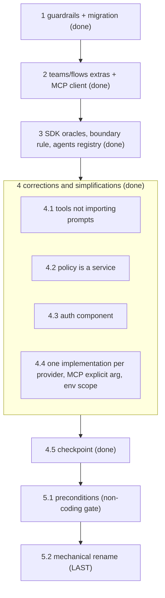

# Implementation Plan: structure

## Overview

This plan executes the target module and folder structure defined in `design.md`, governed by the testable requirements in `requirements.md` (the source of truth; requirements are cited by number). It is a **structure-only migration**: it moves and renames packages and declares boundaries, with no behavior change beyond what the requirements state.

This file records the **current state of the plan**. Finished work is summarized in groups 1–4 (all checked); the only open work is group 5, the planned rename. Earlier task groups that were later corrected or superseded have been folded into the groups below; the original step-by-step history is in git.

### Ordering principle

- **Every task leaves the test suite green and the budgets green.** Run `make budget-fast` after each task; `make budget` green is part of the definition of done.
- **Guardrail tests first.** The AST import-matrix test, the codename test, and the extras/footprint tests enforce the structure from the first step.
- **Moves use `git mv` plus temporary re-exports,** removed once every call site uses the new paths. A move never edits logic.

## Tasks

- [x] 1. Guardrail tests and migration to the target structure
  - Guardrail tests written first: the AST import-matrix test (Layer ceiling, per-Component allowed sets, no orchestrator cross-import), the codename test (15 entries; `vapor` checked separately), the extras-declare-exactly test, and the clean-import/footprint test.
  - `base` package created with the core models, the error hierarchy, configuration, the Ports (including the `Runnable` and `DecisionModel` Ports), the pure capability schema, and the thin `missing_extra` lazy-import helper; the `completion → capabilities`, `providers → capabilities`, and `interfaces → memory` violations are removed.
  - `providers → models` with the shared stdlib transport (`http`, `streaming`, `retry`, `error_mapping`, `token_counter`); the LLM adapters consolidated (`openai_compatible`, `anthropic`, `bedrock`) and implementing `Runnable`; the Google own-dialect adapter staged (the provider formerly named Vertex is `google`, Assumption A6); `remote_api` moved onto the stdlib transport, eliminating the `httpx`/`requests` leak at the source; the two registries unified (Overlap A).
  - `store` created with the in-memory, file, DynamoDB, and Redis backends behind the storage Port (Overlap B); `routes → router` (with the health tracker merged), `capabilities → tools`, and `prompts` reorganized; the declared-but-minimal packages (`memory`, `guard`, `observe`, `policy`, `gateway`, `agents`, `teams`, `flows`) created; the cost/error/token Ports placed in `base` and implementations in `models/transport` (Overlap C).
  - `nimbus/__init__.py` reduced to `messages`, `completion`, `exceptions`, `config`; the `memory` Extra corrected (`psycopg2-binary` removed, `asyncpg` declared) and every Extra aligned with the libraries its code imports; all temporary re-export shims removed.
  - _Requirements: 1, 2, 3, 4, 5, 6, 7, 8, 9, 10, 11_

- [x] 2. teams/flows extras and the tri-faceted MCP client
  - `teams` and `flows` declared as empty Extras in `pyproject.toml` and listed in `known_empty`; core verified to work with neither installed.
  - Tri-faceted MCP client built in `tools` (tools as `Capability`, prompts as `base` messages via the `MCPPrompt` descriptor, resources as the `tools`-internal `Resource` type); built-in stdlib JSON-RPC-over-HTTP client and a `fastmcp` client behind one Port, with a single boundary conversion (`mcp_boundary.py`) and no protocol type leaking outside `tools`.
  - _Requirements: 13, 15_

- [x] 3. SDK oracles, boundary rule, and agents registry
  - Official vendor SDKs (and `fastmcp`) declared only in the dev/test dependency group; differential tests compare the built-in implementation with the SDK on the fields Nimbus consumes; core-only footprint tests stay in an SDK-free environment.
  - A check enforces that no external-library type (provider SDK types, `mcp`/`fastmcp` protocol types) is exposed outside its owning Component.
  - `agents` exposes its agent types through its registry behind the `Runnable`/agent Port (the ReAct agent is a placeholder; concrete agent types belong to the `agents` spec).
  - _Requirements: 14, 16, 12_

- [x] 4. Corrections and simplifications
  - [x] 4.1 `tools` does not import `prompts`
    - `tools` allowed set is `{base, auth}`; the import-matrix test reports any `tools → prompts` import as a violation.
    - _Requirements: 15, 2_
  - [x] 4.2 `policy` is a service; runtime never imports optional services
    - `policy` moved to the services Layer (allowed `{base, models}`); the authorizer Port added to `base`; `policy`, `guard`, `observe`, and `memory` removed from the `gateway`, `agents`, `teams`, and `flows` rows of `LAYER`/`ALLOWED`.
    - The stale `ModelRouterInterface` test classes in `tests/unit/test_interfaces.py` implement `complete` and `acomplete`, so `tests/unit` is fully green.
    - _Requirements: 17_
  - [x] 4.3 New component `auth`
    - `auth` declared as a Layer-0 package importing only `base`; the authentication Port added to `base`; the SigV4 signer moved from `models/transport` into `auth`; the `auth` Extra declares only `rsa` with its own budget; the import matrix, codename test (15 entries, `auth = ozone`), and extras tests updated.
    - Authentication strategies and credential sources (including the native secret-manager sources and the extensible credential-source Port) are the `auth` and `models` specs, not this plan.
    - _Requirements: 18, 9_
  - [x] 4.4 One implementation per model provider; MCP chosen by an explicit argument; environment-variable scope
    - Model-provider selection machinery removed (`base/backend_select.py`, `base/sdk_versions.py`, `load_impl_config` and the `impl` handling, `tests/unit/test_backend_select.py`); `tests/differential` kept; `budgets.toml` and the extras tests updated.
    - `create_mcp_client(target, impl="builtin")` is the only selection (`"fastmcp"` the only other value, `MissingExtraError` naming `mcp` if absent); the `NIMBUS_MCP_IMPL` reading removed; `fastmcp` lives in a separate `mcp` Extra and `tools` carries no third-party library; the built-in MCP client is consume-only over HTTP (no stdio transport, no subprocess).
    - Data-level SDK compatibility (OpenAI data shape in, Nimbus types out; bring-your-own `Runnable` adapter as the only vendor-SDK path); provider credentials read only from provider-standard variables through `auth`; exactly three Nimbus-prefixed variables remain (`NIMBUS_LOG_LEVEL`, `NIMBUS_CONFIG`, `NIMBUS_ENABLE_TELEMETRY`).
    - _Requirements: 20, 21, 22, 23_
  - [x] 4.5 Checkpoint
    - `make budget-fast`, `make budget`, and `tests/unit` green (verified 2026-11-02: 1151 unit and budget tests passed; the budget suite passed on its own).
    - _Requirements: 2, 7, 8, 20, 21_

- [ ] 5. Planned project rename Nimbus → Skye (executed LAST)
  - [ ] 5.1 Preconditions (non-coding; gate for the whole group)
    - Not a coding task. Confirm: all previous task groups are closed; the owner has checked the trademark of "Skye" in software; the owner has reserved `skyeai` (and `skye-ai`) on PyPI.
    - _Requirements: 19_
  - [ ] 5.2 Execute the mechanical rename
    - `src/nimbus → src/skye` and every import; the classes `NimbusMessage`, `NimbusError`, `NimbusConfig` and any other `Nimbus*` name → `Skye*`; the three env vars `NIMBUS_LOG_LEVEL`, `NIMBUS_CONFIG`, `NIMBUS_ENABLE_TELEMETRY` → `SKYE_*`; `nimbus.yaml → skye.yaml`; the project name in `pyproject.toml → skyeai`; and the occurrences in `budgets.toml`, CI, CODEOWNERS, the Makefile, the specs, the steering, the wiki, the examples, and the README. The GitHub repository rename is done by the owner (the platform redirects the old address).
    - Adapt the codename test to the new names; record `nimbus` as the project-wide umbrella watermark (documentation-only, outside the 15 Component Codenames, like `vapor`).
    - Definition of done: `make budget-fast`, `make budget`, `make differential`, and the guardrail tests give the same results as before the rename.
    - _Requirements: 19_

## Notes

- Tasks marked with `*` are optional; none remain.
- Each task references requirements by number for traceability. Requirement numbers changed when `requirements.md` was consolidated; the old-to-new mapping is at the end of `requirements.md`. Comments in code and tests that cite requirement numbers (for example `Req 25`) may still use the old numbering and should be updated in a separate pass.
- Checkpoints ensure incremental validation; the suite and `make budget-fast` must be green at each one.
- The rename (group 5) is always the LAST group; it runs only after every other group is closed.

## Task Dependency Graph

Execution waves (tasks within a wave are independent and can run in parallel; a wave runs only after all earlier waves complete). Groups 1–4 are complete.

```json
{
  "waves": [
    { "id": 0, "tasks": ["1", "2", "3"] },
    { "id": 1, "tasks": ["4.1", "4.2", "4.3", "4.4"] },
    { "id": 2, "tasks": ["4.5"] },
    { "id": 3, "tasks": ["5.1"] },
    { "id": 4, "tasks": ["5.2"] }
  ]
}
```

The same ordering as a diagram:


