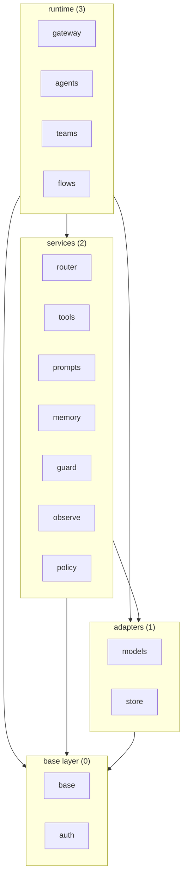

# High-level design

How the system is built to meet `10-requirements.md`. Component specs hold the detailed design of each component and
cite the section they depend on. The long form, with the file-by-file mapping, is in `.kiro/specs/0-base-structure/design.md`
while that spec exists. `<pkg>` is the import package.

## Two independent axes
- **Layer** is an import-direction rule only. It is a ceiling: the most a component may import, never a list of what it needs.
  Nothing is installed or loaded per layer.
- **Installation** is a separate classification: a component is always present or comes with its own extra. A services-layer
  component can be core (`router`) while another is optional (`memory`).
- So a user never has to install or load `memory`, `guard`, `observe`, `teams`, `flows` or any other optional component
  to use the rest. Extras are independent: one extra never pulls another.

## Layers

| Layer | Ordinal | Components |
|---|---|---|
| base | 0 | `base`, `auth` |
| adapters | 1 | `models`, `store` |
| services | 2 | `router`, `tools`, `prompts`, `memory`, `guard`, `observe`, `policy` |
| runtime | 3 | `gateway`, `agents`, `teams`, `flows` |

The arrows are the allowed direction (a ceiling), not actual dependencies; the per-component table below is tighter.

## Allowed imports (maximum per component; enforced by `tests/budget/test_import_matrix.py`)

| Component | May import | Notes |
|---|---|---|
| `base` | none (standard library only) | `base/http.py` is the one network-I/O module |
| `auth` | `base` | |
| `models`, `store` | `base`, `auth` | |
| `router` | `base`, `models`, `store` | |
| `tools` | `base`, `auth` | never `prompts` |
| `prompts` | `base` | |
| `memory` | `base`, `store`, `auth` | |
| `guard`, `observe` | `base` | `guard` may use `models` for decision pre-flight |
| `policy` | `base`, `models` | implements the authorizer Port |
| `gateway` | `base`, `tools`, `models`, `auth` | never `policy`, `guard`, `observe`, `memory`, `prompts` |
| `agents` | `base`, `models` | `tools`, `prompts` only when the matching hook is on; never `teams`, `flows` |
| `teams`, `flows` | `base` | `prompts` only when enabled; never `models`, `agents`, each other, nor the four optional services |

Three checks run on every import: no upward import; no import outside the component's set; no import among `agents`, `teams`, `flows`.

## Installation

| Class | Components |
|---|---|
| Core, standard library only | `base` |
| Optional, own extra | `auth` (`rsa`), `models` (only where no stdlib path exists, such as `google`), `store`, `memory`, `observe`, `mcp` (`fastmcp` for the MCP client), `teams`, `flows` |
| Shipped with the core, pure Python, no extra | `router`, `tools`, `prompts`, `guard`, `policy`, `gateway`, `agents` |

## Components
| Component | Layer | Role | Ports consumed |
|---|---|---|---|
| `base` | 0 | core models, errors, configuration, all Ports, `missing_extra` helper, `http.py` | none (standard library only) |
| `auth` | 0 | strategies, credential sources, token cache, SigV4 | implements `authentication` |
| `models` | 1 | adapters for language, embedding and decision models; shared transport, retry, error mapping, token counting; implements `runnable` | `model`, `decision`, `vector_encoder`, `registry`, `cost_calculator`, `error_handler`, `token_counter`, `runnable`; credentials through `auth` |
| `store` | 1 | in-memory, file, DynamoDB, Redis backends | `storage`; credentials through `auth` |
| `router` | 2 | ModelRouter, strategies, health tracking, fallbacks | `router`, `model`, `decision`, `registry`, `storage` |
| `tools` | 2 | capability registry, local functions, remote API, MCP client | `capability`, `registry`, `prompt` and the `base` messages for the MCP prompt facet; credentials through `auth` |
| `prompts` | 2 | loaders, role-based messages, templates | `prompt`, `content_reader` |
| `memory` | 2 | conversation and state memory | `memory`, `storage`; credentials through `auth` |
| `guard` | 2 | safety filters, pre-flight checks | `safety`, `decision` |
| `observe` | 2 | events, logs, metrics, traces | `observer`, `event_handler` |
| `policy` | 2 | policy decisions; implements `authorizer` | `authorizer`; optionally `decision` |
| `gateway` | 3 | the library acting as an MCP server, toolset per operation | `capability`; optionally `decision`; optional services by injection |
| `agents` | 3 | agent loop, BaseAgent, hooks, agent-type registry | `runnable`, `model`; per enabled hook `capability`, `prompt`; optional services by injection |
| `teams` | 3 | coordinate units toward a shared objective; owns the team-role concept | `runnable` only; optionally `prompt` |
| `flows` | 3 | sequence units into steps | `runnable` only; optionally `prompt` |

## Ports (all in `base/interfaces`)
`model`, `decision`, `runnable`, `storage`, `registry`, `cost_calculator`, `error_handler`, `token_counter`, `memory`,
`vector_encoder`, `router`, `safety`, `observer`, `event_handler`, `content_reader`, `multimodal_handler`, `prompt`,
`config_loader`, `plugin`, `capability`, `authorizer`, `authentication`. Every cross-component dependency crosses a Port,
never a concrete implementation.

A Port is a class named `*Interface` (exceptions: `Runnable`, `DecisionModel`, `StorageBackend`) and describes the call its users
make (Requirement 16.6). Its docstring ends with a fixed footer: what it raises, what it returns when something is missing, whether
several threads or tasks may call it, and, for hooks and observers, that their exceptions are logged and swallowed (Requirement 16.8).
The compliance check compares every method by parameter names and kinds and by `def` or `async def`, for abstract bases and
`Protocol`s alike, and one test runs every built-in implementation through it (Requirement 16.7). A Port that nothing implements
and nothing tests is not exported (Requirement 16.9). Whether a Port is a `Protocol` or an abstract base is open decision O25.

## Composition
`agents`, `teams`, `flows` compose each other and model adapters without importing each other, because each holds its children
as `Runnable` references received from the caller. Model adapters implement `Runnable`, so a model is a step in a flow or a
member of a team. A supervisor that picks the next member may use a decision model, again received as a `Runnable`.
Cycle detection runs at runtime (visited set, depth bound 100). Roles are membership metadata in `teams`.

## Optional services
`gateway`, `agents`, `teams`, `flows` get authorization, safety, observation and memory by injection or hooks through the
Ports `authorizer`, `safety`, `observer`, `memory`. An agent without a memory hook never imports `memory`. The gateway checks
every listing and call with the authorizer when one is provided.

## Extension points
| Kind | Port in `base` | Owner | A new one is added by |
|---|---|---|---|
| model provider | `model`, `decision` | `models` | configuration or a thin dialect inside `models` |
| store backend | `storage` | `store` | one new module in `store` |
| tool | `capability` | `tools` | registering it in the tools registry |
| observability exporter | `observer` | `observe` | registering it in the observe registry |
| credential provider | credential-source Port | `auth` | registering it in the `auth` registry |

Adding one never edits a file outside the owner; a check rejects it otherwise.

## Base contracts
`base` holds the shapes every component shares. Message types: `SkyeMessage` with the role variants (`UserMessage`, `AssistantMessage`,
`SystemMessage`, `CapabilityMessage`) and `ContentChunk`. Completion: `CompletionRequest` and `CompletionResponse` (content, role,
metadata, token usage, model identifier, provider; streaming yields chunks in one format). The capability schema (name, description,
parameters) is a pure contract in `base`; handlers and the registry stay in `tools`. Errors: `SkyeError` with `ProviderError`
(provider context, status), `ConfigurationError`, `ValidationError` (field and value), `CapabilityExecutionError` and `MissingExtraError`;
wrapped errors keep the original message and stack. Configuration sources, in priority order: code, environment, file (YAML or JSON);
`${VAR}` is substituted; invalid values raise `ConfigurationError`. The Ports are listed in "Ports"; each performs no I/O.

## Public API and lazy imports
A user-facing path has at most two levels and never goes through `<pkg>.base` or into a module inside a component (Requirement 7.14, D34).
The public paths are thin facades that only re-export `base` (Requirement 7.15): `<pkg>` (the commonest names, resolved lazily),
`<pkg>.interfaces` (every Port), `<pkg>.data` (`Validated`, `validated`, `field`), `<pkg>.messages`, `<pkg>.completion`,
`<pkg>.exceptions`, `<pkg>.config`; each component package exports what its users need. All of it is standard-library only, so
`import <pkg>` never reaches an optional or provider library (Requirement 7.4, 7.8). `tests/budget/test_public_imports.py` scans the
examples, the documentation and the `README.md`. Lazy loading uses the standard library
(`importlib`, module `__getattr__`) plus one thin helper in `base` that imports at first use and raises `MissingExtraError`
(wrapping the `ImportError`, naming the extra). Each optional component imports its heavy library inside the function that first
needs it. A breaking rename is acceptable while the version is 0.x and the migration is documented.

## Transport and providers
One shared transport in `models/transport`: `http.py` (JSON over `urllib`, bearer and API-key headers, timeouts; the helper itself is
`base/http.py`), `streaming.py` (stdlib parsing of `text/event-stream`), `retry.py` (3 retries after the first attempt),
`error_mapping.py`, `token_counter.py`, `cost.py`, `multimodal.py`. SigV4 signing is in `auth` and reused by Bedrock. Three adapter
families under `models/llm` (and analogues for embeddings): `openai_compatible` (one adapter keyed by base URL and key: OpenAI, Azure and
the OpenAI-compatible ecosystem), `anthropic` (Messages API), `bedrock` (Converse with SigV4, boto3 not required); Google has its own
dialect. Streaming parsing and signing are written once and reused. The provider-SDK extras are driven to zero; the residual extras
are `memory`, `observe` if no stdlib path exists, `mcp` and `auth`.
Adapters expose `invoke` (the `Runnable` Port) and delegate to `acomplete`; vendor SDKs appear only in `tests/differential`. Where an external type exists it is converted once, inside the owner (Requirement 9.5).

## Store layout
| Backend | Module | Presence | Driver |
|---|---|---|---|
| in-memory | `store/memory.py` | core | standard library |
| file | `store/file.py` | core | standard library |
| DynamoDB | `store/dynamodb.py` | first-choice durable backend | boto3 (preinstalled in the serverless runtime) |
| Redis | `store/redis.py` | extra `memory` | `redis.asyncio` |
| PostgreSQL | used by `memory` | extra `memory` | `asyncpg` (pure Python, preferred over compiled `psycopg2`) |
Each backend is a separate module reached only through the storage Port.

## DecisionModel (Jev)
`base/interfaces/decision.py` defines the one `DecisionModel` Port: a finite option set in, one choice and a probability per option out
(each in 0..1, sum 1, empty set rejected). The implementation, Jev, is `models/decision/jev.py`. Consumers: `gateway` (tool selection),
`router` (cheapest capable model), `guard` (pre-flight).

## Extras and budgets (table)
| Component | Extra | Third-party libraries |
|---|---|---|
| models | none | none (standard library REST); `google` declares only its SDK |
| tools | none | none |
| tools (MCP client) | `mcp` | `fastmcp` |
| auth | `auth` | `rsa` |
| memory | `memory` | `redis`, `asyncpg` |
| observe | `observe` | only if no stdlib path exists |
| teams, flows | `teams`, `flows` | none; both in `known_empty` |

`budgets.toml` holds `max_modules_loaded`, `max_import_ms`, `forbidden_at_import`, the allowed dependencies, and one entry per extra
(`[extras.<name>]`, with `known_empty` for extras that declare nothing). The suite in `tests/budget` and `.github/workflows/budgets.yml`
enforce them; `make budget-fast`, `make budget` and `make differential` run them locally.

## Auth component
Layer 0, next to `base` but separate: `base` does no I/O (apart from `base/http.py`), `auth` calls metadata and token endpoints, reads
credential files, may run a subprocess and needs `rsa`. The authentication Port is in `base`; `auth` supplies strategies (API key and
bearer, SigV4, OAuth2), credential sources (environment, files, container credentials, IMDSv2, token exchange, metadata server, secret
managers over `base/http.py`), an extensible credential-source Port and a token cache. Tiers for the order of work: A (no network),
B (an HTTP exchange or metadata call), C (RSA, a subprocess, vendor-format files). The modes to verify are listed in Requirement 11.9.
Tests use fake credential endpoints (stdlib `http.server`, as in `tests/differential/fake_mcp_server.py`).

## MCP client
Lives in `tools`, consume-only. Official MCP types are converted at one module (`tools/mcp_boundary.py`); the prompt facet returns `base`
messages through the `MCPPrompt` descriptor in `tools`; `Resource` stays internal to `tools` until a same-layer consumer needs it
(then a resource Port in `base`, open decision O7). The built-in client is JSON-RPC over stateless HTTP on `base/http.py`; `fastmcp`
is the optional substitute (`create_mcp_client(target, impl=...)`); differential tests keep both equal.
Only `tools/mcp_fastmcp.py` imports `fastmcp`; the built-in client is the default and `impl="fastmcp"` returns the substitute from the `mcp` extra.

## Correctness properties (what the tests guard)
1. Layer import direction is downward only. 2. Imports stay within each component's allowed set. 3. `base` imports only the standard library.
4. A clean top-level import pulls no forbidden library. 5. Extras declare exactly the imported libraries. 6. Codename invariants hold.
7. A store backend lives in exactly one place. 8. An absent extra raises `MissingExtraError`. 9. `DecisionModel` probabilities are
well-formed. 10. The transport and the adapters import no provider SDK or third-party HTTP client. 11. No import edge among
`agents`, `teams`, `flows`. 12. `teams` and `flows` import neither `models` nor an orchestrator. 13. An added integration stays inside its owner. 14. Examples, documentation and `README.md` import only from the public paths.
15. No public class name is defined twice. 16. Every built-in implementation conforms to its Port by signature. 17. Every example runs
offline, exits 0 and ends in no traceback, and every install line names a real extra. 18. The first docstring of the package and of
each Port runs.

## Codename placement

| Component | Codename | Component | Codename |
|---|---|---|---|
| base | stratus | memory | dew |
| auth | ozone | guard | halo |
| models | zephyr | policy | isobar |
| store | lake | observe | radar |
| router | jet | gateway | horizon |
| tools | updraft | agents | cyclone |
| prompts | cirrus | teams, flows | front, stream |

Front matter of the spec and the docs section; one italic line under the section index title; last line of the package docstring;
`docs/glossary.md`. Nowhere else (R8).

## Testing
Deterministic checks guard the architecture: the import matrix, the codename test, the extras footprint test, the clean-import test,
the steering test, the no-old-name test, the public-imports test, and the differential tests. The public surface adds the Port
conformance test, the duplicate-name test, the example-quality tests (offline run, size, README against folder, install lines) and the
docstring test (properties 14 to 18). A requirement that has no test names the reason.
