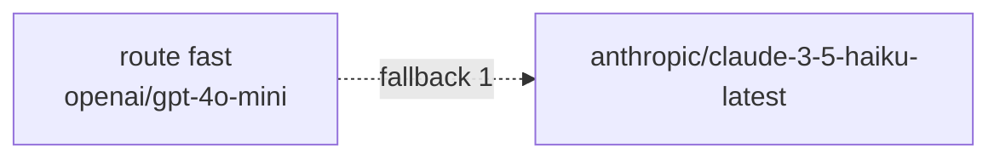

# First .skye file

This page shows you how to start a `.skye` file with `skye new`, check it, format it, draw it as a diagram and load it from Python.
A `.skye` file holds routers, prompts and flows as text you keep next to your code.

## What you need

- Skye installed: see [Install](index.md). The `skye` command comes with the package.
- Optional: the VS Code extension for highlighting and errors as you type, see [Editor support](../reference/editor.md).

## 1. Start a file with `skye new`

`skye new` prints a starting file for a router, a prompt or a flow. `-o` writes it to a file; `--list` shows the templates of each
kind.

```bash
skye new router chat -o router.skye
skye new prompt summarize -o summarize.skye
skye new --list
```

Each template marks with `CHANGE ME` the lines you edit. `skye new router chat -t full` gives the long form of a router, with
strategies, retry policies and one block per target.

## 2. Write a router or a prompt

A router names your models. This one has one alias, `fast`, with an OpenAI model first and an Anthropic model as its fallback:

```skye
---
title       = "chat"
description = "The chat models: a fast OpenAI model with an Anthropic fallback."
version     = "0.1.0"
tags        = []
---

router "chat" {
  route "fast" = ["openai/gpt-4o-mini", "anthropic/claude-3-5-haiku-latest"]
}
```

The part between the `---` lines is the front matter: a title, a description, a version and tags, in TOML. A prompt declares its
variables and its messages with their roles:

```skye
---
title       = "Summarize"
description = "Summarize a text in a few words."
version     = "0.1.0"
---

prompt "summarize" {
  variables = { text = string, max_words = number(50) }

  message "system" { text = "You write short, plain summaries." }
  message "user" {
    text = "Summarize the text in at most {{ max_words }} words."
    text = "---\n{{ text }}"
  }
}
```

`max_words = number(50)` declares a number with a default of 50; `text = string` is required.

## 3. Check it with `skye check`

```bash
skye check router.skye summarize.skye
```

A valid file prints `router.skye: ok`. A mistake prints the file, the line and the column, what is wrong and how to fix it, and the
command exits with status 1:

```text
router.skye:3:14 strategy "fastest" is not valid. Use one of: simple_shuffle, round_robin, least_busy, rate_limit_aware, latency_based, cost_based, weighted, priority_based.
```

`skye check --format json` prints the same diagnostics as one JSON object, for an editor or a CI job.

## 4. Format it with `skye fmt`

```bash
skye fmt router.skye        # rewrite the file in the standard layout
skye fmt --check .          # change nothing; exit 1 if a file under . is not formatted
```

`skye fmt` keeps your comments and strings. With no path it formats every `.skye` file under the current folder.

## 5. Draw it with `skye render`

`skye render` draws a router or a flow as a [Mermaid](https://mermaid.js.org/) diagram. By default it writes `router.mmd`; `--stdout`
prints it, and `--fence` wraps it in a fence ready to paste into Markdown:

```bash
skye render router.skye --stdout --fence
```

This is the output for the router above:



A file with only prompts has nothing to draw: `skye render` says so and exits with status 2. `--direction TD` draws top down;
`--name` picks one block when the file holds several. From Python, `to_mermaid(skye.load("router.skye").router())` (from
`skye.dsl`) returns the same text.

## 6. Load it from Python

`ModelRouter.from_file` builds a router from the file:

```python
from skye import UserMessage
from skye.router import ModelRouter

router = ModelRouter.from_file("router.skye")
response = router.complete(messages=[UserMessage(content="Hello!")], model="fast")
```

`skye.load` reads any `.skye` file and returns its blocks; `render_prompt` turns a prompt into messages for `complete`:

```python
import skye
from skye.prompts import render_prompt

document = skye.load("summarize.skye")   # raises ConfigurationError listing every mistake
spec = document.prompt("summarize")
messages = render_prompt(spec, {"text": "Skye is a serverless-first Python library for LLM applications."})
# [SystemMessage("You write short, plain summaries."), UserMessage("Summarize the text in at most 50 words.\n---\nSkye is ...")]
```

`skye.load` keeps what it built in memory and does not parse the file again while it is unchanged. The document has `routers`,
`prompts`, `flows` and `metadata` (the front matter); `document.router()`, `document.prompt()` and `document.flow()` pick one block
by name, or the only one.

## See also

- [Write a prompt in .skye](../guides/prompts/write-a-prompt.md) and [Variables and filters](../guides/prompts/variables-and-filters.md).
- [The .skye language](../concepts/skye-language.md) (concepts) and the [.skye language reference](../reference/skye-language.md).
- [CLI reference](../reference/cli.md): every option of `check`, `fmt`, `render` and `new`.
- [`skye.dsl` API reference](../reference/api/dsl.md) and [`skye.prompts` API reference](../reference/api/prompts.md).
- Examples: [`routing/router_config.skye`](https://github.com/ggiallo28/skye/blob/main/examples/routing/router_config.skye),
  [`prompts/basic_rendering.skye`](https://github.com/ggiallo28/skye/blob/main/examples/prompts/basic_rendering.skye).
