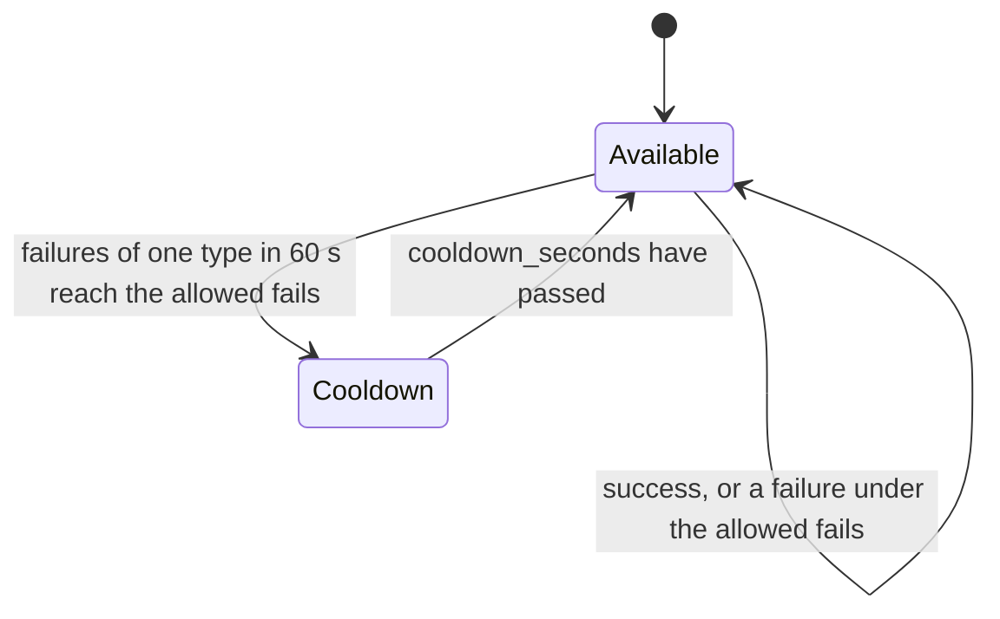

# Health and cooldown

This guide shows you how the router tracks the health of each target, takes a failing target out of rotation for a while, keeps
targets under their rate limits, and how you read those figures.

## What you need

- A router with routes (see [Aliases and fallbacks](aliases-and-fallbacks.md)).
- The model id of a target, `alias:provider:model` (`smart:openai:gpt-4o`), or the name you gave to `router.register_model`.

## What the router records

For every target the router records, in its store:

- successes and failures, with the failures counted by error type;
- the latency of successful calls (average, minimum, maximum);
- the requests and tokens of the current minute, and the requests in flight;
- whether the target is in cooldown, and until when.

The [strategies](strategies.md) read these figures to choose a target. They live in the router's store (in memory by default; see
[Router state in a store](router-state.md) to share them between invocations).

## Step 1: set rate limits

Give a target `rpm` (requests per minute) and `tpm` (tokens per minute). With pre-call checks on (the default), the router skips a
target whose requests this minute have reached `rpm`, and does not call one when 1000 more tokens would pass its `tpm`. The counters
reset every minute.

=== "Python"

    ```python
    from skye.router import ModelRouter, ModelTarget, RouteConfig

    router = ModelRouter(
        routes=[RouteConfig(alias="chat", targets=[
            ModelTarget(model="gpt-4o-mini", provider="openai", api_key="${OPENAI_API_KEY}", rpm=2000, tpm=200000),
        ])],
        enable_pre_call_checks=True,
    )
    ```

=== ".skye"

    ```skye
    router "main" {
      enable_pre_call_checks = true
      route "chat" {
        target { model = "gpt-4o-mini", provider = "openai", rpm = 2000, tpm = 200000 }
      }
    }
    ```

`router.set_rate_limits(model_id, tpm=..., rpm=...)` changes the limits later (a model id the router does not know yet gets its
counters in the router's store), and `router.enable_pre_call_checks(False)` turns the checks off. A route whose targets are all over
their limits is not a dead end: the router goes to its [fallback chain](aliases-and-fallbacks.md#step-3-fallback-chains).

## Step 2: configure the cooldown

A target goes into **cooldown** when it fails too often: when the failures of one error type in the last 60 seconds reach the
**allowed fails** of that type. While in cooldown the router skips it; after `cooldown_seconds` (60 by default) it is available again.



=== "Python"

    ```python
    from skye.router import AllowedFailsPolicyConfig, ModelRouter

    router = ModelRouter(
        routes=[...],
        cooldown_seconds=120.0,
        allowed_fails_policies=[
            AllowedFailsPolicyConfig(error_type="ProviderError", allowed_fails_per_minute=5),
            AllowedFailsPolicyConfig(error_type="ProviderTimeoutError", allowed_fails_per_minute=10),
        ],
    )
    ```

=== ".skye"

    ```skye
    router "main" {
      cooldown = "2m"
      route "chat" = ["openai/gpt-4o-mini", "anthropic/claude-3-5-haiku-latest"]

      allowed_fails_policy "ProviderError"        { allowed_fails_per_minute = 5 }
      allowed_fails_policy "ProviderTimeoutError" { allowed_fails_per_minute = 10 }
    }
    ```

The error type is the name of an error class, matched as the retry policy matches it: the class and its subclasses, the most
specific name first (the classes are listed in [Aliases and fallbacks](aliases-and-fallbacks.md#step-4-retries)). In the example a
`ProviderTimeoutError` counts toward its own entry (10), and every other provider error toward `ProviderError` (5). The failures are
counted under the entry that matched, so `ServerError` and `RateLimitError` failures add up under `ProviderError`. The defaults are
`RateLimitError` 100 and `ContentPolicyError` 1000; an error with no matching entry never puts a target in cooldown.

A failure that triggers the cooldown also stops the retries of that call: the router moves on to the other targets of the route,
then to the fallback chain. To take a target out by hand, call `router.mark_model_failed(model_id)` (in async code
`await router.amark_model_failed(model_id)`); the cooldown is stored when the call returns. `router.set_cooldown_time(seconds)`
changes the duration.

## Step 3: read the figures

Three methods return validated dataclasses (each has an async twin: `aget_model_health`, `aget_usage_stats`,
`aget_cooldown_models`). This loop prints the health and usage of every target of a router:

```python
--8<-- "examples/routing/fallbacks_and_health.py:47:55"
```

| Method | Returns | Main fields |
|---|---|---|
| `router.get_model_health(model_id)` | `ModelHealthMetrics` | `success_count`, `failure_count`, `total_requests`, `success_rate`, `average_latency_ms`, `min_latency_ms`, `max_latency_ms`, `failure_reasons`, `is_in_cooldown`, `cooldown_until`, `active_requests`, `tags` |
| `router.get_usage_stats(model_id)` | `UsageStats` | `tpm_used`, `tpm_limit`, `rpm_used`, `rpm_limit`, `active_requests`, `total_requests`, `total_failures` |
| `router.get_cooldown_models()` | `list[CooldownInfo]` | `model_id`, `cooldown_until` (a Unix time), `reason` (the most frequent error type) |

A model id the router does not know returns empty figures, not an error. A target with no calls yet has a `success_rate` of 1.0.
Every result has `to_dict()` and `to_json()`, so you can log it or return it from a health endpoint:

```python
import json

def health_report(router):
    report = {}
    for alias in router.list_aliases():
        for target in router.get_route(alias).targets:
            model_id = f"{alias}:{target.provider}:{target.model}"
            report[model_id] = router.get_model_health(model_id).to_dict()
    return json.dumps(report)
```

Success and failure counts are kept for 24 hours after the last update; the per-minute counters for two minutes. Every count is an
atomic increment of the store, so routers in several processes that share one store lose no count; only the latest times and the
lowest and highest latency are plain values that the last writer sets.

## What you get

A target that keeps failing leaves the rotation by itself and comes back after the cooldown; a target that reached its `rpm` is
skipped until the next minute. Each response says which target served it in `response.metadata["router"]` (see
[Aliases and fallbacks](aliases-and-fallbacks.md#what-you-get)).

## See also

- [Router state in a store](router-state.md): keep these figures across serverless invocations
- [Strategies](strategies.md) that read them
- [`skye.router` API reference](../../reference/api/router.md)
- Example: [fallbacks_and_health.py](https://github.com/ggiallo28/skye/blob/main/examples/routing/fallbacks_and_health.py)
